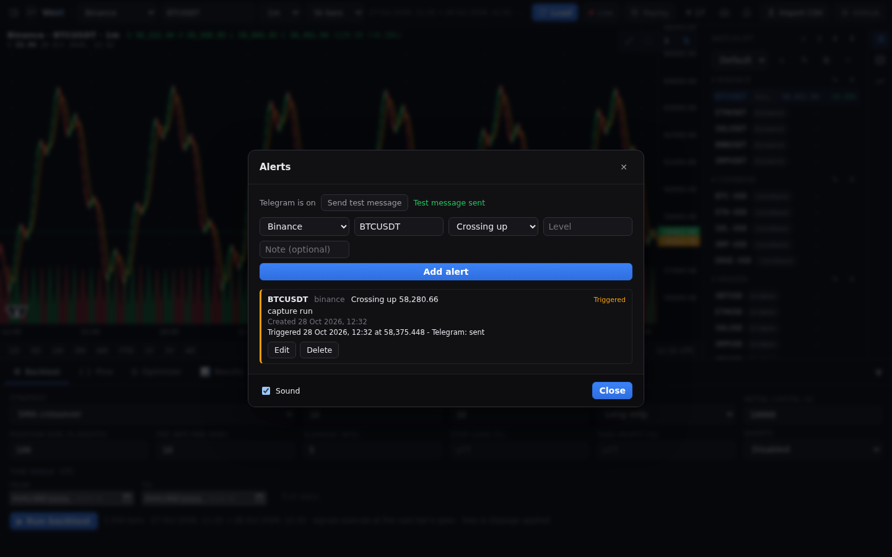
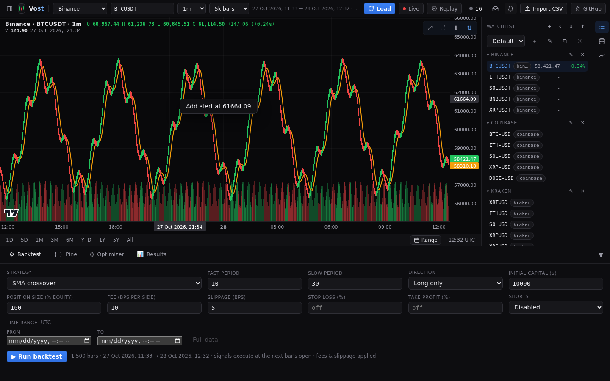
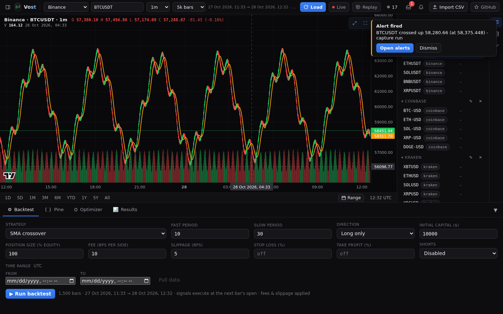

# Alerts

A price alert fires once when the price crosses a level. The Vost server stores alerts and watches prices around the clock, so an alert fires even with every browser tab closed.

## Adding an alert

Three ways in:

- Right-click the chart and choose **Add alert at** the price you clicked. The Alerts dialog opens with the provider, symbol and level filled in.
- Press the bell (**Alerts**) in the top bar and fill the form: **Provider**, **Symbol**, **Condition** (Crossing up, Crossing down or Crossing), **Level** and an optional **Note** (200 characters), then **Add alert**.

Alerts need a provider that the server fetches (an exchange or Yahoo); the Demo provider and CSV data cannot have alerts, and the dialog says so. The exchanges are watched on their live stream; Yahoo, which has none, is polled every `VOST_ALERT_POLL` seconds (60 by default).

## Managing alerts

The list shows newest first, with the symbol, provider, condition, level, an **Active** or **Triggered** badge and the note. Edit an alert's condition, level or note and save it, or delete it. The dialog has a **Sound** switch for the chime.

## When one fires

A popup shows **Alert fired** with the alert and a **Dismiss** button.

## Telegram

Set `VOST_TELEGRAM_BOT_TOKEN` and `VOST_TELEGRAM_CHAT_ID` on the server and every alert that fires also sends one Telegram message. The Alerts dialog says **Telegram is on** and has a **Send test message** button to check the setup; with the variables unset it says Telegram is off and names them. See [deployment](../DEPLOYMENT.md) for the variables.

## Where alerts are saved

On the server, in `alerts.json` in `VOST_DATA_DIR`, not in your browser. Back that file up with the rest of the data folder.
