# Backtesting

Backtests run in your browser (a Web Worker), so they are unlimited. Signals are computed per bar from data up to and including that bar, and executed at the next bar's open. There is no look-ahead.

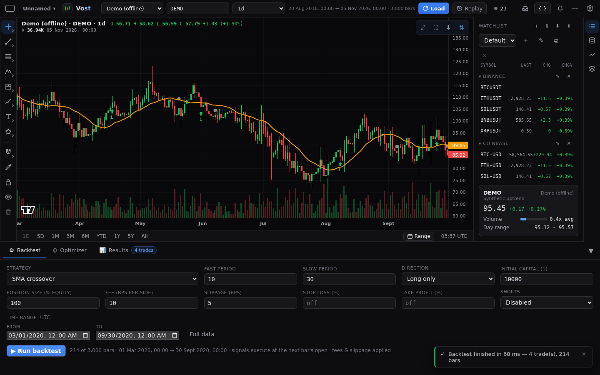

## The Backtest pane

Open the **Backtest** tab in the bottom dock. Pick a **Strategy** and set its parameters:

- SMA crossover and EMA crossover (fast, slow, direction)
- MACD (fast, slow, signal, direction)
- RSI mean reversion (length, oversold, overbought, direction)
- Bollinger (length, mult, mode: breakout or reversion, direction)
- Donchian breakout (entry, exit, direction)
- Composed (entry + filters): see [Composed strategy](#composed-strategy)
- Pullback in trend (trend EMA length, RSI length, dip, target, direction)
- Reversal (length, mult, direction)
- Momentum breakout (entry, exit, volume average length, volume multiple, direction)
- Buy & hold
- Custom (JS) and Pine strategies: see [Custom strategies](../STRATEGIES.md) and [Pine Script](pine.md)

Next to the Strategy select, **Strategy maker** opens the [strategy maker](strategy-maker.md) page in a new tab, where you can find a strategy from trades you mark. Its **Open in Backtest** button brings you back here: Vost opens with this tab already set to the strategy it found, its settings and its risk, and a message says so ([Using a result in the backtester](strategy-maker.md#using-a-result-in-the-backtester)).

A Pine strategy shows all of its inputs under **Script inputs**, with the same controls as the Pine pane (color picker, source and timeframe selects, UTC date-time, text fields), in the script's groups and rows with its tooltips ([Pine Script](pine.md#inputs)). What you pick here is what the backtest runs with, it is kept with the backtest settings, and the optimizer uses it in every combination (and in walk-forward, held-out and Monte Carlo reruns). The optimizer still sweeps only whole-number and decimal inputs, and its CSV export lists the other inputs on its `fixed params:` line.

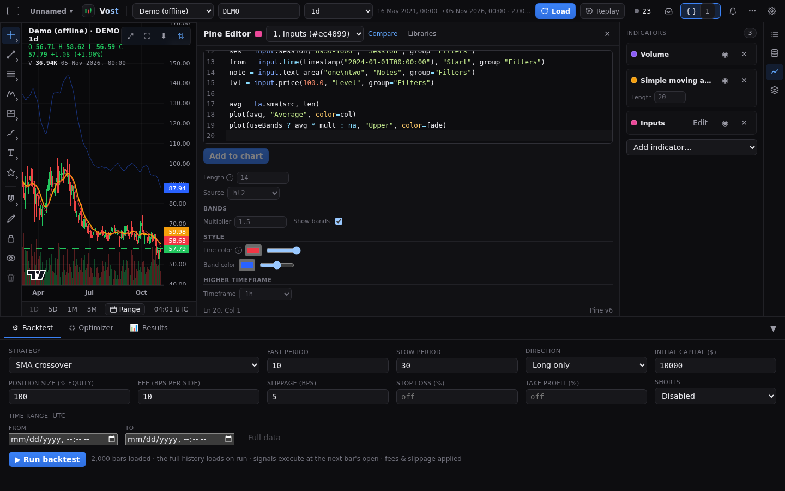

Risk controls: initial capital, position sizing (a percent of equity, or [risk per trade](#risk-per-trade)), fees and slippage in bps per side, [stop loss, take profit and trailing stop](#stops-take-profits-and-trailing-stops) and long and short. Then press **Run backtest**.

While it runs, a progress bar under the button (and in the Results tab) shows the stage and a percent: computing signals, simulating trades, running the Pine script, then computing metrics. It goes away when the run ends.

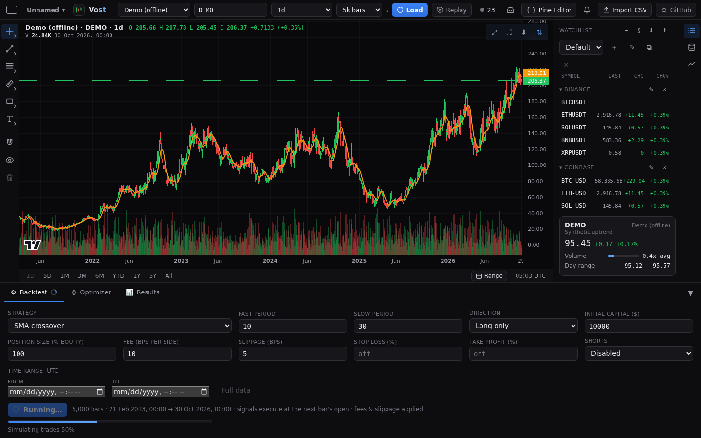

## Stops, take profits and trailing stops

Each exit has a mode select beside its value:

- **Stop loss**: **Percent** (the distance from the entry price) or **ATR multiple** (that many times the ATR).
- **Take profit**: **Percent**, **ATR multiple**, or **Times the stop** (for example 3 gives a 3R target: three times the distance to the stop).
- **Trailing stop**: **Off**, **Percent** or **ATR multiple**.

The **ATR length** field (default 14, 1 to 500) appears when any exit uses an ATR multiple. Pine strategies set their exits in the script, so these fields are disabled for them.

How each trade gets its levels:

- **Fixed at entry.** Every trade works out its own levels from its entry fill price (slippage included): an ATR stop is entry minus (a long) or plus (a short) the multiple times the ATR, an ATR target the other way round, and a target in times the stop is that many times the initial stop distance.
- **The ATR is the one on the signal bar**, the bar before the entry fills, so it never includes the entry bar or anything later. The ATR needs `ATR length` bars of history: until it is known, a trade that needs it does not open. It opens on the first later bar whose signal still asks for that side.
- **Trailing.** The distance is fixed at entry (a percent of the entry price, or a multiple of the signal-bar ATR). The trail starts that far behind the entry and, after each bar, moves to that distance behind the best price since entry (the highest high for a long, the lowest low for a short). It never moves back. A bar checks the stop set by earlier bars first, so its own high never tightens a stop that the same bar then hits.
- **The stop in force** is the tighter of the fixed stop and the trail. If one bar reaches both the stop and the target, the stop wins. A gap through the level fills at the open. After a stop or a target, the signal has to leave that side before the next entry.
- **Exit reasons.** An exit at the trail is a **trailing stop** in the trades list and the exit reasons table; an exit at the fixed stop is a stop loss.
- **Times the stop needs a stop.** A take profit in times the stop with no stop loss and no trailing stop is refused with a message, and nothing starts (the optimizer too).

[Risk per trade](#risk-per-trade) sizes each trade from its own initial stop distance, the tighter of the fixed stop and the trail's starting level, so an ATR stop or a trailing stop alone is enough.

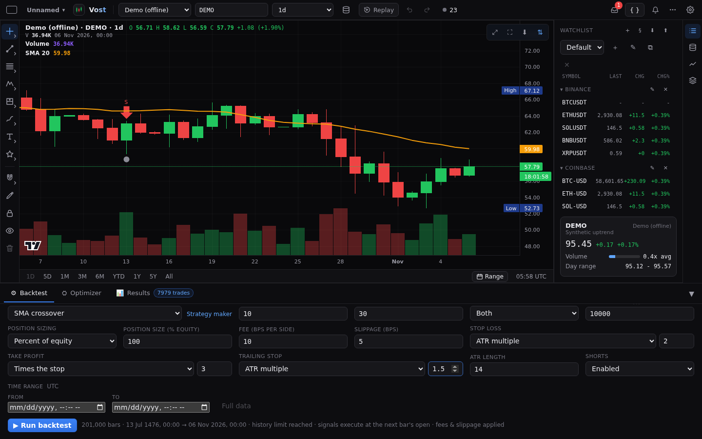

The Results tab names the modes in its badges (for example `SL 2 ATR`, `TP 3R`, `Trail 1.5 ATR`), and the optimizer's CSV names them in its settings lines.

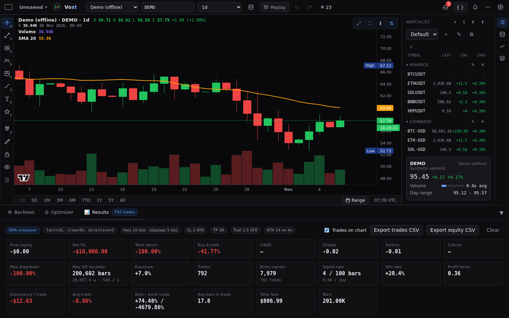

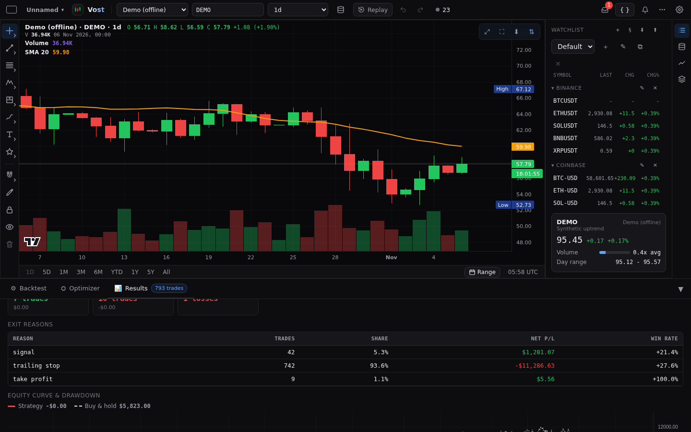

## Composed strategy

**Composed** takes its entries from one rule (SMA or EMA crossover, MACD, RSI, Bollinger or Donchian) and lets up to four filters veto them: trend (price above or below an SMA or EMA), volume (at least a multiple of its recent average), volatility (ATR as a percent of price inside a band) and trend strength (ADX at least a level). Choose the **Entry rule**, then switch filters on; only the chosen rule's settings and the enabled filters' settings show. A blocked entry is skipped for the rest of that signal run, and exits are the entry rule's own. With every filter off it equals the entry rule alone. Rules in [Composed strategy](../STRATEGIES.md#composed-strategy).

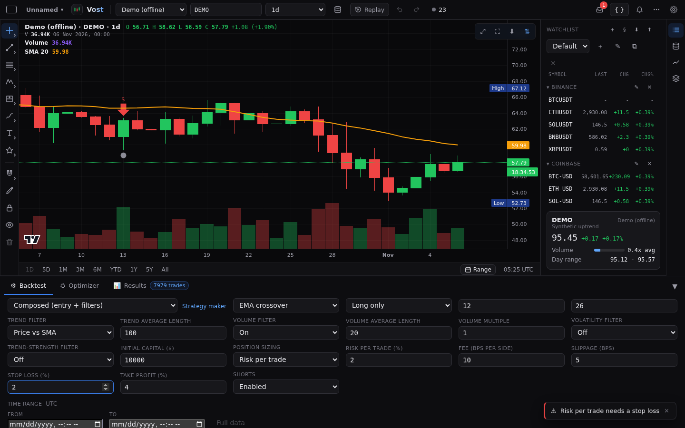

## Risk per trade

**Position sizing** has two choices. **Percent of equity** is the default: each trade commits that share of your equity. **Risk per trade (%)** sizes each trade so that hitting its stop loss loses that percent of your equity at that moment:

position = equity x risk % / stop %

The stop is the trade's own initial stop distance as a percent of its entry price: the fixed percent, or the ATR multiple worked out at entry.

From $1,000 at 2% risk, a stopped-out trade loses $20.00 and the next one $19.60, whatever the stop distance. A 2% stop is a position the size of the account; a 0.04% stop is a position 50 times the account.

- **There is no cap on the position.** A tight stop can mean a leverage of 50x or more. Each trade records the leverage it used, and the Results tab shows the largest one as the **Max leverage** card, so check that your exchange would allow it.
- **It needs a stop**: a percent or ATR stop loss, or a trailing stop. With none, the run is refused with "Risk per trade needs a stop loss" and nothing starts (the optimizer too).
- The loss can be larger than the risk percent: fees count on top of it, and a gap through the stop fills at the open, past the stop. On a leveraged position a big gap can wipe the account out; the run still finishes and opens no new trade once the equity is gone.
- It is saved with the backtest settings, comes across from the strategy maker, and is named in its settings text and Pine export (each entry is sized by `qty=`). Pine strategies size in their own script, so the setting does not apply to them.

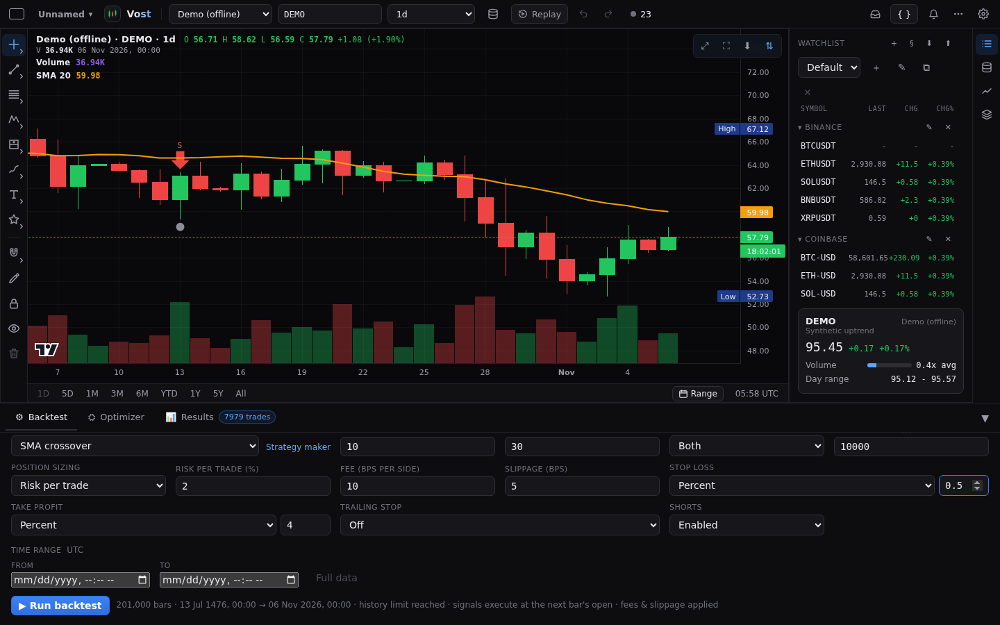

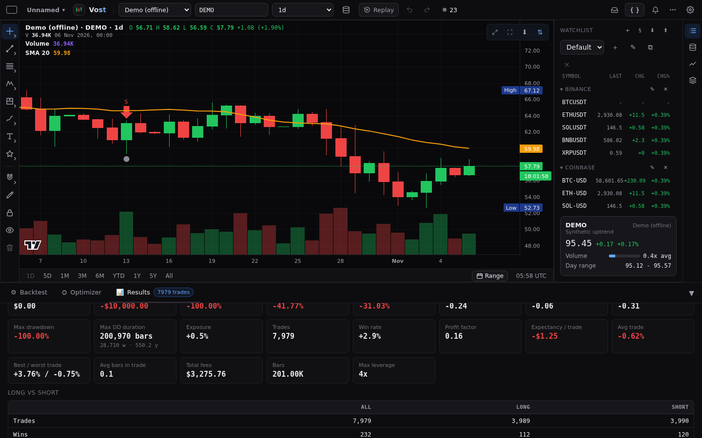

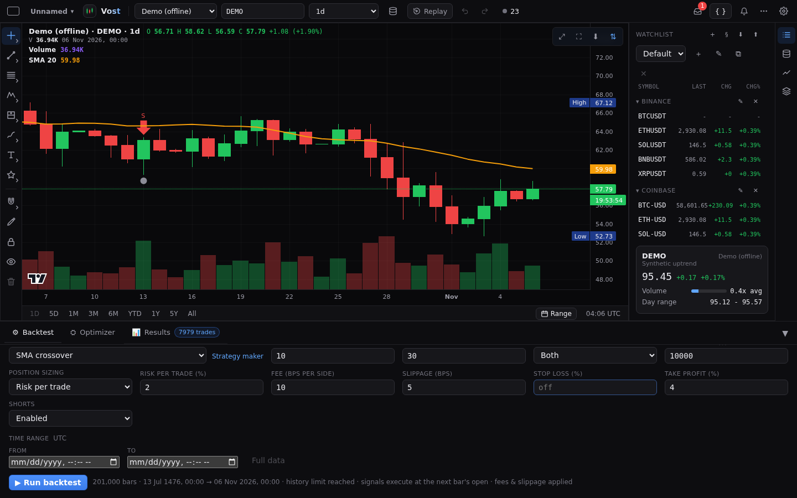

## The backtest range

The pane has a **From** and **To** range. The backtester and the optimizer run only on that window of the loaded data; empty means all of it (**Full data**). The pane says how many of the loaded bars are in the range, and warns when the range starts before or ends after the data or holds fewer than 3 bars. The range is remembered between sessions.

**Full data** (no From) tests the provider's whole history for that market and timeframe: running first loads all the older history (the pane says "the full history loads on run" beforehand), up to a limit of 200,000 bars, and the finished message names the limit if it stopped there. This works in both chart history modes and leaves the chart view alone. A local dataset, a chart range and bar replay never load more: Full data there is the data shown.

When the range starts before the bars the chart has loaded (the chart opens on the latest page of history), running loads the older history first (the progress bar says "Loading history"), tests the whole range and moves the chart to show it. A range inside the loaded bars runs at once and leaves the chart alone. If the data source has no bars that far back, or the load fails, the run says so or uses what exists.

## Where heavy jobs run

By default a backtest, an optimizer run and a Monte Carlo run run in your browser tab and stop when the tab closes. In **Settings**, **Heavy jobs** lets you pick **Server** instead (see [The Settings popup](getting-started.md#the-settings-popup)). A choice applies to the next job; a job already running is not moved.

On **Server**, a run of a built-in strategy goes to the Vost server and shows the same progress bar and the same results as in the browser. Pine and custom-code strategies, and chart indicators, always run in the browser. The finish message says where the run happened ("Backtest finished on the server in 1,898 ms ...").

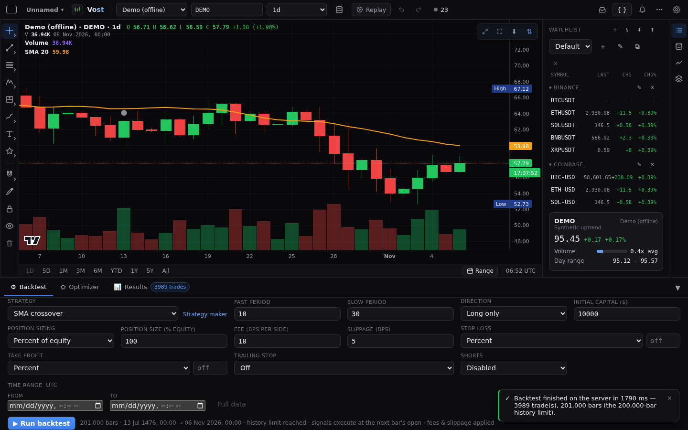

A server run keeps going when you close the tab or reload. Open the chart again and it shows the progress of a run still going, or the finished result; a run that ended while Vost was closed adds a note to the inbox under Backtest ("... finished on the server while Vost was closed"). A Monte Carlo run is picked up again only while the backtest it ran on is the one shown. **Cancel** on a server optimizer run stops it on the server and brings back the previous result. If the server restarts during a run, the run is gone and a message says so.

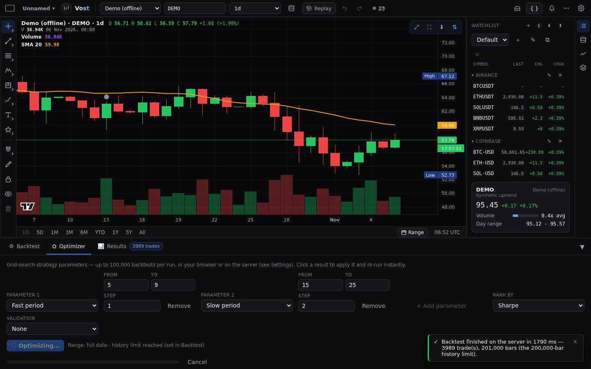

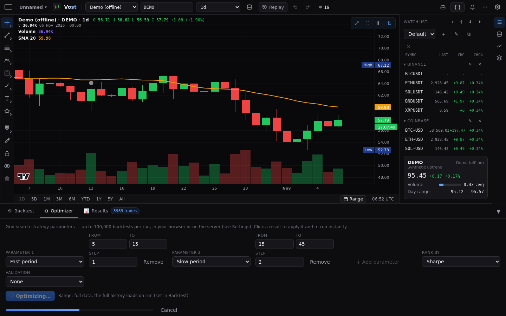

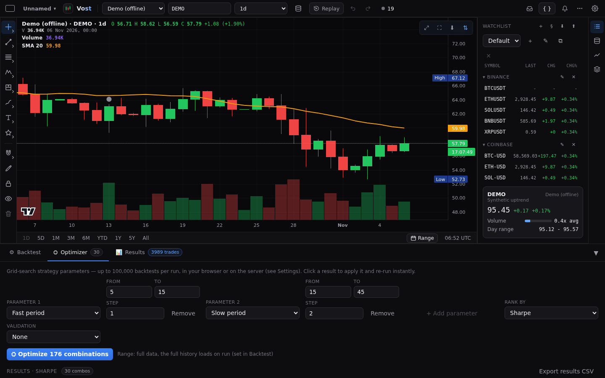

If the server cannot take a job (its engine is missing, its data folder cannot be written, the request is too big or the server cannot be reached), the job runs in the browser instead and one message says why ("Server jobs unavailable (...); running in the browser"), in a toast and in the inbox under Backtest. With **Browser** picked, nothing is sent to the server.

## Results

The **Results** tab shows 20+ metrics (return against Buy & hold, CAGR, Sharpe, Sortino, Calmar, max drawdown and its duration, profit factor, exposure, expectancy and more; hover, focus or tap any figure for what it means, how to read it and what it relates to), the equity and underwater chart and the full trade log. **Export trades CSV** and **Export equity CSV** save them. The equity chart draws a dashed grey **Buy & hold** line next to the strategy's equity, starting from the same capital, with a legend naming both lines and their final values. Buy & hold ignores fees and slippage. **Export equity CSV** has a `buy_hold` column with the same curve.

The **Max DD duration** card shows the longest drawdown in bars and, under it, the same stretch in time units: minutes, hours, days, weeks and years, only the units that fit (at least one, and none finer than the data's bar size). It is real clock time between the bars, so a stock's weekends and nights count; on 24/7 crypto data it equals bars times the timeframe.

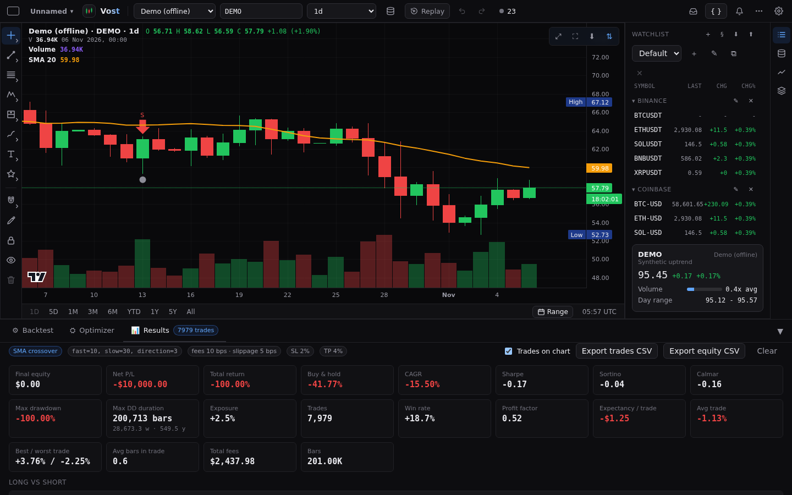

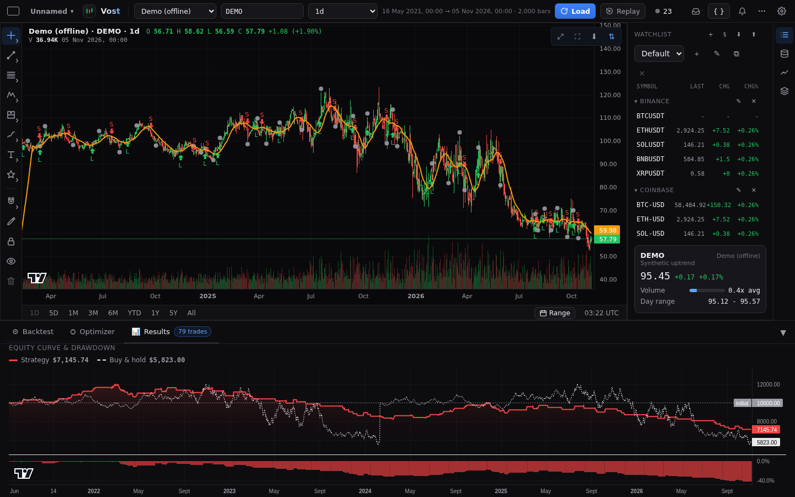

When the strategy is Composed, a line under the metric grid counts the entry signals and how many each enabled filter blocked, for example `Filters: 3689 entry signals, 1033 taken - trend blocked 1620, volume blocked 1863`. A signal vetoed by two filters counts for both.

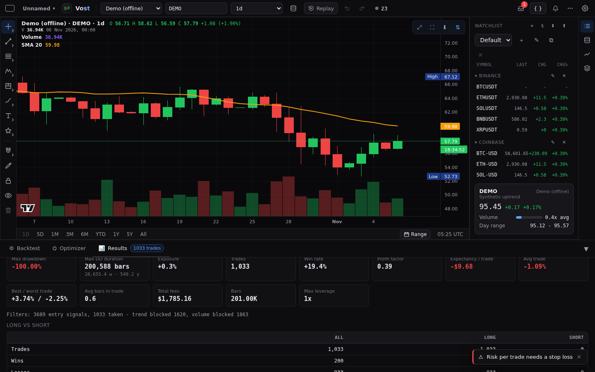

Every figure in the tab has this help, including the breakdown rows, streaks, exit reasons, the chart legend and the Monte Carlo figures. Press Escape to close it.

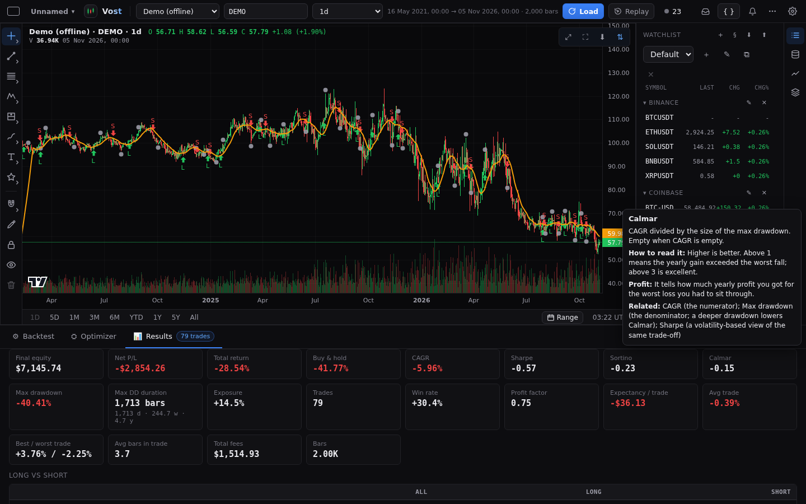

**Show backtest trades** (also in the chart toolbar) draws entry and exit markers on the chart.

Under the metric cards, the tab breaks the trades down: a **Long vs short** table (All, Long and Short side by side: trades, wins, win rate, net P/L, profit factor, average, best and worst trade, average bars), the **Streaks** (longest winning and losing run of trades with their summed P/L, and the streak the run ended on) and the **Exit reasons** (how many trades ended by signal, stop loss, take profit or end of data, with their share, net P/L and win rate). A trade with exactly zero P/L counts as a loss. With no trades the breakdown shows a single hint line.

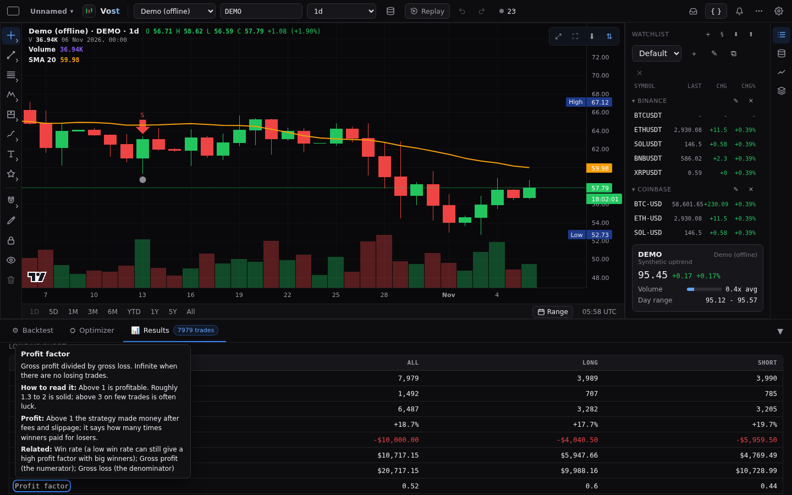

### Monte Carlo

Under the equity chart, **Monte Carlo** shows how much of a run was luck. It takes the run's trades and replays them many times, then reports the range of final returns and drawdowns those replays give and the chance of ending below your starting capital. Set **Runs** (100 to 10,000), **Method** and **Seed** and press **Run Monte Carlo**. The same settings always give the same answer; change the seed for a different draw. A run needs at least 2 trades.

- **Shuffle trade order** replays the same trades in a random order. It tests only order luck: the final return stays the same in every replay, and only the drawdown changes.
- **Resample trades** draws trades at random with replacement, so a trade can repeat or be left out. It also tests which trades happened, so the final return varies too.

The table lists the 5th, 25th, median, 75th and 95th percentile of final return and of max drawdown (a 5th percentile of -20% means 5% of replays ended at -20% or worse). The **This run** row shows your actual result and the percentile it falls at, the share of replays at or below it. **Chance of ending at a loss** is the share of replays that finish below the starting capital. The drawdown here is measured trade to trade, so it differs from the bar-by-bar **Max drawdown** metric above. The histogram shows the spread of final returns (losses in red). **Export Monte Carlo CSV** saves the figures, with `#` lines recording the strategy, method, runs and seed.

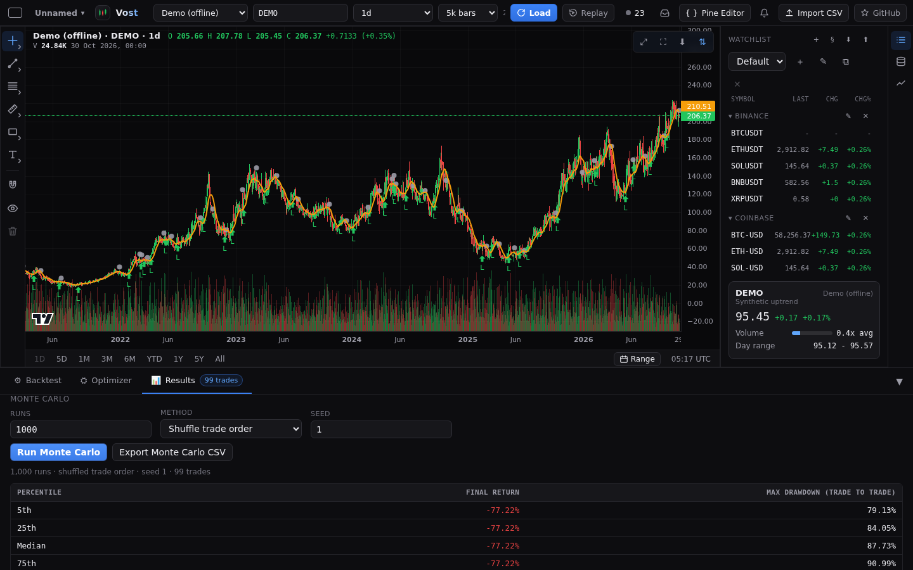

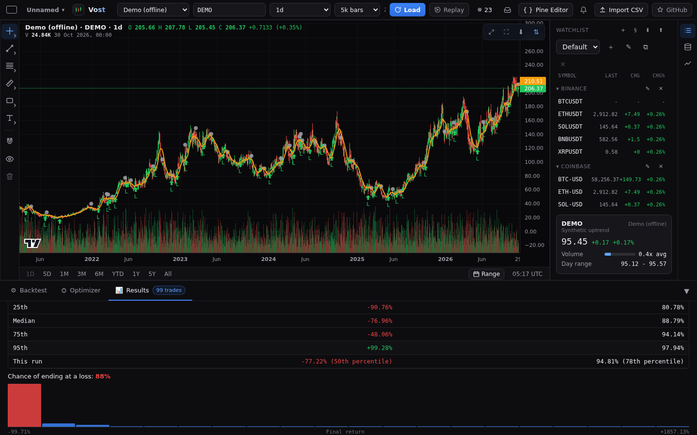

## The Optimizer

The **Optimizer** tab grid-searches any number of parameters at once. Each parameter is a row (**Parameter 1**, **Parameter 2**, ...) with its own **From**, **To** and **Step**. Press **Add parameter** to sweep another one (it starts at half to one and a half times its current value) and **Remove** to drop a row; a parameter can only be used in one row. The pane shows how many combinations it will run (the product of every row). Choose the metric in **Rank by** and press **Optimize**. Every combination is listed in a full-width table with its rank, one column per swept parameter, the ranking metric and the main measures (total return, CAGR, Sharpe, Sortino, Calmar, profit factor, win rate, max drawdown and its duration, trades, exposure, expectancy and buy & hold). Click a column header to sort by it (click again to reverse; empty values always come last); sorting by **Rank** brings back the ranking order. The table shows 100 rows at a time: use **Previous** and **Next**, and the count under it ("Rows 101-200 of 1,234") says where you are. A heatmap below the table shows the combinations. Click a heatmap cell or press **Apply** on a row to set those parameters and re-run the backtest.

**Export results CSV** downloads every combination in ranking order, with all measures as raw numbers. The file starts with `#` lines recording the settings the run used (strategy, fixed parameters, symbol, timeframe, data and range, capital, position size (or the risk per trade % when you size by risk), fees, slippage, stop loss, take profit, shorts, ranking metric and the swept ranges), so a result can be reproduced later; changing settings after the run does not change them.

The heatmap has **Rows** and **Columns** pickers for choosing its two axes among the swept parameters (**Columns** can be set to none). With three or more parameters it shows only the combinations where the other parameters equal the best result, and says which values they are fixed at.

While a sweep runs, **Cancel** next to the progress bar stops it and brings back the result that was shown before. Other charts are not affected.

The table and heatmap are labelled with the parameters you swept, and each result is exactly what a single backtest with those parameters gives. Every value from **From** to **To** is tried (nothing is dropped). A grid is limited to 100,000 combinations: above that the pane says so and **Optimize** stays disabled until you narrow a range or raise a step. A whole-number parameter (such as a period) needs a whole-number step, otherwise the pane says so and **Optimize** is disabled.

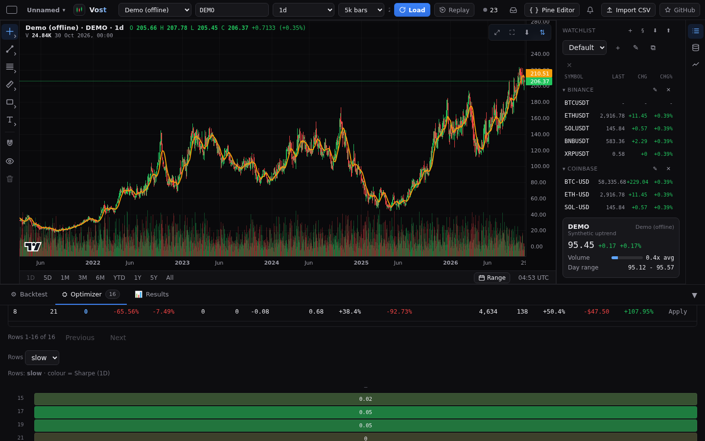

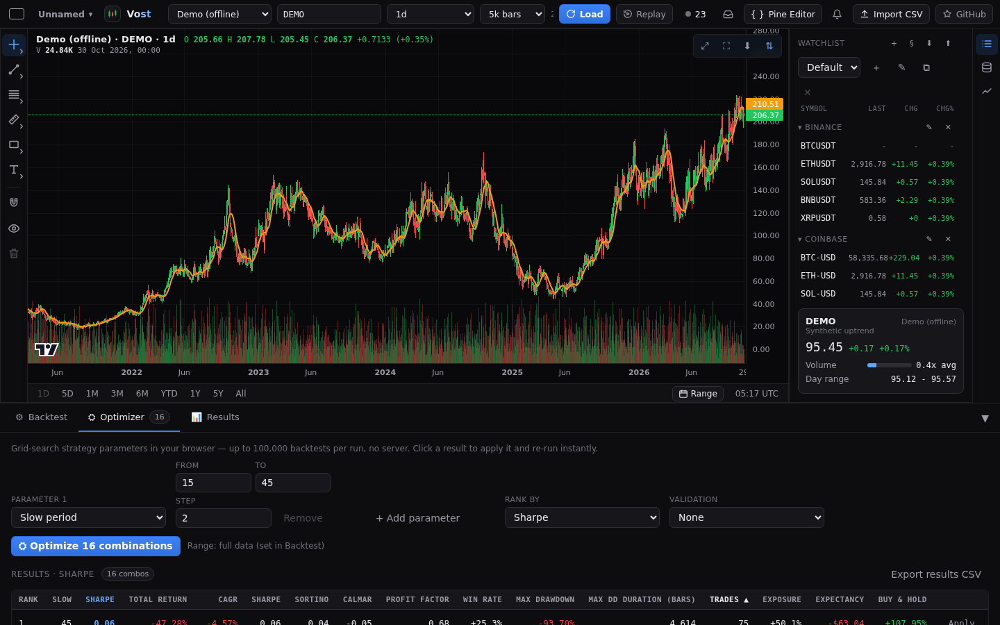

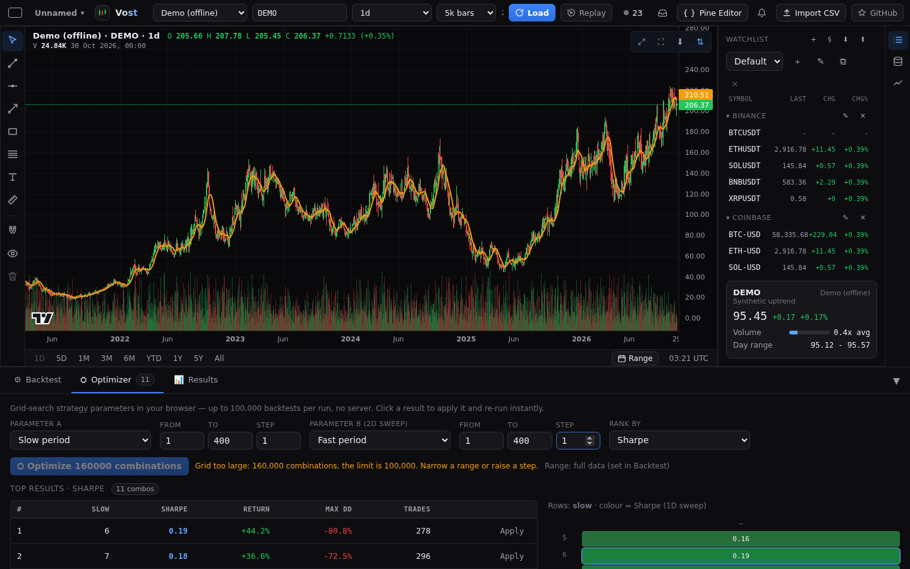

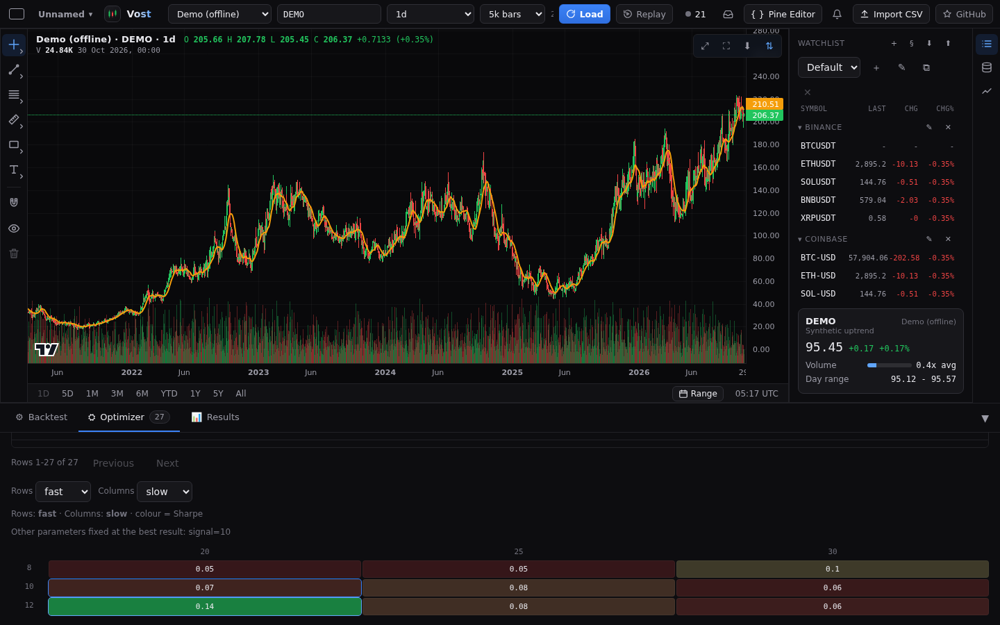

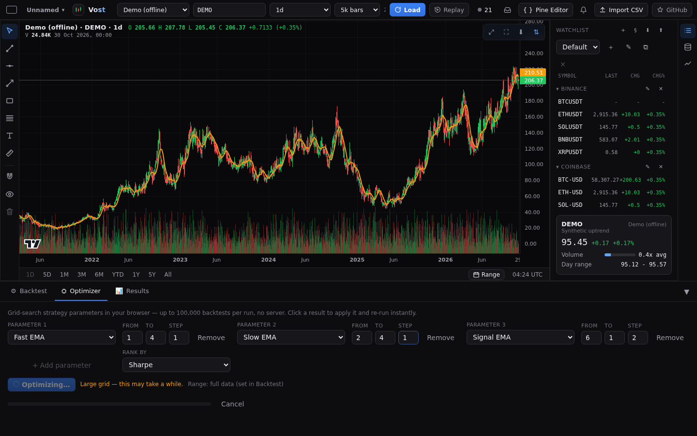

### Validating results

A grid search finds the parameters that fit the past best, which says little about how they do on data they have not seen. **Validation** in the Optimizer tab checks this. **None** (the default) behaves as described above. **In-sample / out-of-sample** splits the backtest range by bars: the first `floor(bars x In-sample % / 100)` bars are the in-sample part and the rest is held out. **In-sample %** is a whole number from 50 to 95 and **Top results to check** a whole number from 1 to 50 (defaults 70 and 10). Out of range or fractional values, or a part with fewer than 3 bars, disable **Optimize** and the pane says why; with the split on, the range hint names both parts. The values you last chose for the split are kept while you switch to **None** and back.

The grid is searched on the in-sample bars only, so the table, heatmap and the title "Results (in-sample)" show in-sample results. Each of the top results (fewer if fewer have a ranking value) is then run again as a fresh backtest on the held-out bars alone, with the starting capital again and no position carried over. The **Held-out check** section below the table names both parts (dates in your time zone, bar counts) and lists one row per checked result: its in-sample rank, the swept parameters, the ranking metric, total return, Sharpe, max drawdown and trades for in-sample and held-out side by side, and its held-out rank (by the ranking metric, higher first). **Apply** works as in the table. A held-out run that fails is shown as failed and counted, not dropped. **Cancel** stops either phase and brings back the previous result.

**Export results CSV** adds `validation`, `in-sample %`, `top results checked` and the in-sample and held-out from, to and bars lines, and the columns `heldout_rank` and one `heldout_<measure>` per measure, filled for checked rows and empty for the rest. With **None** the file is unchanged.

Indicators start again at the held-out boundary, so the first bars of the held-out part trade less than they would in a continuous run; keep the held-out part long enough for that not to matter. A walk-forward has this at every held-out boundary, one per window.

**Walk-forward** repeats the check over several windows. **Windows** is a whole number from 2 to 20, **In-sample %** a whole number from 50 to 95 and **Mode** is **Rolling** or **Anchored** (defaults 5, 70 and Rolling). With `n` bars, `k` windows and `p` the in-sample %, each held-out block is `floor(n / (k + p / (100 - p)))` bars and the in-sample part is the rest of the range minus the `k` blocks. The blocks sit one after the other and the last one ends at the last bar. In **Rolling** mode each window's in-sample part is that same number of bars just before its block, so it slides forward; in **Anchored** mode it runs from the first bar up to its block, so it grows. Every part needs at least 3 bars, otherwise **Optimize** is disabled and the pane says which part is too short; the range hint shows the bar counts.

For each window the grid is searched on its in-sample bars, the best result with a ranking value is the winner, and the winner is run once as a fresh backtest on its held-out block. A window with no winner shows "no winner" and a held-out run that fails shows "failed". The **Walk-forward** section lists one row per window (spans, winning parameters, the ranking metric in-sample and held-out, held-out total return, max drawdown and trades, and **Apply**), then the combined held-out result: total return (the windows' returns compounded), max drawdown on the joined equity (the peak carried across windows), total trades and the walk-forward efficiency (mean held-out CAGR over mean in-sample CAGR of the winners, n/a when one is missing or the in-sample mean is not positive), with a chart of the joined held-out equity. When any window has no held-out result the section says so and shows no combined figures. The table and heatmap above show the last window's in-sample grid and are titled "Results (last window in-sample)".

Cost: a walk-forward does `windows x combinations + windows` backtests, and the same 100,000 limit applies to that total: the button reads "Optimize N backtests (k windows x C combinations)" and a total over the limit disables it. The progress bar covers all windows and **Cancel** brings back the previous result, never a partial one. **Export results CSV** adds `validation: walk-forward`, `windows`, `in-sample %` and `mode` lines, a block of lines per window (in-sample and held-out from, to and bars, the parameters, the in-sample ranking value and the held-out return, max drawdown and trades, or `failed` / `no winner`) and the combined figures; the rows are the last window's grid, without held-out columns.

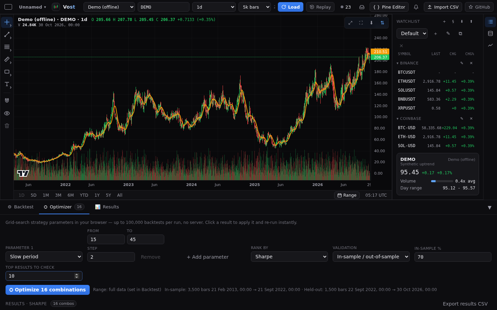

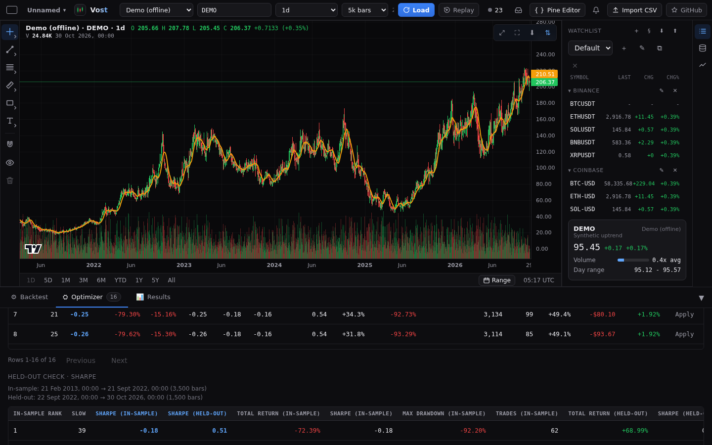

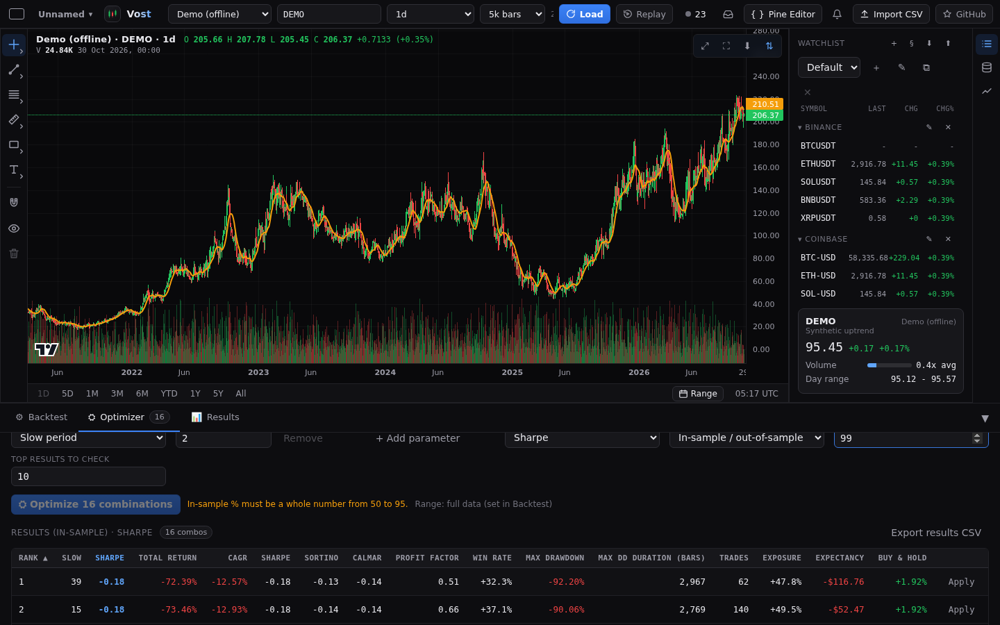

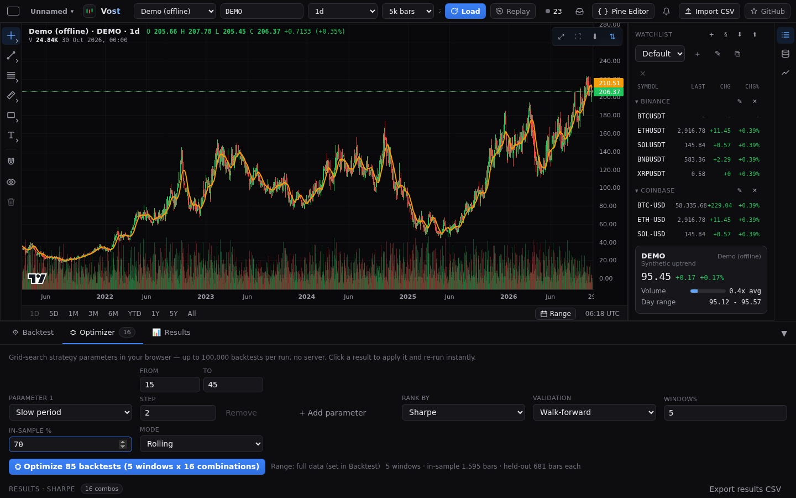

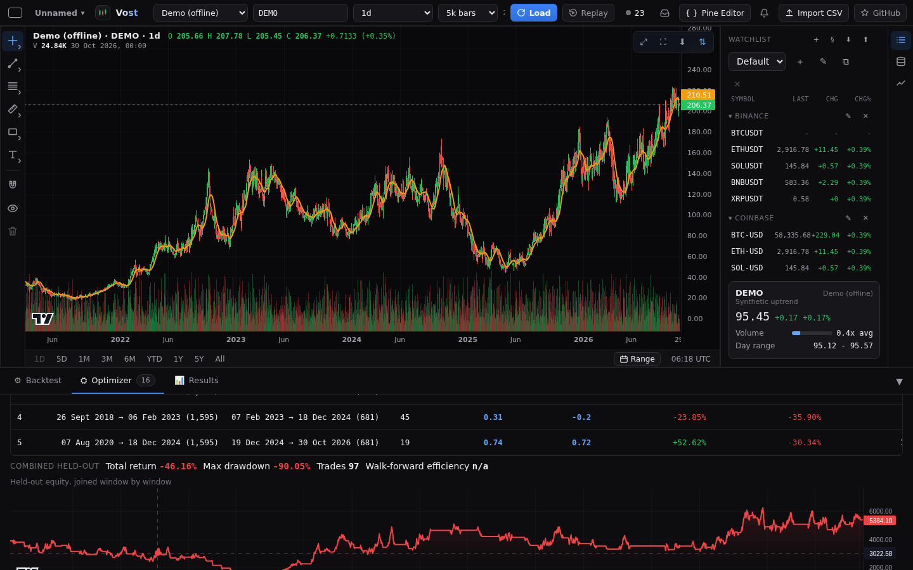

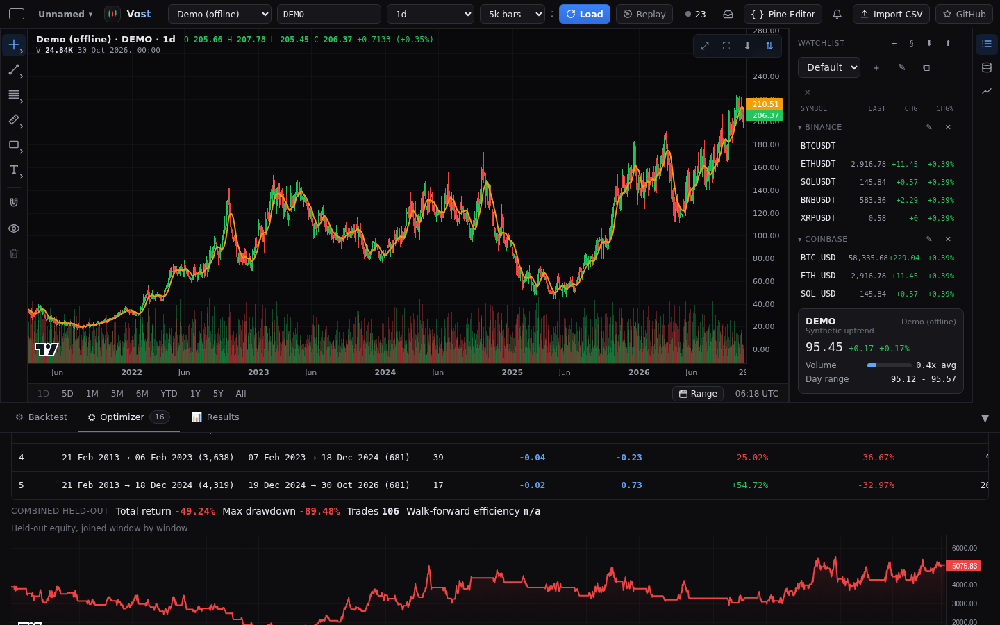

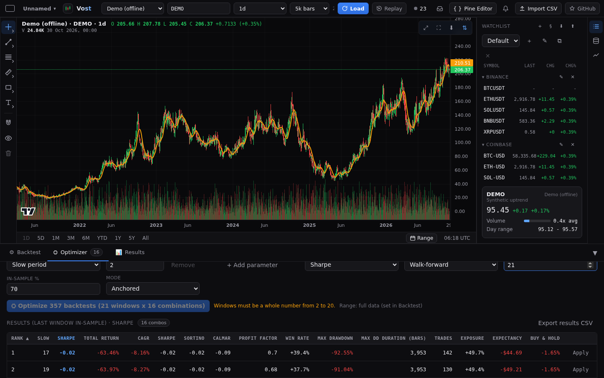

#### Robustness

**Robustness** looks at how steady a result is. A result whose neighbours in the grid did well too sits on a broad, steady area; a lucky one-off peak has poor neighbours. Nothing is run again: the figures come from the finished grid, and the table, heatmap and title are the normal ones ("Results · <metric>"), with a hint naming the neighbourhood.

**Neighbourhood** is a whole number from 1 to 3 (default 1): the number of grid steps in every swept parameter. A result's **neighbours** are all the other results whose position differs by at most that many steps in every parameter (a square for two parameters, a cube for three, clipped at the edges of the grid). Failed combinations and results without a ranking value are not neighbours. The table gets four sortable columns after the ranking metric: **Neighbour mean**, **Neighbour min**, **Neighbours** (how many there are) and **Robustness**, the mean of the result's own value and its neighbours' values. They are empty when a result has no neighbours, and Robustness is also empty when the result has no value of its own.

An infinite value (for example a profit factor with no losing trade) counts as the largest finite value in the grid, and minus infinity as the smallest; when the grid has no finite value, infinite values count as missing. A Robustness cell that used such a replacement is marked with `*` and its tooltip names the values used.

Tick **Rank by robustness** to open the table sorted by Robustness, highest first (empty last, ties in ranking-metric order); clicking **Rank** restores the ranking-metric order. When the most robust result is not the best one, the heatmap outlines its cell with a dashed line and a line above it reads "Most robust: ..." with its Robustness. The colour scale is unchanged. The values you last chose are kept while you switch to another method and back.

**Export results CSV** adds `validation`, `neighbourhood` and `rank by robustness` lines and the columns `neighbour_mean`, `neighbour_min`, `neighbour_count` and `robustness` (empty when not available); rows stay in ranking-metric order.

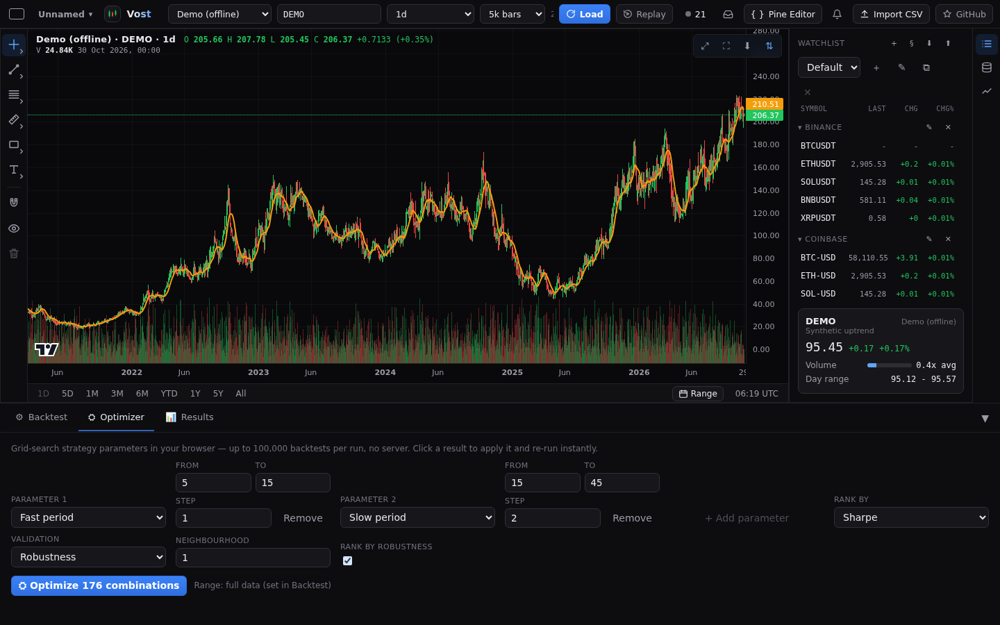

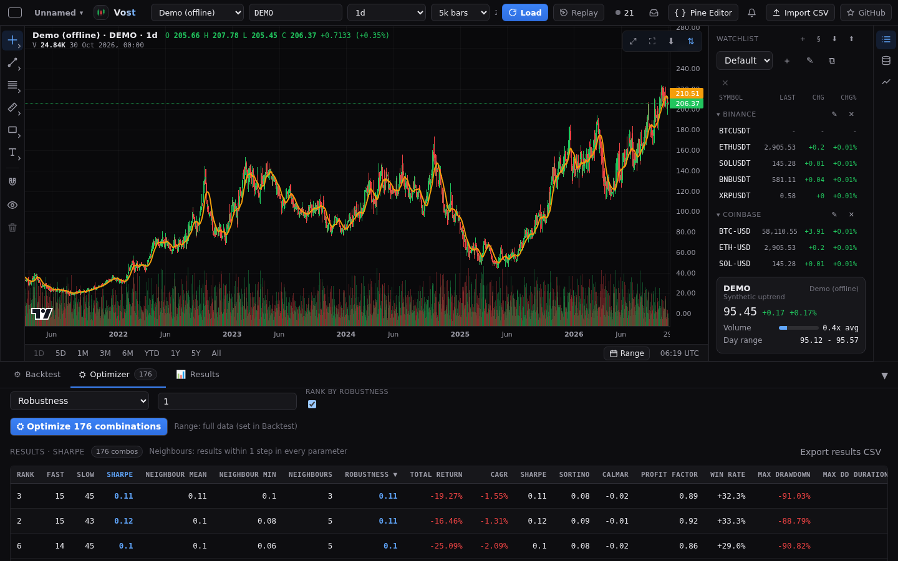

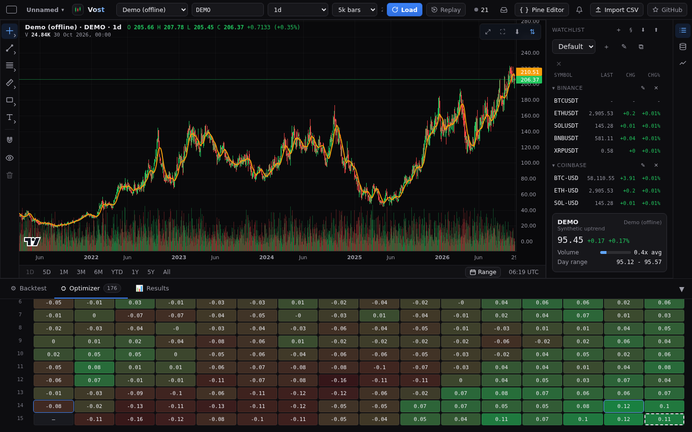

#### Monte Carlo of the top results

**Monte Carlo** shows how fragile the best results are. The grid is searched on the whole backtest range (no split), then each of the top results (fewer if fewer have a ranking value) is run once more to get its trades and the backtester's [Monte Carlo](#monte-carlo) is run on them. How the figures are computed is described there; every result is simulated with the same settings, so a row shows exactly what the Results tab's Monte Carlo shows after you **Apply** that row with the same settings.

The settings are **Top results to check** (a whole number from 1 to 50, default 10), **Runs** (a whole number from 100 to 10,000, default 1,000), **Method** (**Shuffle trade order** or **Resample trades**) and **Seed** (a whole number, default 1). Anything else disables **Optimize** and the pane says why. The values you last chose are kept while you switch to another method and back.

The table and heatmap above keep their normal title ("Results · <metric>"). A **Monte Carlo · <metric>** section below them names the runs, method and seed and lists one row per checked result: its rank, the swept parameters, the ranking metric, trades, the 5th percentile, median and 95th percentile of the final return and of the max drawdown (measured trade to trade), the chance of a loss, and **Apply**. Every column header sorts the rows (click again to reverse; rows without figures stay last either way) and the default order is by rank. A result with fewer than 2 trades reads "needs at least 2 trades" and a re-run that fails reads "failed" and is counted in a badge, not dropped.

Cost: the button counts only the grid; the checks add one more backtest and simulation per checked result, and the progress bar covers all of it. **Cancel** stops any phase and brings back the previous result.

**Export results CSV** adds `validation: monte-carlo`, `top results checked`, `runs`, `method`, `seed` and `max drawdown is measured trade to trade` lines and the columns `mc_status`, `mc_trades`, `mc_return_p5`, `mc_return_p50`, `mc_return_p95`, `mc_drawdown_p5`, `mc_drawdown_p50`, `mc_drawdown_p95` and `mc_prob_loss_pct`, filled for checked rows and empty for the rest.

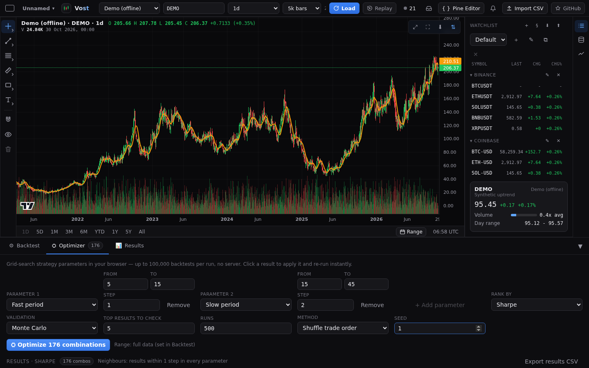

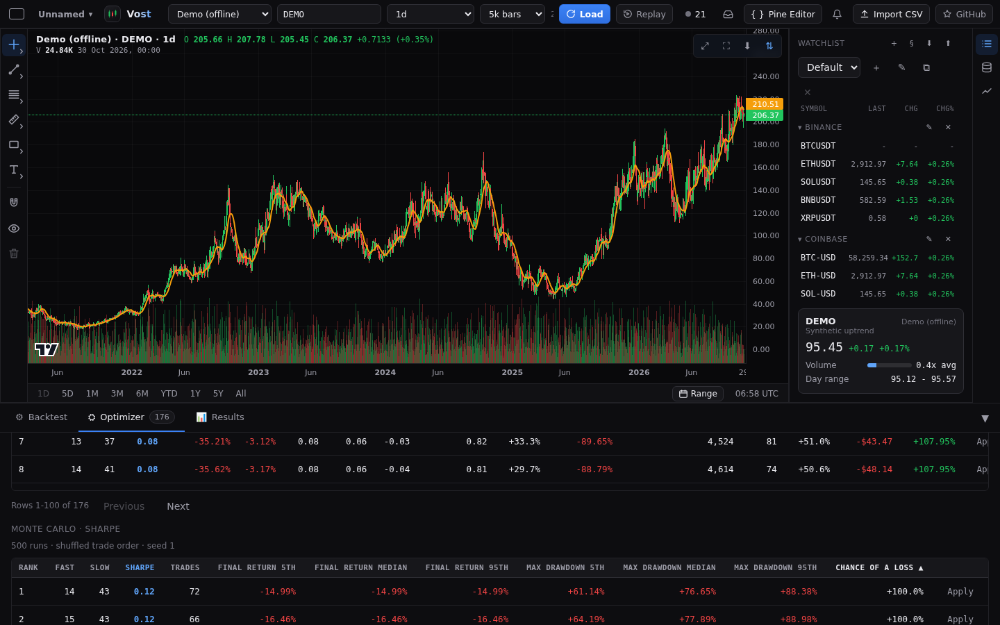
