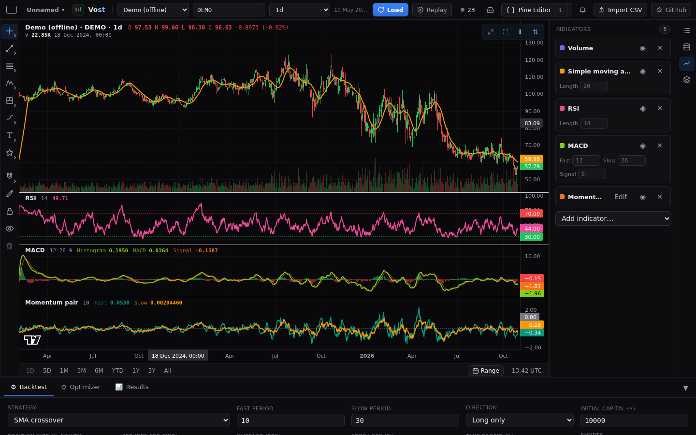
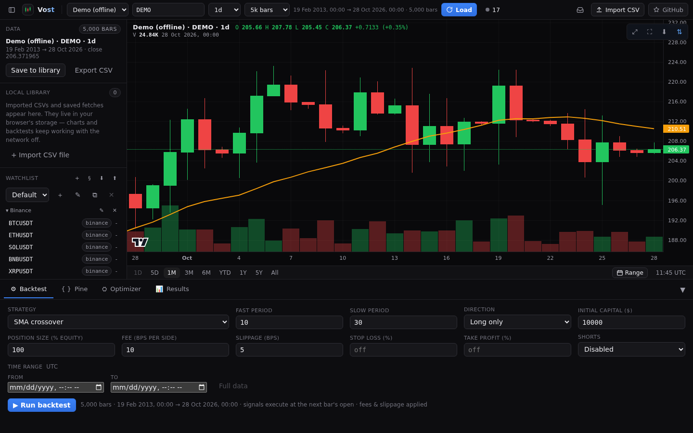
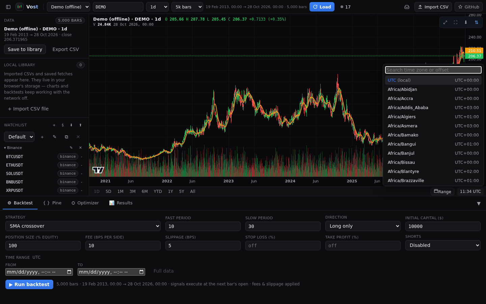
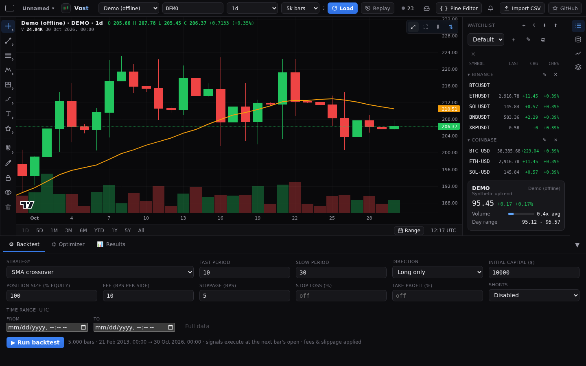
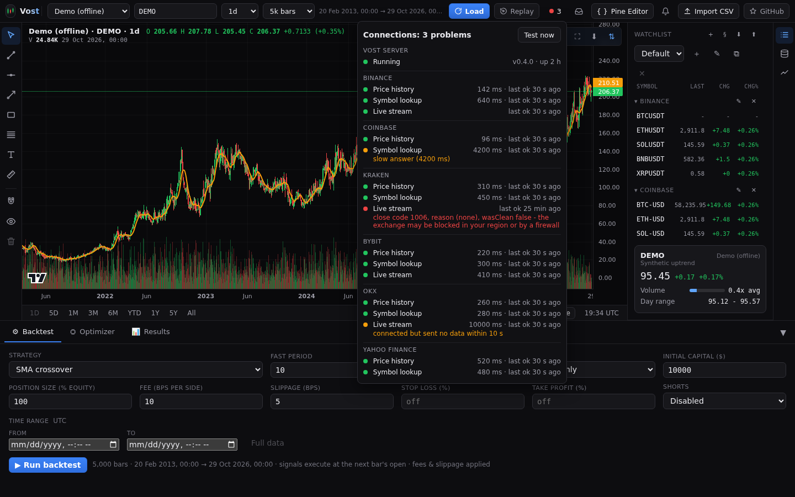

# Charts

## The chart

A candlestick chart with a volume pane, drawn with TradingView's open-source lightweight-charts. Drag to pan and use the wheel or pinch to zoom. Right-click the chart for its menu, which has "Add alert at" the price you clicked ([Alerts](alerts.md)).

## Legend

The one-line legend at the top of the chart shows the symbol, the open, high, low and close under the crosshair, the change and the volume, coloured by direction. The indicator panes below the chart have their own legends (see [Indicators](#indicators)).

## Indicators

Open **Indicators** in the side panel and pick **Add indicator...**: SMA, EMA, Bollinger Bands, VWAP, Volume, RSI, MACD, or a Pine script ([Pine Script](pine.md)), which is named by the title in its code. Each row has a colour swatch, a show and hide button and a remove button, and its parameters (such as the period) edit live. RSI and MACD get their own panes under the chart, and so does a Pine script that is not drawn on the price.

Each of those panes has a small legend at its top-left with the indicator's name and its parameters (for example `RSI 14` or `MACD 12 26 9`; a Pine script shows its title and its input values), then the value of each plot in the plot's colour. The values follow the crosshair; with the crosshair off the chart they show the last bar, and a bar where a plot has no value shows `-`. The pane's price scale carries a label for each plot's last value and for fixed levels such as the RSI 30 and 70 lines or a Pine `hline`.

A new pane opens at a modest height, so the candles keep most of the chart. Drag the line between two panes to resize them: the size you set stays when you add, remove or hide other indicators or edit a Pine script.

## Quick ranges and the Range picker

The bar under the chart has quick ranges **1D, 5D, 1M, 3M, 6M, YTD, 1Y, 5Y** and **All**. A button is disabled when the loaded bars do not reach that far back and the provider has no older bars to page in; while older bars can still load, a range that reaches before the first loaded bar is enabled, and clicking it loads older pages until the range is covered (or the provider's history starts), then zooms. **All** shows the bars loaded so far and does not page. See [how history loads](data.md#how-history-loads).

The **Range** control opens a From and To picker that crops the chart to a window. If the window lies outside the loaded bars, Vost fetches that span from the provider (Demo generates it). On a live chart the range pauses **Live** (with a note) and clearing it returns to the latest bars and Live.

## Time zone clock

The clock at the right of the bar under the chart shows the time in a chosen zone. Click it to search and pick a time zone: every date on screen is then shown in that zone. Candle times themselves stay UTC. The choice is remembered.

## Reset view

**Reset view** in the chart toolbar restores automatic price scaling on every pane and the default gap at the right edge, and shows a window sized to the timeframe: the last day on minute charts, the last 5 days on hourly charts and the last month on daily charts. Weekly and monthly charts show all the data, and so does any chart whose provider has no bars that far back. Reset view loads older pages first when the window reaches before the loaded bars. A freshly loaded chart still shows all data.

## Screenshot and CSV export

In the chart toolbar, **Screenshot (PNG)** saves the chart as an image and **Export candles as CSV** saves the loaded bars. With several charts you can also download every chart's data ([Layouts](layouts.md#download-chart-data)). **Show backtest trades** toggles the trade markers from the last backtest ([Backtesting](backtesting.md)).

## Live candles

Charts open live on their own for providers that support it: **Live** in the top bar streams new candles. Turning Live off sticks for that chart through symbol, timeframe and provider changes until you turn it back on, and picking a chart range pauses it until you clear the range. The server keeps one exchange connection per feed and shares it between tabs, reconnects by itself and backfills the bars a drop missed. Live works on built timeframes too ([Timeframes](timeframes.md)). When live fails, the error goes to the inbox.

## Connection light

The dot in the top bar shows whether each exchange's price history, symbol lookup and live stream work right now. Click it for latency, the last good time, the error text and a **Test now** button. The server checks about once a minute (`VOST_STATUS_INTERVAL=0` turns that off).

