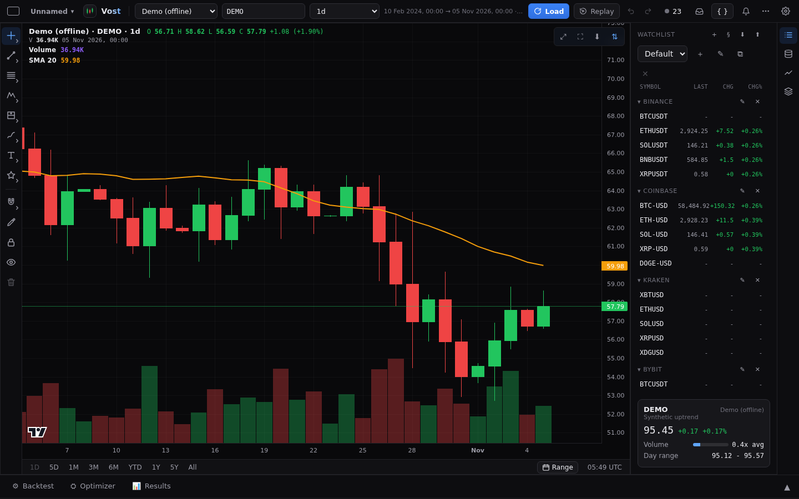
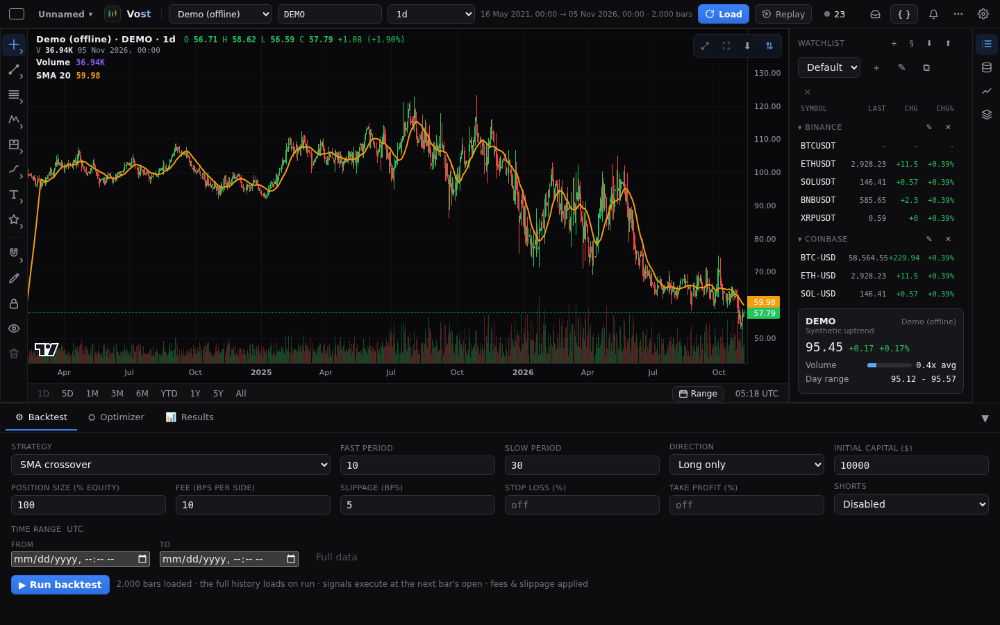
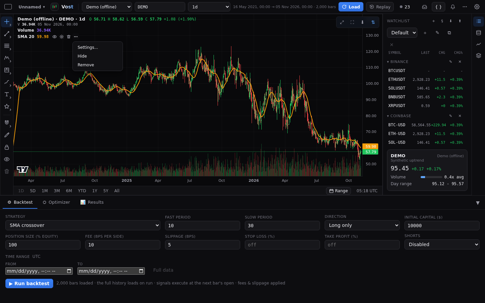
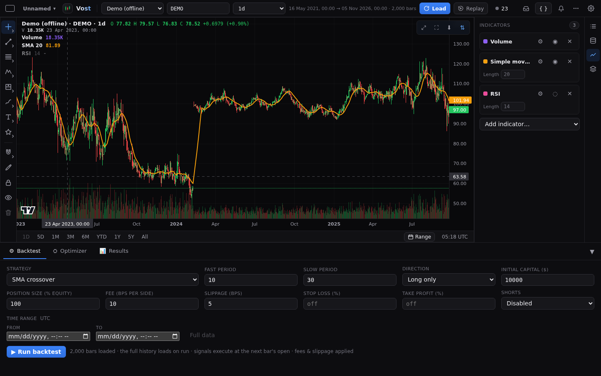
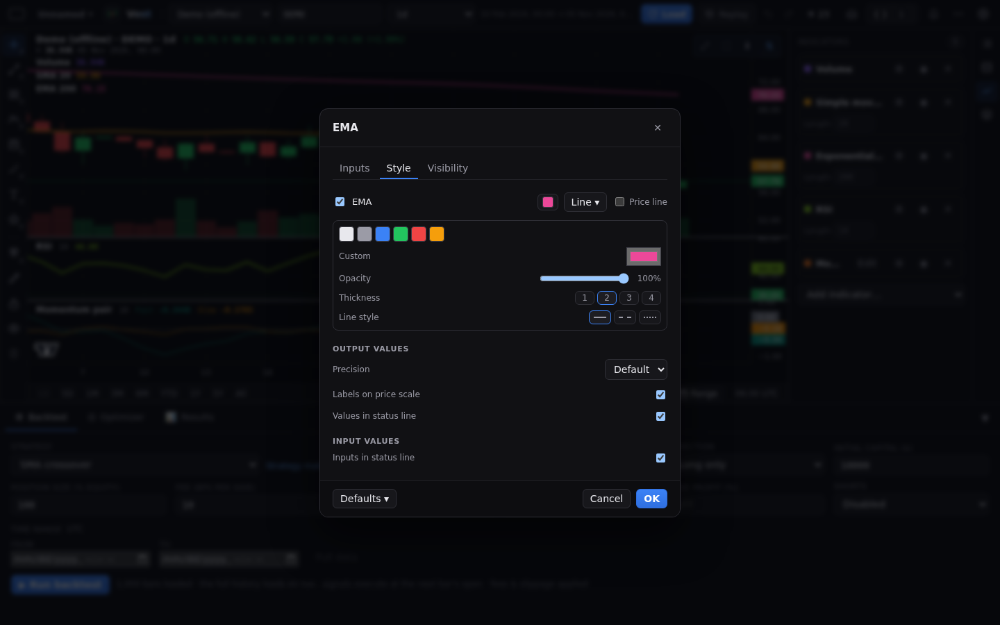
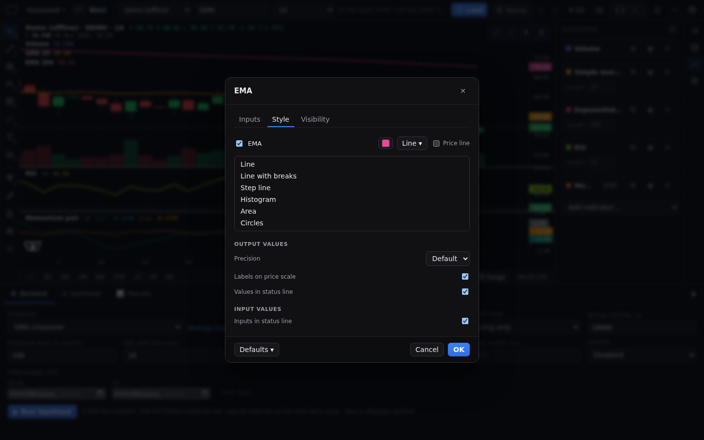
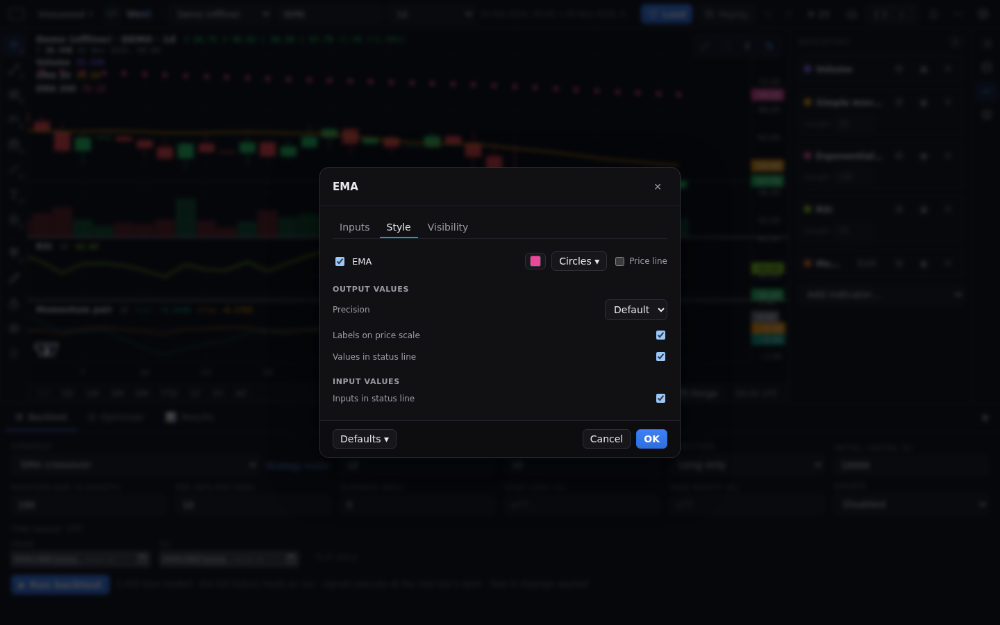
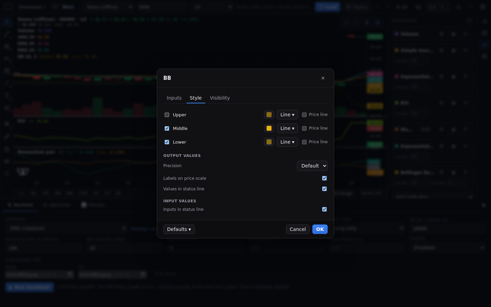
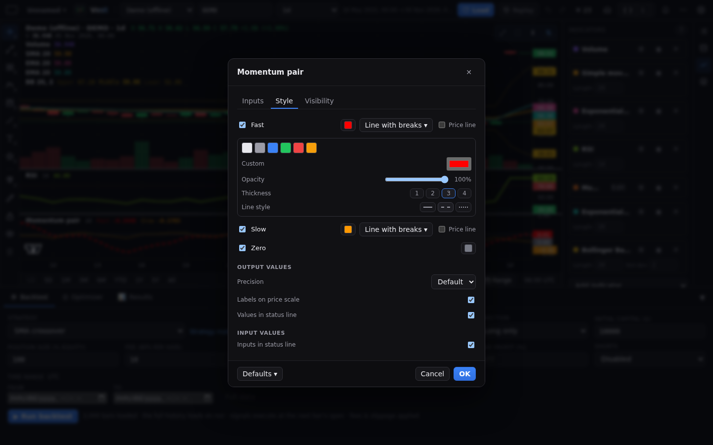

# Charts

## The chart

A candlestick chart with a volume pane, drawn with TradingView's open-source lightweight-charts. Drag to pan and use the wheel or pinch to zoom. Right-click the chart for its menu, which has "Add alert at" the price you clicked ([Alerts](alerts.md)).

## Legend

The one-line legend at the top of the chart shows the symbol, the open, high, low and close under the crosshair, the change and the volume, coloured by direction. Under it, every indicator drawn on the price pane (Volume included) has its own row, and the indicator panes below the chart have their own legends (see [Indicator legend rows](#indicator-legend-rows)).

## Indicators

Open **Indicators** in the side panel and pick **Add indicator...**: SMA, EMA, Bollinger Bands, VWAP, Volume, RSI, MACD, or a Pine script ([Pine Script](pine.md)), which is named by the title in its code. Each row has a colour swatch, a gear (**Settings**) button, a show and hide button and a remove button, and its parameters (such as the period) edit live. RSI and MACD get their own panes under the chart, and so does a Pine script that is not drawn on the price.

Each of those panes has a small legend at its top-left with the indicator's name and its parameters (for example `RSI 14` or `MACD 12 26 9`; a Pine script shows its title and its input values), then the value of each plot in the plot's colour. The values follow the crosshair; with the crosshair off the chart they show the last bar, and a bar where a plot has no value shows `-`. The pane's price scale carries a label for each plot's last value and for fixed levels such as the RSI 30 and 70 lines or a Pine `hline`.

A new pane opens at a modest height, so the candles keep most of the chart. Drag the line between two panes to resize them: the size you set stays when you add, remove or hide other indicators or edit a Pine script.

### Indicator legend rows

Each indicator has a row in the chart's legend: its name and inputs (`EMA 200`, `BB 20, 2`, or a Pine title with its input values), then each plot's value in the plot's colour at the crosshair bar (the last bar with the crosshair away, `-` where there is no value). Rows for the price pane sit under the one-line legend in list order; an RSI, MACD or Pine pane keeps its own legend at the top of its pane.

Hover a row (or tap it on a touch screen) to show its buttons: the eye (**Hide** or **Show**), the gear (**Settings**, which opens the [settings dialog](#indicator-settings)), `{}` (**Source code**, Pine scripts only, which opens the Pine editor on that script), the bin (**Remove**) and `...`, a menu with Settings..., Source code..., Hide or Show and Remove. Escape, a click outside or a choice closes the menu. Double-click the name to open the settings.

A hidden indicator keeps its row, dimmed, with `-` for its values, so you can show it again. An RSI, MACD or Pine pane that is hidden has no pane any more, so its dimmed row is listed with the price pane's rows. An indicator turned off for the current timeframe kind has no row. A Pine script that is still running or failed to run shows its name and no values.

Only the rows themselves take clicks: dragging the chart, drawing and zooming work as before everywhere else, including right below the rows.

### Indicator settings

The gear opens a dialog titled with the indicator's short name (for example **EMA**, or a Pine script's title). It has three tabs, and every change shows on the chart at once; the row's own fields and show and hide button stay in step with it.

- **Inputs** has one field per parameter of a built-in indicator; a value outside the allowed range, or text that is not a number, is refused in place with a message. A Pine script shows its inputs (and its Calculation settings when it declares a timeframe) once it has run.
- **Style** has one row per plot of the indicator (a Pine script's `plot()` lines and `hline`s, once it has run; candle and bar plots, `bgcolor` bands, fills, markers and drawings have no row). Each row has a checkbox that turns the plot off (a hidden Pine plot still lets a `fill` between plots draw), a colour button, a plot type (Line, Line with breaks, Step line, Histogram, Area or Circles) and a **Price line** switch. The colour button opens swatches, a custom colour, **Opacity**, and for line-drawn types the **Thickness** and **Line style**. A colour you pick replaces per-bar colours (the MACD histogram, Volume, a Pine script's conditional colours); an opacity alone fades them. **Output values** sets the **Precision** (Default, or 0 to 8 decimals, on the price scale and in the legend), whether the plots' **Labels on price scale** show and whether the **Values in status line** show; **Input values** sets whether the **Inputs in status line** show (off, an EMA's row reads "EMA" instead of "EMA 20"). A style never reruns a Pine script.
- **Visibility** has one checkbox per timeframe kind (Seconds, Minutes, Hours, Days, Weeks, Months), all on by default. An indicator turned off for the chart's current kind is not drawn at all: no lines, no pane and legend, no bar colours. It comes back when you move to a kind that is on.
- **Defaults** (bottom left) has **Reset settings**, which brings the inputs, style and visibility back to your saved default or the built-in values (for a Pine script it clears the input, calculation and style overrides and shows it on every timeframe), and **Save as default** for built-in indicators, which makes new indicators of that kind start from these settings, style included.

**OK** keeps the changes; **Cancel**, Escape and the close button put the indicator back as it was when you opened the dialog.

## Quick ranges and the Range picker

The bar under the chart has quick ranges **1D, 5D, 1M, 3M, 6M, YTD, 1Y, 5Y** and **All**. A button is disabled when the loaded bars do not reach that far back and the provider has no older bars to page in; while older bars can still load, a range that reaches before the first loaded bar is enabled, and clicking it loads older pages until the range is covered (or the provider's history starts), then zooms. **All** shows the bars loaded so far and does not page. See [how history loads](data.md#how-history-loads).

The **Range** control opens a From and To picker that crops the chart to a window. If the window lies outside the loaded bars, Vost fetches that span from the provider (Demo generates it). On a live chart the range pauses **Live** (with a note) and clearing it returns to the latest bars and Live.

## Time zone clock

The clock at the right of the bar under the chart shows the time in a chosen zone. Click it to search and pick a time zone: every date on screen is then shown in that zone. Candle times themselves stay UTC. The choice is remembered.

## Reset view

**Reset view** in the chart toolbar restores automatic price scaling on every pane and the default gap at the right edge, and shows a window sized to the timeframe: the last day on minute charts, the last 5 days on hourly charts and the last month on daily charts. Weekly and monthly charts show all the data, and so does any chart whose provider has no bars that far back. Reset view loads older pages first when the window reaches before the loaded bars. A freshly loaded chart opens on the same window.

## Screenshot and CSV export

In the chart toolbar, **Screenshot (PNG)** saves the chart as an image and **Export candles as CSV** saves the loaded bars. With several charts you can also download every chart's data ([Layouts](layouts.md#download-chart-data)). **Show backtest trades** toggles the trade markers from the last backtest ([Backtesting](backtesting.md)).

## Switching symbol

Switching to another symbol on the same timeframe keeps the dates and zoom you were looking at (a chart following the latest bar keeps following the new symbol's latest bar), and older bars load if the window needs them. Changing the timeframe, or opening a dataset, opens the chart on the timeframe's window (a chart limited by the Range picker shows its whole range).

## Live candles

Charts open live on their own for providers that support it: **Live** in the top bar streams new candles. Turning Live off sticks for that chart through symbol, timeframe and provider changes until you turn it back on, and picking a chart range pauses it until you clear the range. The server keeps one exchange connection per feed and shares it between tabs, reconnects by itself and backfills the bars a drop missed. Live works on built timeframes too ([Timeframes](timeframes.md)). When live fails, the error goes to the inbox.

## Connection light

The dot in the top bar shows whether each exchange's price history, symbol lookup and live stream work right now. Click it for latency, the last good time, the error text and a **Test now** button. The server checks about once a minute (`VOST_STATUS_INTERVAL=0` turns that off).

