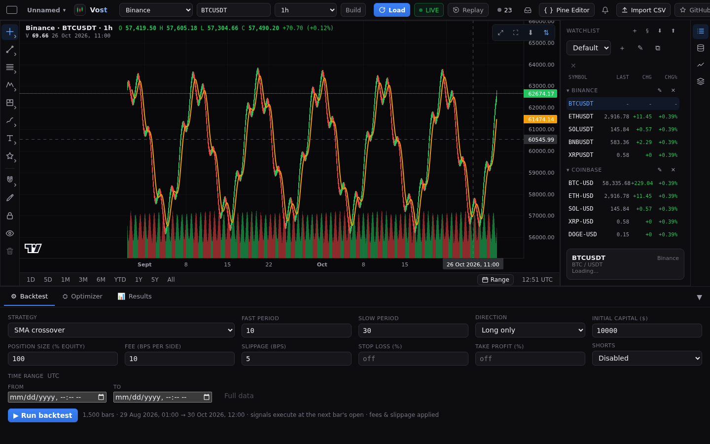

# Data

## Providers

Pick a provider in the top bar. All remote data is fetched by the Vost server, so the browser never needs a key or a cross-origin call.

| Provider | Coverage | Live |
|---|---|---|
| Binance, Coinbase, Kraken, Bybit, OKX | Crypto spot | Yes |
| Hyperliquid Perps and Hyperliquid Spot | Crypto perpetuals and spot (latest 5000 bars per timeframe) | Yes |
| Yahoo Finance | Stocks, ETFs, indices, FX (delayed) | No |
| Demo (offline) | Synthetic, deterministic | No |

Limits per provider (such as Kraken's latest 720 candles, or Yahoo's intraday history) are in the [data sources](../DATA-SOURCES.md) survey and the README's table. The Demo provider needs no network.

### How history loads

By default a chart from a market provider (or Demo) opens on its latest 1000 bars and loads older bars in pages of 1000 as you scroll or zoom back, so a chart opens fast and the view stays where it is while older bars arrive. Paging stops at the start of the provider's history (or at 200000 loaded bars), and a failed page shows one warning in the inbox and is retried the next time you scroll back. There is no **Number of bars** menu in this mode. A local dataset, a chart range and bar replay never page.

An app setting (saved in the app preferences, no screen for it yet) switches to the older behaviour: the **Number of bars** menu in the top bar (500 to 20k) sets how many bars one request loads, and nothing is paged in later.

## CSV import

Press **Import CSV** in the top bar, drop a file (or click to browse, or paste text). The parser detects the delimiter, a header row, the columns and the timestamp format, and shows a preview where you can change the delimiter, header, date order and the column roles. Name the dataset and import: it charts at once, with no network. **Load demo dataset** there makes synthetic data. Ready-made samples are in `examples/` in the repo. The README has the [list of formats](../../README.md#csv-import--the-offline-workflow) the parser accepts.

## Local library

Open **Data and library** from the icon rail. **Data** shows what is on the chart (range, bar count, last close) with **Save to library** and **Export CSV**. **Local library** lists the datasets you kept: click one to chart it, export it as CSV or delete it. Datasets live in your browser's local storage, so you can chart and backtest them with the network off.

## Recorded markets

The server records some markets all the time into a candle store (`candles.sqlite` in `VOST_DATA_DIR`). By default that is BTC and ETH on Binance, Coinbase and Hyperliquid Perps, on every timeframe, kept back to 20000 bars. For you this means a recorded market loads from disk and Vost asks the exchange only for what is missing, so long histories open fast. Nothing changes in the UI; the store is safe to delete (history is refetched). To change what is recorded, see `VOST_RECORD` and `VOST_RECORD_BARS` in the [README configuration table](../../README.md#configuration) and [deployment](../DEPLOYMENT.md).
