# Text and notes

Six note tools sit in the Annotations family of the [drawing rail](drawings.md). **Text** and **Anchored text** (the Text section) are a note at a time and price and a note fixed on the chart's pane. **Note**, **Anchored note**, **Callout** and **Comment** (the Notes section) are described [below](#notes).

## Typing a note

Pick a tool and click the chart (a Callout asks for two points, see below). A box opens where you click and takes the note's own font, size, bold, italic and alignment while you type.

- **Enter** adds a line. **Ctrl+Enter** (**Cmd+Enter** on a Mac) saves the note, and so does clicking away from the box. **Escape** cancels.
- The box grows with the text. When the note wraps, it is as wide as its wrap width and a long line breaks to the next one, as it will on the chart.
- A note is at most 500 characters. An empty note is not saved.
- Double-click a note (double-tap on a phone) to edit it in place. Emptying it deletes it. **Shift+double-click** opens its settings instead.

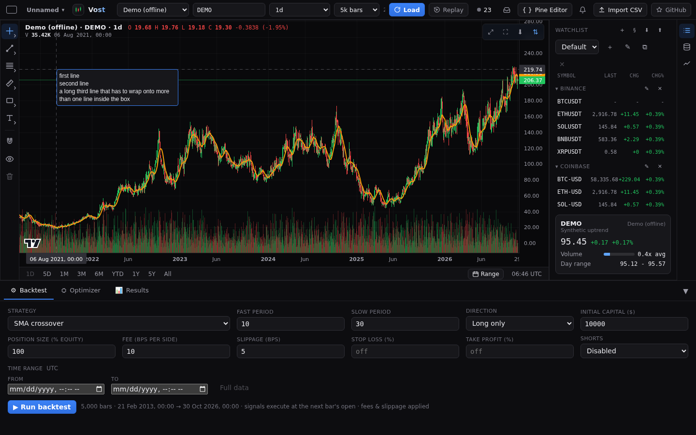

## The Text tab

The settings dialog of every note tool has a **Text** tab with the text itself and every text setting:

- text colour, text size (8 to 48), bold and italic;
- **Alignment**: left, centre or right;
- **Wrap text** and **Wrap width** (40 to 1000 pixels). With wrap off a line only ends where you pressed Enter.

The background colour, its opacity and the border colour stay on the **Style** tab. Changes show on the chart as you make them, and **OK** keeps them as one undo step. **Save as default** makes them the start for new notes of that tool.

Text starts at 12 pixels and wraps at 240 pixels, so notes saved earlier look as they always did. Anchored text starts at 14 pixels, left aligned, without wrapping.

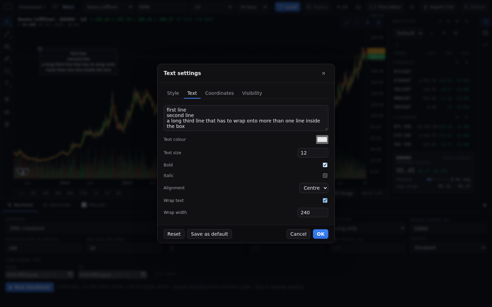

## Anchored text

Anchored text keeps its spot on the pane, whatever the chart does: panning, zooming, another timeframe or a new live bar do not move it. Use it for a title or a remark that belongs to the screen and not to a bar.

- It has no price or time. Its **Coordinates** tab shows the box's top-left corner as **X %** and **Y %** of the pane, from 0 to 100.
- Dragging moves it inside the pane. The magnet does not apply and it shows no labels on the axes.
- If the pane gets smaller, the box stays inside it as far as it can.

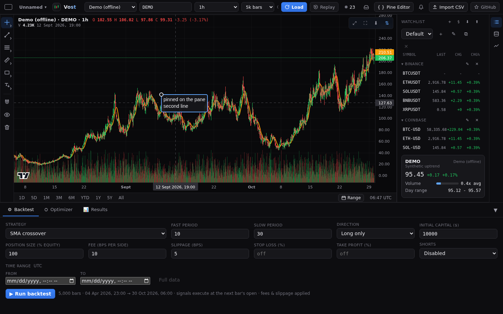

## Table

The **Table** tool (in the Annotations flyout, under Text) puts a grid of text cells on the chart. A table shows under the pointer until you click or tap: it is placed with two rows and two columns, and the first cell opens for typing at once.

- **Type in a cell**: double-click it (double tap on a touch screen). **Tab** saves the cell and moves to the next one, wrapping to the next row, **Shift+Tab** to the previous one, and Tab from the last cell saves and closes. **Ctrl+Enter** or clicking away saves, **Escape** cancels. A cell may be empty; the table stays.
- **Add and remove rows and columns**: right-click a cell for **Add row below**, **Add column right**, **Delete row** and **Delete column**. Or open the settings (Shift+double-click) and set **Rows** and **Columns** (1 to 20 each); new cells are added at the end and removed ones come off the end.
- **Look**: columns are as wide as their widest cell and rows as tall as their tallest. The **Text** tab sets the colour, size, bold, italic and alignment of the cell text. The **Style** tab has the border colour and width, the cell background and its opacity, and a **Header row** that makes the first row bold on its own background colour.
- **Move**: drag the table or its handle at the top-left corner. A table stays inside the pane, and follows its bar through zoom, pan and a timeframe change.

Every edit, a cell, a row or a column, is one undo step, and tables are saved with the chart, copied and cloned with their cells.

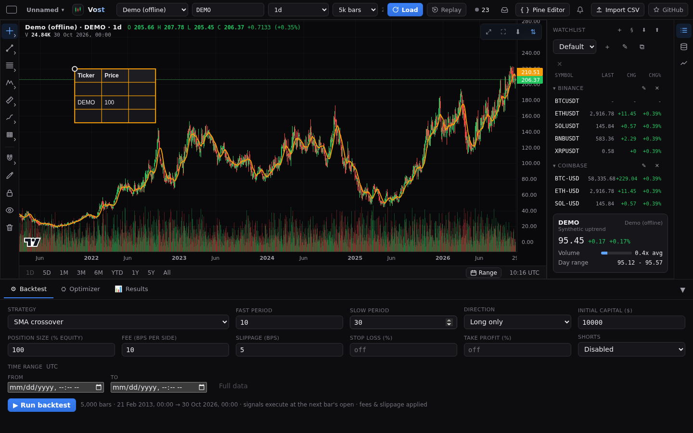

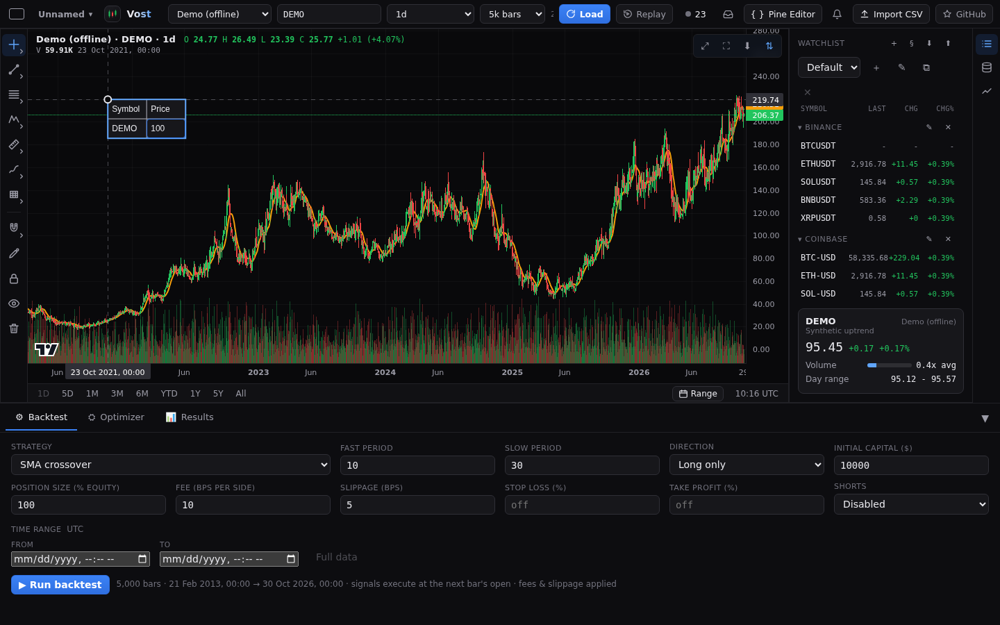

## Notes

The Notes section has eight tools. Four of them carry text like Text does (Note, Anchored note, Callout and Comment): they are typed, edited, styled and saved the same way, and their settings have the same Text tab. They start as white 14 pixel text on a blue box, wrapped at 240 pixels. On the Style tab you set the box's background colour and opacity and its border colour.

### Note and Anchored note

A **Note** is a pin whose tip sits on the bar and price you clicked. Its text is not on the chart until you ask for it:

- **Hover** the pin and the text shows in a box beside it.
- **Click** the pin (or tap it on a phone) to pin the box open; click it again to close it. A pinned box stays while you look elsewhere. It is not saved: after a reload every box is closed.
- A selected note shows its box too.
- The box is drawn over every other drawing and stays inside the pane, on the left of the pin near the right edge.
- The **Marker colour** on the Style tab colours the pin.

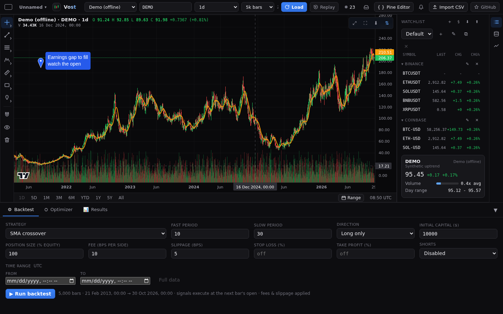

**Anchored note** is the same tool fixed on the pane like Anchored text: it keeps its spot through panning, zooming, another timeframe and new live bars, has X % and Y % on its Coordinates tab and ignores the magnet.

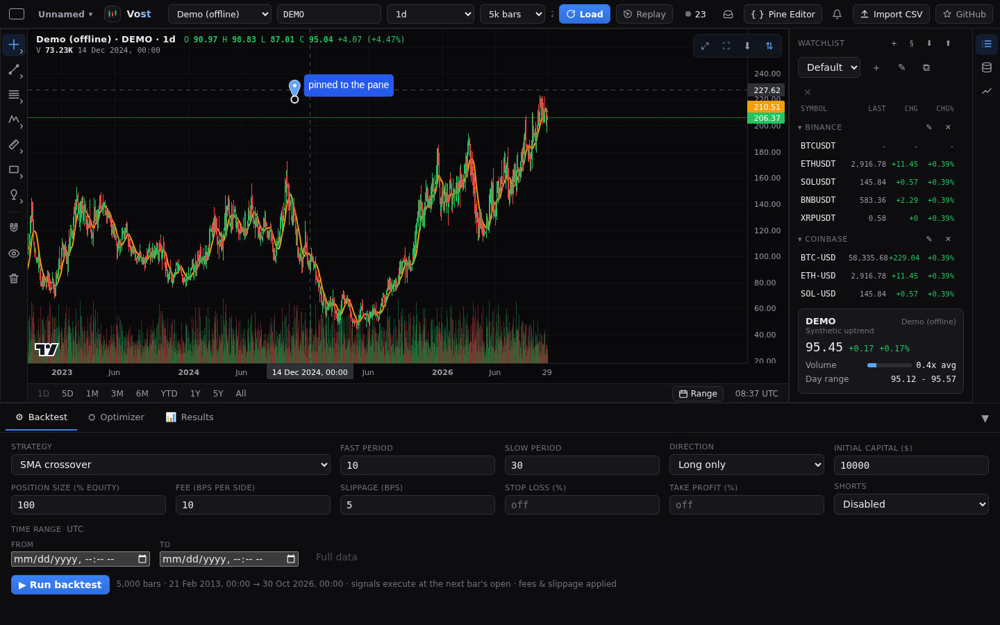

### Callout

A **Callout** is a text box with a pointer to a bar. Press where the box goes and drag to the target, or click the box's place and then the target; the box opens for typing once both are placed, with a live preview until then. The pointer is a wedge from the box's nearest edge to the target and is not drawn while the target is inside the box.

- Drag the box handle to move the box and keep the target; drag the target handle to move the target; drag the body to move both.
- Pressing the box or the pointer selects it.

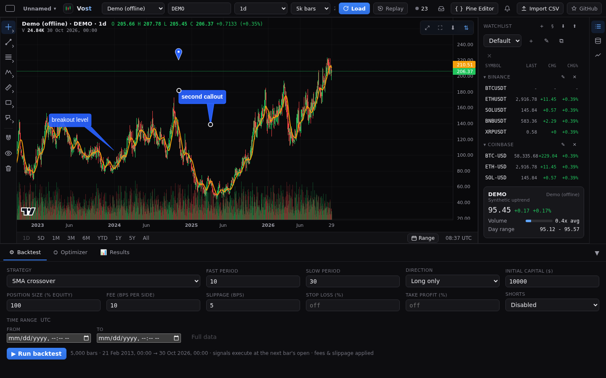

### Comment

A **Comment** is a rounded speech bubble whose tail tip is on the bar and price you clicked. The bubble sits above and to the right of the tip, below it near the top edge and to its left near the right edge. Its text wraps by default. Double-click (double-tap) it to edit.

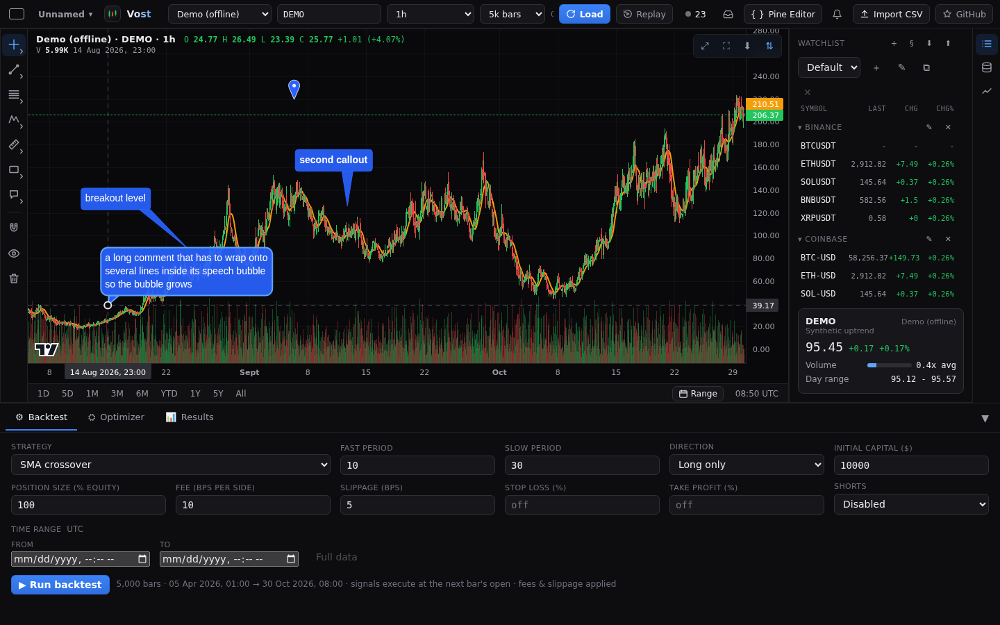

### Price note

A **Price note** has a dot on the bar and price you press and a straight line from it to a blue box. The box shows the dot's price, in the chart's own price format, and it updates while you drag the dot. Press the dot's place and drag to the box's place, or click the two places; a live preview shows until both are placed. A label set on the **Text** tab goes under the price in the box. Drag the dot handle to change the price, the box handle to move the box, or the body to move both. Selecting it shows the dot's price and time on the axes.

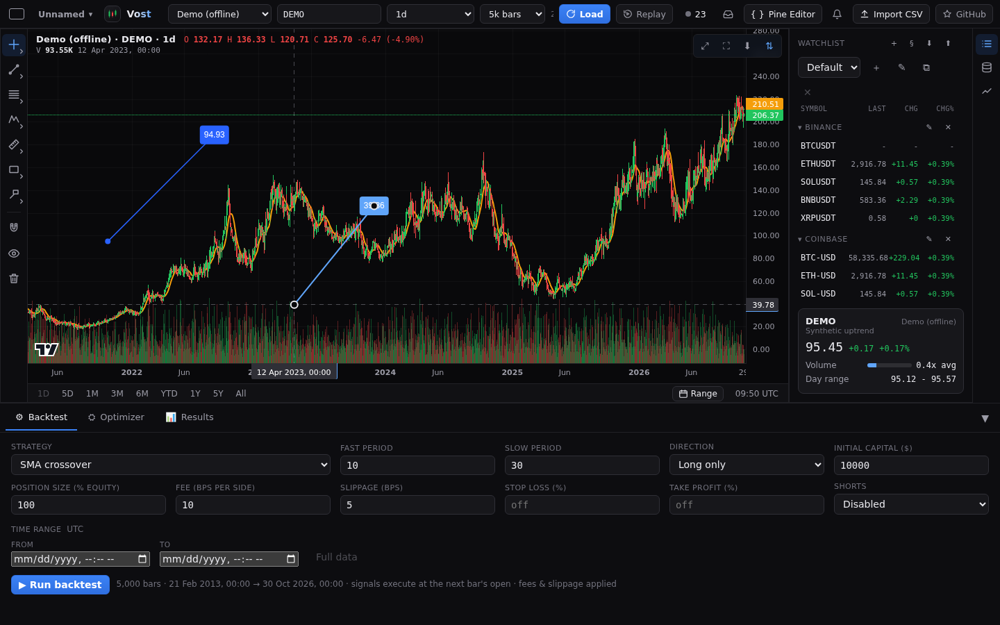

### Price label

A **Price label** is a pointed blue tag whose point is on the price you clicked, with the price in white inside it. It has no text of its own; its colour, text colour and size are on the Style tab.

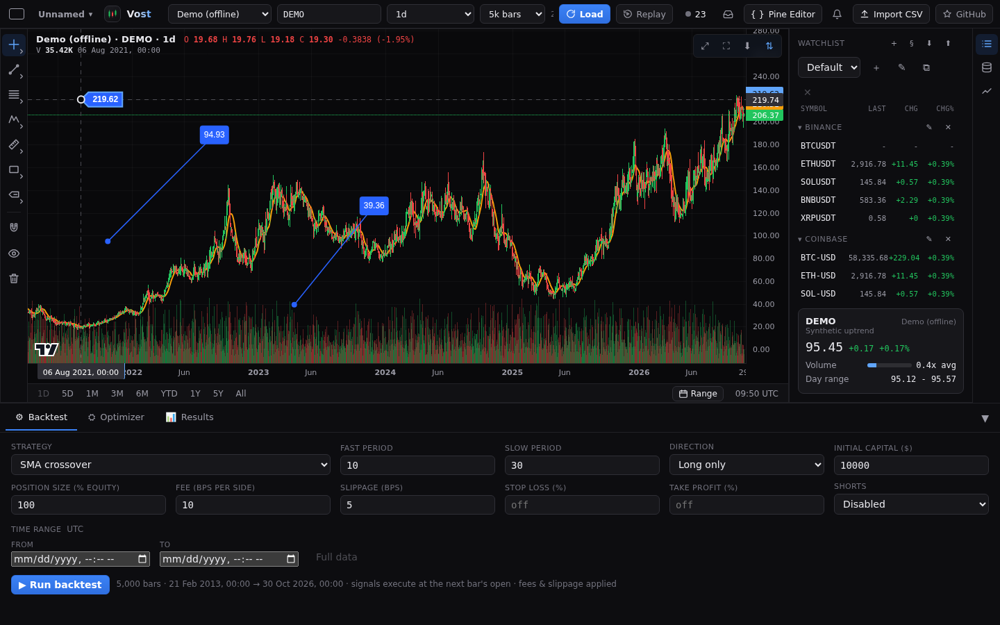

### Signpost

A **Signpost** is a pole from a bar to a rounded plate. The plate is above the point, or below it when **Position** on the Style tab is set to Below. It shows an **Emoji** chosen on the Style tab (none, flag, star, pin, fire or rocket), or the label set on the Text tab when no emoji is chosen. It always sits on a bar's time.

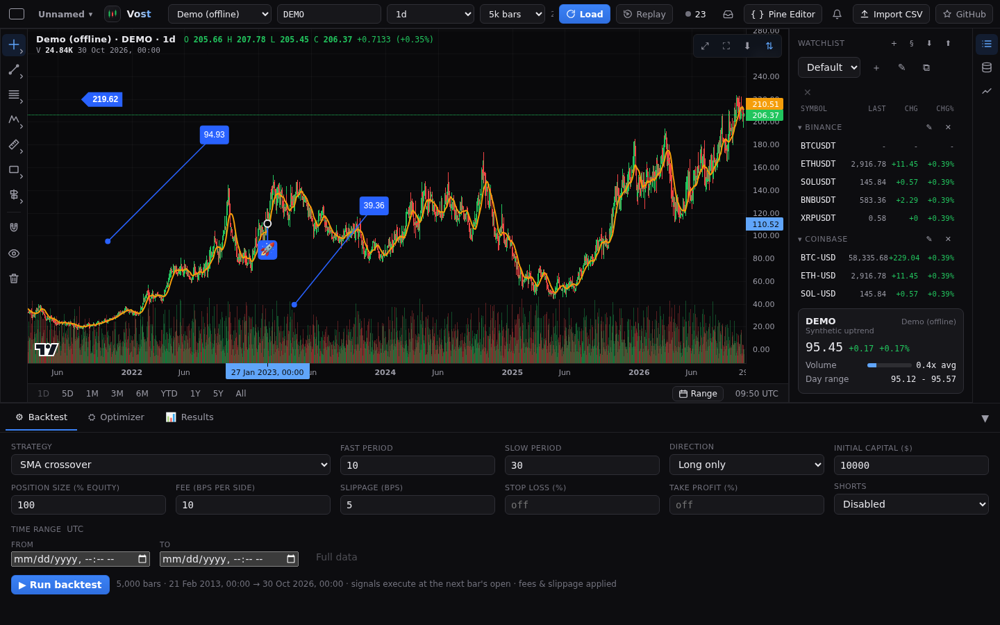

### Flag mark

A **Flag mark** is a small pole with a flag at the bar and price you clicked. Its **Colour** is on the Style tab. It always sits on a bar's time.

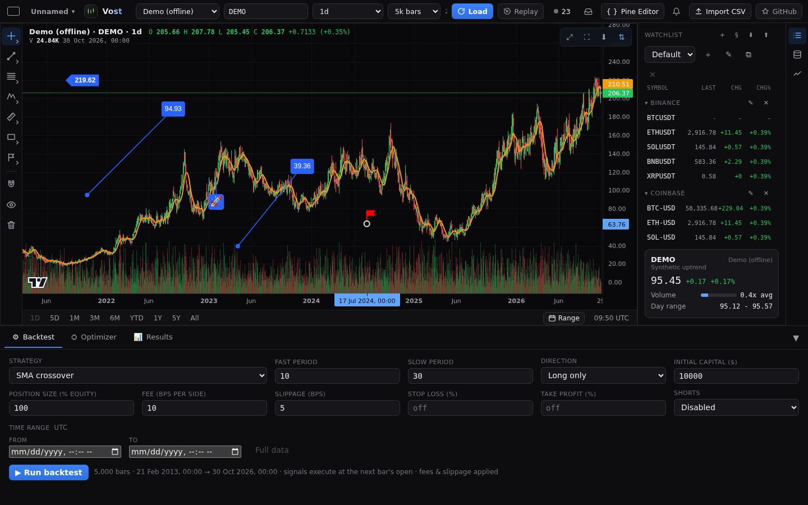

All the note tools and price markers are saved in your browser with the other drawings, with their lines, and can be hidden on timeframes on the **Visibility** tab.

## Image

The **Image** tool (in the Annotations flyout, in its own **Content** section) puts a picture on the chart. Picking it opens a file chooser for a PNG, JPEG, GIF or WebP picture of up to 5 MB. While the tool is picked you can also paste a picture from the system clipboard (Ctrl+V; with no picture on it Ctrl+V pastes the copied drawings as always) or drop a file on the chart.

- **Place**: click or tap to put the picture's top-left corner there at its natural size, scaled down to fit within half the chart. Or press, drag and release to set its box: the picture keeps its ratio and shows live while you drag; hold **Shift** to free the ratio (on a desktop). **Escape** or picking another tool drops the picture before it is placed.
- **Move and resize**: drag the picture, or one of its four corner handles. A corner drag keeps the ratio, and **Shift** frees it; with **Keep ratio** off in the settings a corner drag is always free.
- **Settings**: **Opacity** (100% by default), a **Border colour** and a **Border width** from 0 to 5 (no border by default) and **Keep ratio**. There is no Text tab.

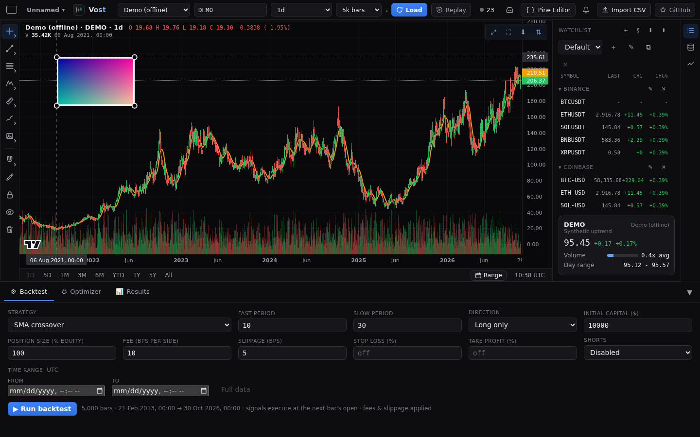

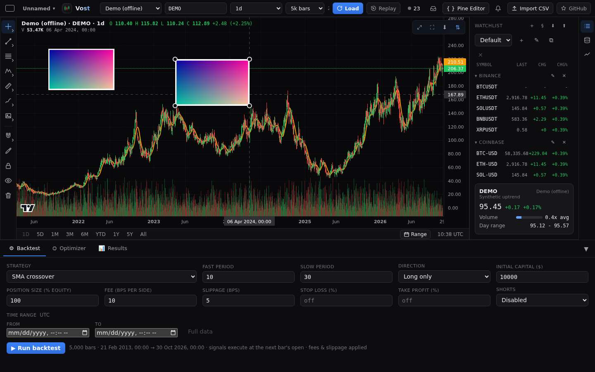

A file that is not a PNG, JPEG, GIF or WebP picture (the type and the file's own bytes must both say so), or is over 5 MB, shows a message and adds nothing. The picture store holds up to 50 MB in all.

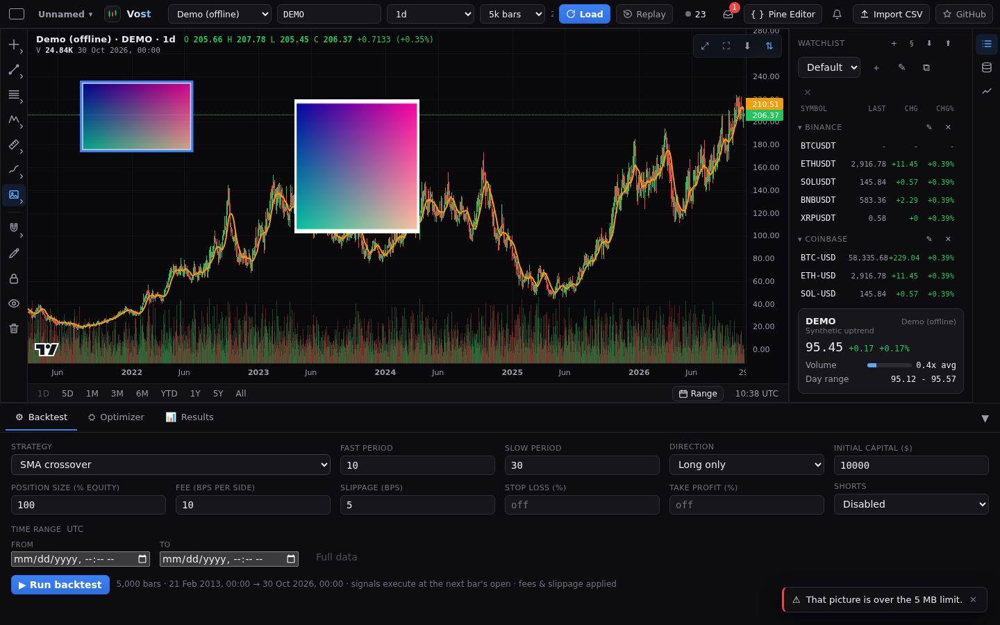

Pictures are kept in your browser's own picture store, apart from the drawings, so a picture is stored once however many times it is used. Undo, redo, clone, copy and paste, lock, reorder and delete work as for any drawing, and a deleted picture comes back with undo. A picture nothing uses any more (no drawing, no undo step, no copy) is removed from the store a day after it was last in use. If the store lacks a picture (you cleared the site's data, or the drawings were copied to another browser) the drawing shows a dashed box labelled **Picture missing**, which you can still select, move and delete. In a browser that cannot keep pictures (some private modes) the Image tool is greyed out.
