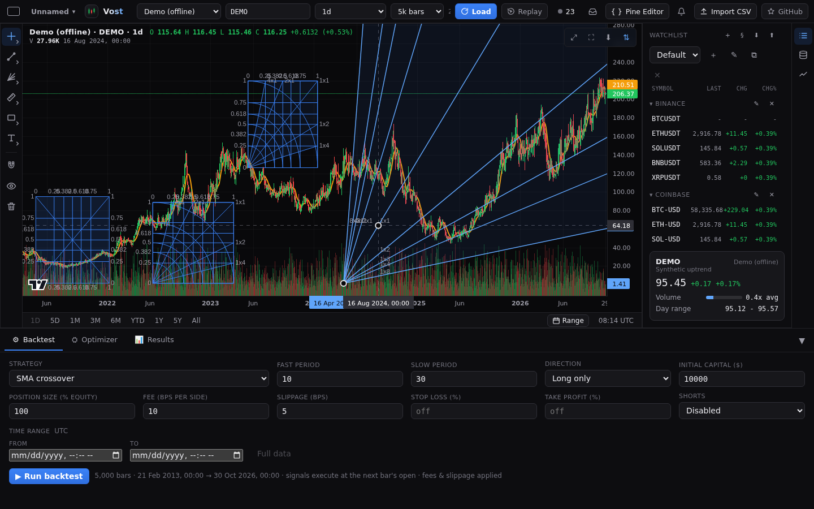

# Fibonacci and Gann tools

The **Fibonacci and Gann** family of the [drawing rail](drawings.md) holds the Fibonacci retracement and five more two-point tools, and under a second heading the four Gann tools. Pick one, then click two points on the chart, or press, drag and release (or tap two points on a phone). A preview follows the pointer until the second point. Escape cancels.

All five select, move by their lines, curves or fills, resize by their two handles, snap to the bars with the magnet, undo and redo, and are saved with the chart. Double-click one to open its settings: levels, colours and switches are on the **Style** tab and the level labels on the **Text** tab.

## The tools

- **Fib time zone**: vertical lines at the Fibonacci bar counts (0, 1, 2, 3, 5, 8, 13, 21, 34, 55, 89) from the first point. One unit is the number of bars from the first point to the second, so a wider drag spaces the lines out. The lines span the full height of the pane, and while the drawing is selected the time axis shows the time of each line. Settings: the level table, width, line style, a background between lines, and labels (Text tab).
- **Fib speed resistance fan**: lines from the first point through the price and time levels of the box the two points span (0, 0.25, 0.382, 0.5, 0.618, 0.75, 1). Price levels end on the vertical edge at the second point, time levels on the horizontal edge. Settings: a table each for the price and the time levels, width, a grid, a fill between lines, **Reverse**, and left, right, top and bottom labels (Text tab).
- **Fib circles**: circles around the midpoint of the two points, one radius per level (0.236 to 4.236). Level 1 passes through both points. Settings: the level table, width, background and labels (Text tab).
- **Fib spiral**: a golden spiral around the first point that passes through the second. It grows by the golden ratio every quarter turn. **Counter-clockwise** turns it the other way. Settings: colour, opacity, width, line style.
- **Fib speed resistance arcs**: half circles around the first point, on the side of the second, at the levels of the distance between the two points. **Full circles** draws whole circles. Settings: the level table, width, background and labels (Text tab).

## Gann tools

The Gann box, Gann square fixed, Gann square and Gann fan are placed, selected, moved, resized, undone and saved like the Fibonacci tools, and show the time and price of their points on the axes while selected.

- **Gann box**: the two points are opposite corners. Price levels and time levels (0, 0.25, 0.382, 0.5, 0.618, 0.75, 1) are two tables, **Angles** draws the box diagonals, each band can be filled, and **Reverse** measures the levels from the other side. Left, right, top and bottom labels are on the Text tab. It has eight handles: the corners, and the side midpoints, which move only their own side.
- **Gann square**: a free rectangle whose first point is the origin of its three tables: grid levels, fans (1x4, 1x2, 1x1, 2x1, 4x1) and quarter arcs. Each entry has its own switch and colour.
- **Gann square fixed**: the same, held square on screen: its side is the larger of the two point distances, so the second point only picks the direction and the size.
- **Gann fan**: lines from the first point at 1x8, 1x4, 1x3, 1x2, 1x1, 2x1, 3x1, 4x1 and 8x1 of the box the points span (1x1 runs through the second point), continuing to the edge of the pane, with a fill between neighbouring lines and the ratio as a label.

## Levels

Each level table works like the retracement's: edit a value, add one (up to 24), remove one, change its colour or switch it off. Only levels that are on are drawn, hit and labelled. A line, curve or fill is only grabbed where it is drawn, and nothing is drawn outside the pane. Prices in labels use the chart's price format.

Colours, widths and a changed level table are kept per drawing; **Save as default** in the dialog makes them the start for new drawings of that tool.
