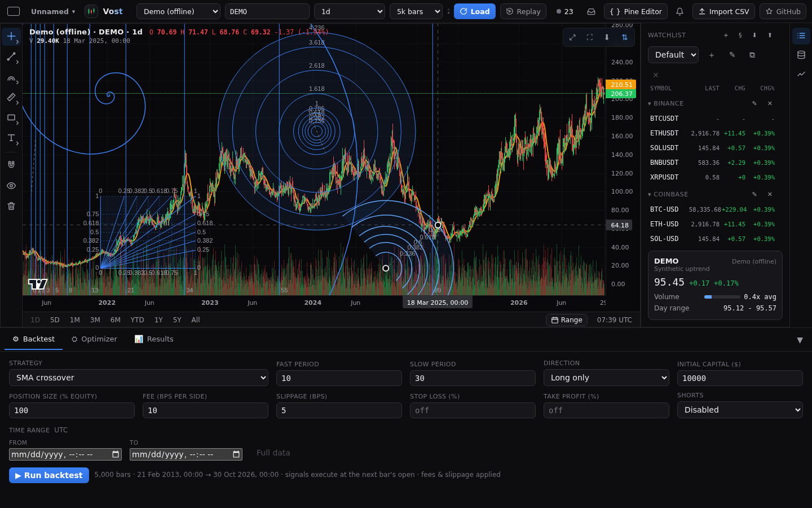
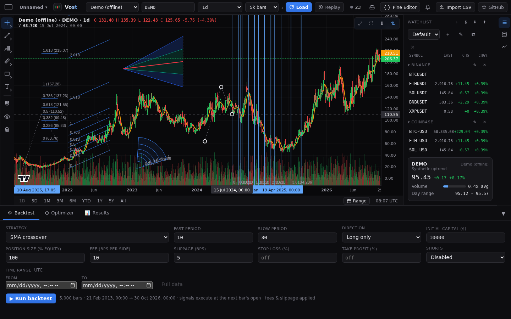
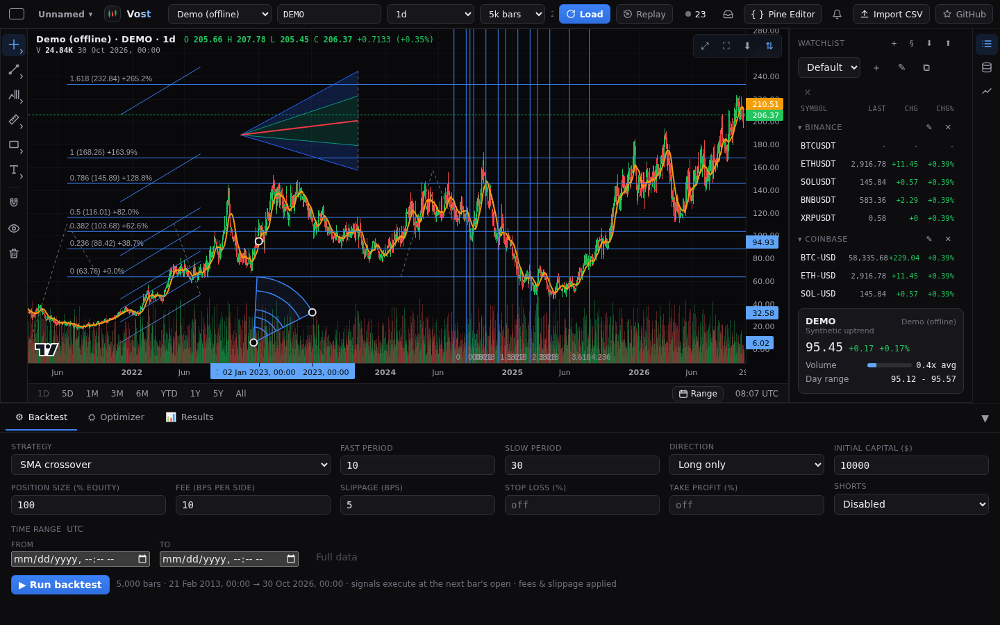
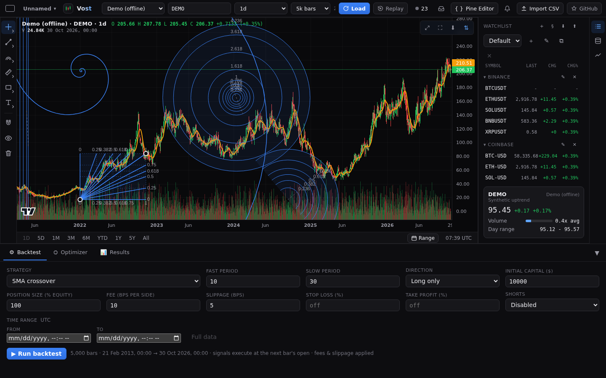

# Fibonacci tools

The **Fibonacci and Gann** family of the [drawing rail](drawings.md) holds the Fibonacci retracement, five more two-point tools and five three-point tools. Pick one, then click two points on the chart (three for the three-point tools), or press, drag and release and then click (or tap the points on a phone). A preview follows the pointer until the last point. Escape cancels.

All of them select, move by their lines, curves or fills, resize by their handles (two or three), snap to the bars with the magnet, undo and redo, and are saved with the chart. Double-click one to open its settings: levels, colours and switches are on the **Style** tab and the level labels on the **Text** tab.

## The two-point tools

- **Fib time zone**: vertical lines at the Fibonacci bar counts (0, 1, 2, 3, 5, 8, 13, 21, 34, 55, 89) from the first point. One unit is the number of bars from the first point to the second, so a wider drag spaces the lines out. The lines span the full height of the pane, and while the drawing is selected the time axis shows the time of each line. Settings: the level table, width, line style, a background between lines, and labels (Text tab).
- **Fib speed resistance fan**: lines from the first point through the price and time levels of the box the two points span (0, 0.25, 0.382, 0.5, 0.618, 0.75, 1). Price levels end on the vertical edge at the second point, time levels on the horizontal edge. Settings: a table each for the price and the time levels, width, a grid, a fill between lines, **Reverse**, and left, right, top and bottom labels (Text tab).
- **Fib circles**: circles around the midpoint of the two points, one radius per level (0.236 to 4.236). Level 1 passes through both points. Settings: the level table, width, background and labels (Text tab).
- **Fib spiral**: a golden spiral around the first point that passes through the second. It grows by the golden ratio every quarter turn. **Counter-clockwise** turns it the other way. Settings: colour, opacity, width, line style.
- **Fib speed resistance arcs**: half circles around the first point, on the side of the second, at the levels of the distance between the two points. **Full circles** draws whole circles. Settings: the level table, width, background and labels (Text tab).

## The three-point tools

Click or tap the points A, B and C in turn. While you place them, the segment A-B is drawn. Each shows the prices and times of A, B and C on the axes while selected. The dashed path A-B-C (or B-C, or the edges) is part of the drawing, so you can grab the drawing there.

- **Trend-based fib extension**: levels at C plus the move A to B times each ratio (0, 0.236, 0.382, 0.5, 0.618, 0.786, 1, 1.618, 2.618, 3.618, 4.236), as horizontal lines across B and C. **Reverse** measures the other way, and **Extend left** and **Extend right** continue the lines to the edges of the pane. Settings: the level table, width, line style, a background between levels, and on the Text tab **Show levels**, **Show prices** and **Show percent** (the distance from C, such as +41.7%).
- **Fib channel**: lines parallel to A-B, offset by each ratio of the distance from A-B to C (level 0 is A-B, level 1 passes through C). It uses the extension's levels. Settings: the level table, width, line style, a background, **Extend left** and **Extend right**, and **Show levels** (Text tab).
- **Trend-based fib time**: vertical lines at C plus the distance from A to B times each ratio (0, 0.382, 0.5, 0.618, 1, 1.382, 1.618, 2, 2.382, 2.618, 3, 3.618, 4.236). They span the full height of the pane, and while the drawing is selected the time axis shows the time of each line. Settings: the level table, width, line style, a background, and **Show labels** (Text tab).
- **Fib wedge**: arcs around A between the edge A-B and the edge towards C, at multiples of the length of A-B (0.236 to 1) and sweeping the smaller angle. Settings: the level table, width, a background between arcs, and **Show labels** (Text tab).
- **Pitchfan**: lines from A through points of the segment B-C. A median goes through the middle of B-C, and each level adds two lines through the points that far from the middle (level 1 passes through B and C). Only 0.5 and 1 are on at first. **Extend lines** continues them to the edge of the pane. Settings: the level table, the median colour, width and style, level width and style, and a background between lines.

## Levels

Each level table works like the retracement's: edit a value, add one (up to 24), remove one, change its colour or switch it off. Only levels that are on are drawn, hit and labelled. A line, curve or fill is only grabbed where it is drawn, and nothing is drawn outside the pane. Prices in labels use the chart's price format.

Colours, widths and a changed level table are kept per drawing; **Save as default** in the dialog makes them the start for new drawings of that tool.
