# Forecasting and measuring tools

The **Forecasting and measurers** family of the [drawing rail](drawings.md) holds the **Long position**, **Short position**, **Forecast**, **Projection**, **Bars pattern** and **Ghost feed** tools (the Forecasting section) and the **Price range**, **Date range**, **Date and price range** and **Measure** tools (the Measurers section; the temporary Measure is described in [Drawings](drawings.md), the saved range tools [below](#measurers)).

## Positions

A position plans a trade on the chart: an entry, a **target** zone on the profitable side and a **stop** zone on the other, with the risk, the quantity and the profit or loss they imply. A **Long position** profits when price rises (target above the entry, stop below); a **Short position** is the mirror.

### Placing one

Pick **Long position** or **Short position**. Before you click, the shape follows the pointer so you see what the click will place. One click (or one tap on a phone) places it: the entry where you clicked, the target and stop a fixed fraction of the pane above and below (the target twice as far as the stop), and the right edge a fixed distance to the right. With the magnet on, the entry snaps to the bar.

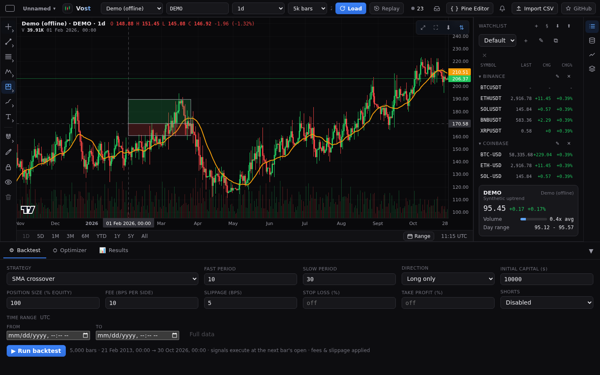

### Moving and resizing

Click a position to select it. Four handles show:

- the **entry** (left edge, at the entry price): moves the entry price and the start time;
- the **target** and the **stop** (the left corner of each zone): move that price only;
- the **right edge**: moves the end time of both zones together.

A target or stop dragged across the entry stops one tick from it (one pixel when the chart has no tick size), so a position never turns inside out. Drag the body to move the whole position. The prices and times of the selected position show on the axes.

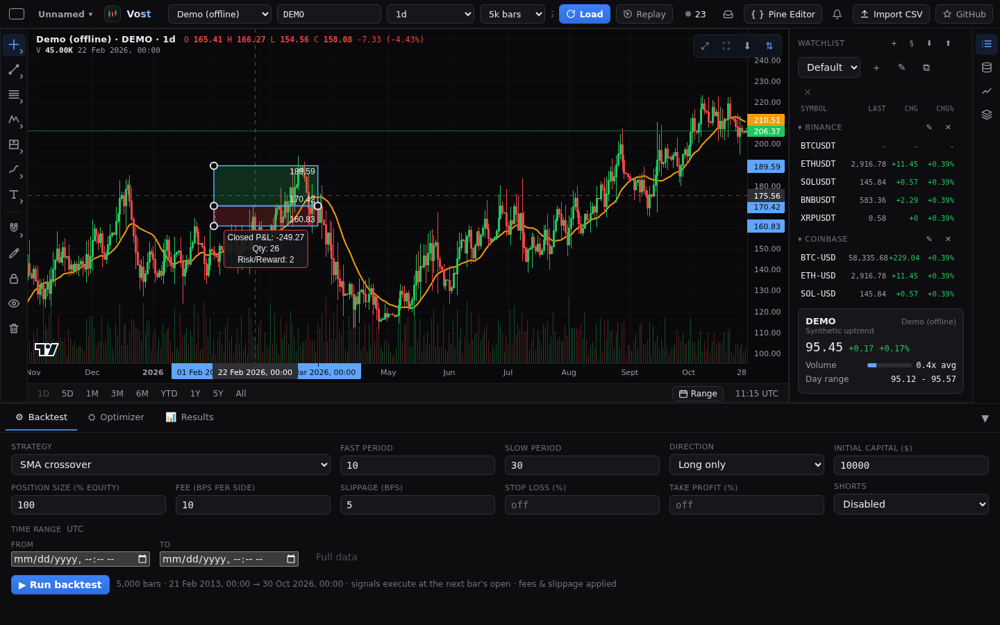

### What it works out

The label (shown while the position is selected, or always with **Always show stats**) gives the closed or open result, the quantity and the risk/reward ratio; each zone adds its distance in price, percent and ticks and its profit or loss when it is wide enough to read.

- **Risk** is a percent of the account size, or a fixed amount.
- **Quantity** is the risk divided by the loss one unit takes at the stop (the stop distance times the lot size), rounded **down** to a whole unit, so the loss at the stop never goes over the risk.
- **Profit** at the target and **loss** at the stop are the distance times the quantity times the lot size. Money shows with two decimals.
- **Risk/reward** is the target distance over the stop distance.

### What happened after the entry

Vost walks the bars after the entry bar up to the position's end. The first bar that reaches the target or the stop decides the result: the dashed line runs from the entry to that point and the label shows **Closed P&L** with the profit or loss. A bar that reaches both counts as the stop, the cautious reading. With neither reached the label says **Open**.

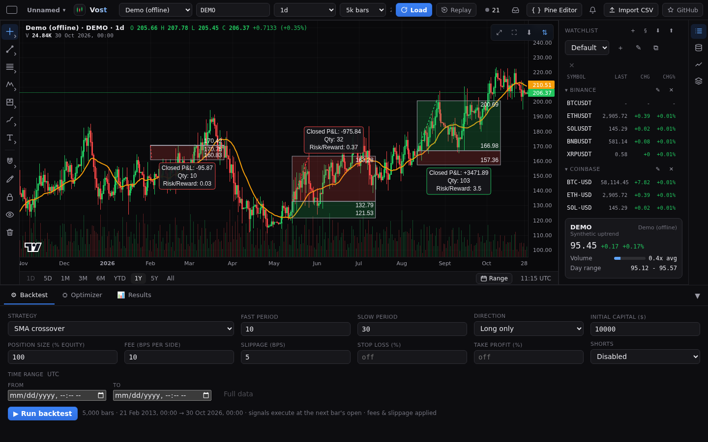

### Settings

Double-click a position to open its settings.

- **Style**: line colour, target and stop fill colour and opacity, text colour and font size, **Compact stats mode**, **Always show stats** and **Show price labels**.
- **Inputs** (after Style): **Account size** (1000), **Lot size** (1), **Risk** (25) and **Risk unit** (percent of the account, or an amount).
- **Coordinates**: the entry, target and stop prices and the start and end times. Editing the target's or stop's time moves both. A price on the wrong side of the entry is refused.
- **Visibility**: the timeframes it shows on.

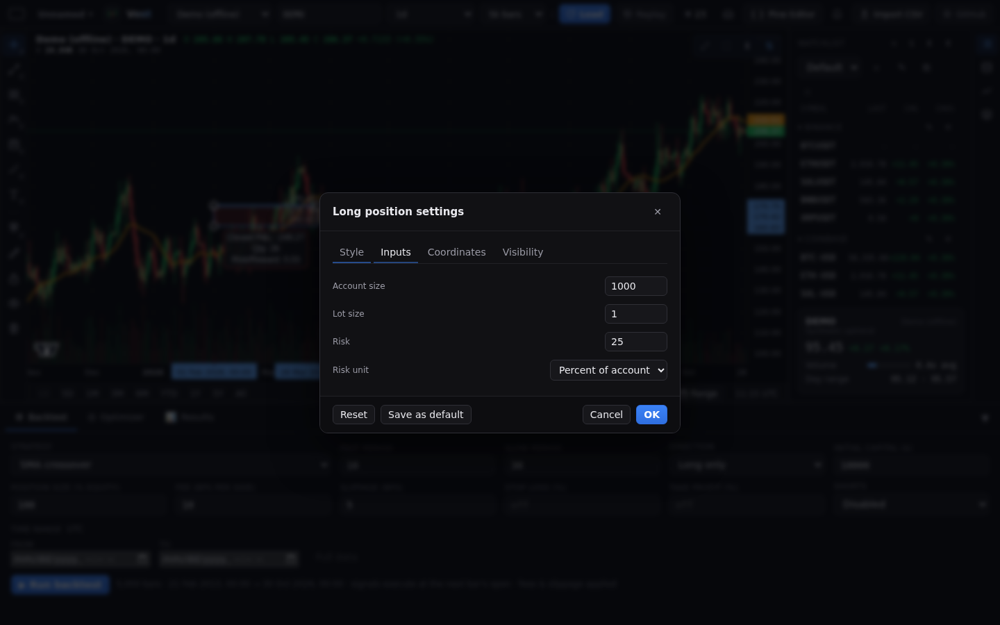

**Save as default** keeps the inputs and the style for new positions of that tool. Positions are saved in your browser and survive a reload, a zoom, a pan and a timeframe change; **Ctrl+Z** and **Ctrl+Shift+Z** undo and redo every change.

## Forecast

A forecast draws where you expect price to be at a later time: a line from a **source** (a price and time) to a **target**. The source label shows the source price; the target label shows the change, the percent, the target date and time and the number of bars to it.

Pick **Forecast**, then press at the source, drag to the target and release, or click the source and click the target (tap, tap on a phone). A live preview follows the pointer, and with the magnet on the points snap to the bars.

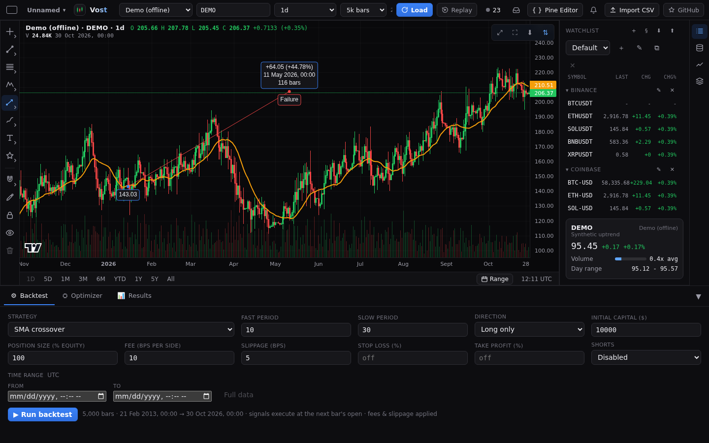

Click it to select: both points show handles, the source and target prices show on the price axis and the target time on the time axis. Drag a handle to move that point, or the line to move the whole forecast.

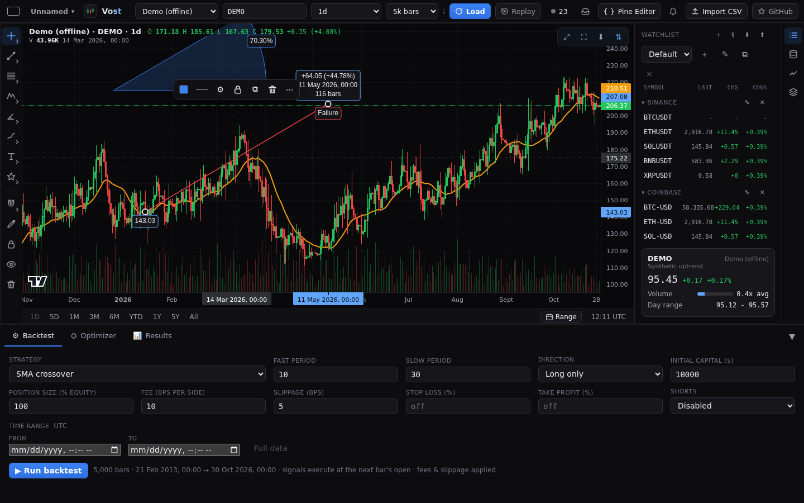

### Success or failure

Once the chart holds a bar at or after the target time, the forecast says how it went:

- **Success** (green): some bar after the source, up to the target time, reached the target price - its high for an upward forecast, its low for a downward one. A bar that only touches the price counts. A forecast whose target equals its source succeeds at once.
- **Failure** (red): no bar did.
- No label while the target time is still in the future (or beyond the loaded bars).

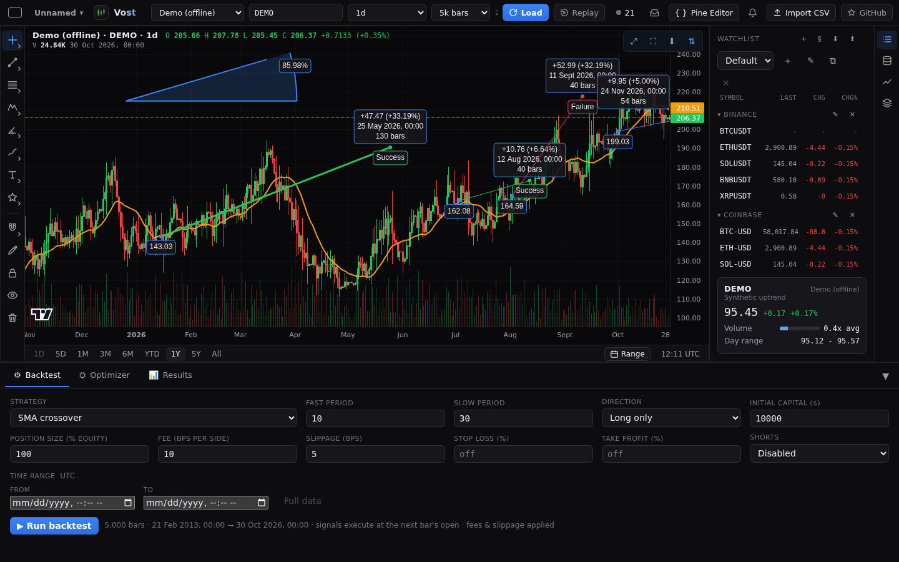

Double-click for settings: **Source colour**, **Target colour**, **Success colour**, **Failure colour**, **Line width**, **Text colour** and **Font size**, plus the Coordinates and Visibility tabs.

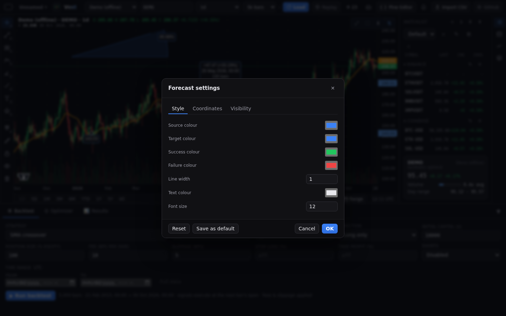

## Projection

A projection measures a move against an earlier one. It has a **leg** from point 1 to point 2 and a **projection** from point 1 to point 3. An arc around point 1, as far out as the leg is long, spans the angle between the two, the wedge is filled, and a label gives the projection's length as a percent of the leg's (a projection as long as the leg reads 100%).

Pick **Projection** and click three points: point 1, point 2, then point 3 (the preview follows the pointer before the third). Select it to see a handle at each point and their prices and times on the axes; point 3 may lie on either side of the leg.

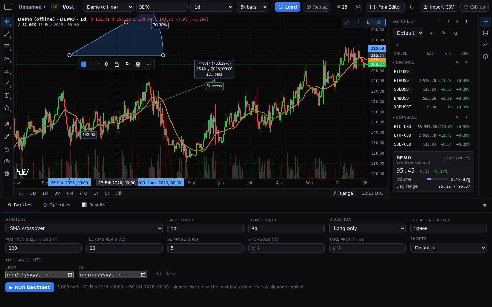

Settings: **Line colour**, **Line width**, **Fill colour**, **Fill opacity**, **Text colour** and **Font size**, plus Coordinates and Visibility.

Forecasts and projections are saved in your browser and survive a reload, a zoom, a pan and a timeframe change; **Ctrl+Z** and **Ctrl+Shift+Z** undo and redo every change.

## Bars pattern

A bars pattern copies a run of bars and shows it ahead, so you can lay an earlier move over where price may go next. The copy is worked out from the chart's bars every time it is drawn (nothing is stored but the three points), so it is the same after a reload, a zoom, a pan or a timeframe change.

Pick **Bars pattern**, then click the two ends of the run you want to copy (or press at one end, drag and release at the other); the frame and the copy follow the pointer while you place the second point. The copy starts one bar after the end of the run, at the price of the run's first bar. A dashed frame marks the source run; the copy is drawn to its right. With no loaded bar in the run only the frame shows.

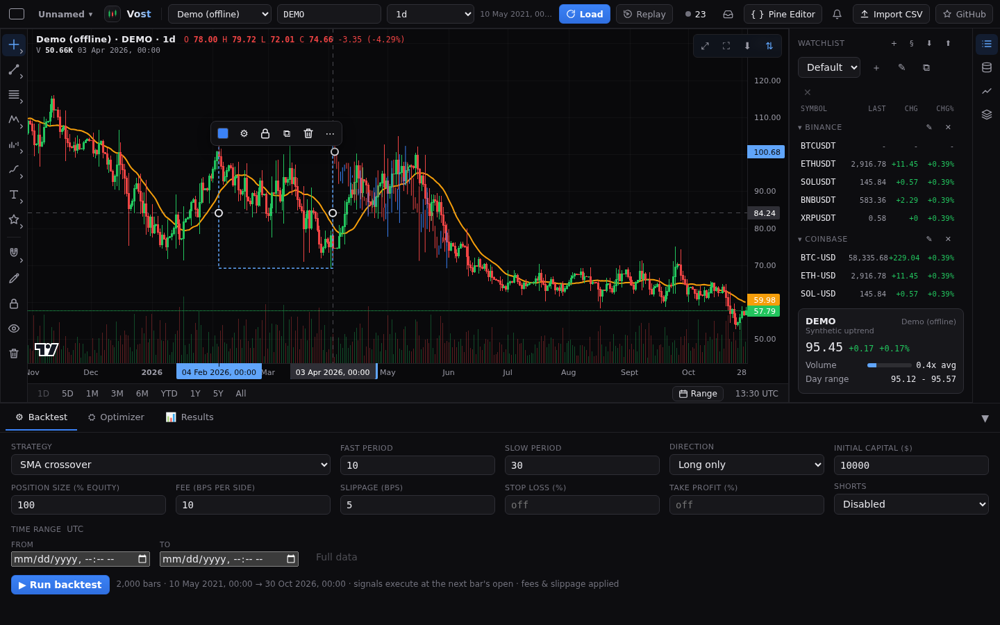

Click it to select: a handle shows at each of the three points. The first two move the run (and so what is copied); the third moves the copy - its time is the copy's first bar and its price the copy's first open. Drag the frame or a copied bar to move all three points together.

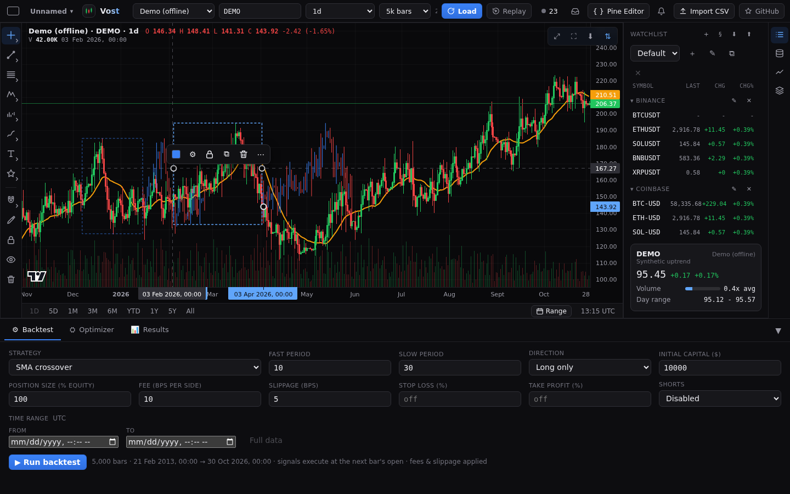

Double-click for settings (defaults in brackets):

- **Colour** (the accent blue) and **Down colour** (red): copied bars that rise use the first, bars that fall the second (after any flipping);
- **Opacity** (1);
- **Display mode** (HL bars): HL bars, OC bars, or a line through the open, high, low or close;
- **Mirrored** (off): the copy runs backwards in time, with each bar's open and close swapped so it still reads as one continuous series;
- **Flipped** (off): prices turned upside down around the copy's first open. Both may be on.

plus the Coordinates and Visibility tabs.

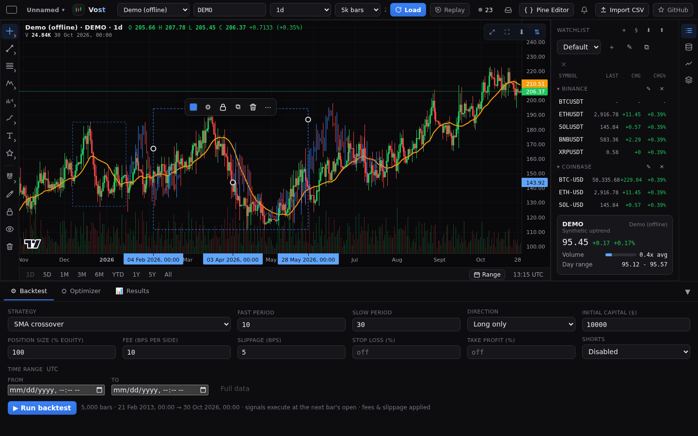

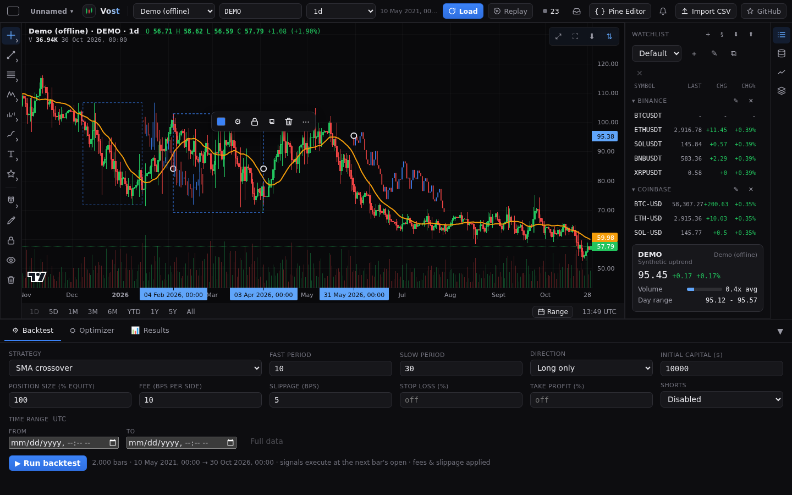

## Ghost feed

A ghost feed is bars you draw by hand into the future, to sketch a scenario. Pick **Ghost feed** and click each point in turn (a tap on a phone); the bars up to the pointer show as you go. End it with a double-click, **Enter**, or a click on the first point; it takes up to 100 points. Between each two points there is one bar for every bar slot between them: the bars step along the straight line from one price to the next, each opening where the last closed, with a body and wicks that vary around the average height.

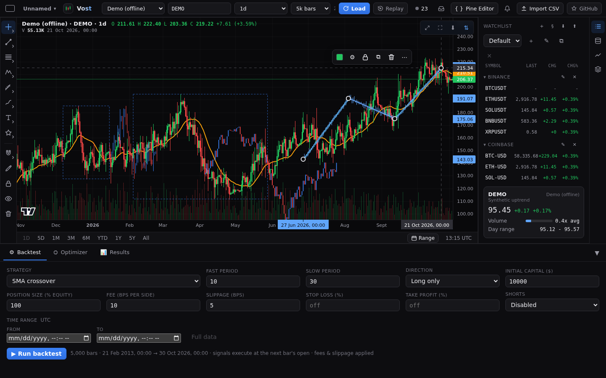

The bars are not random each time: they come from a generator seeded by the two points of each segment, so the same points always give the same bars, and moving one point changes only the two segments next to it.

Click it to select: a handle shows at every point and a dashed line joins them. Drag a handle to move that point or the body to move them all.

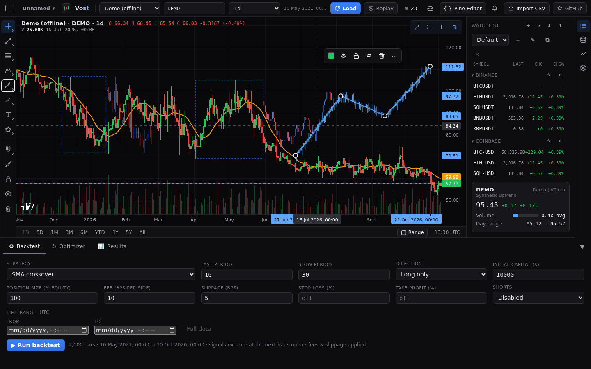

Settings (defaults in brackets): **Up colour** (green), **Down colour** (red), **Border colour** (grey), **Opacity** (0.6), **Average height** (300 ticks - the instrument's tick size times this number, or price units when the chart has no tick size) and **Variance** (50 percent; 0 gives bars of exactly the average height, 100 lets a bar's height range from nothing to twice the average), plus Coordinates and Visibility. A bar is never shorter than its body.

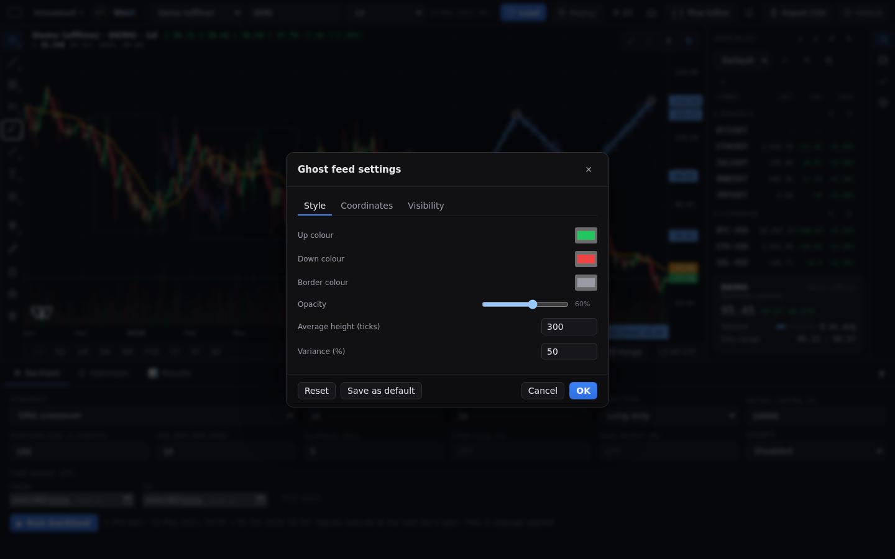

Bars patterns and ghost feeds are saved in your browser and survive a reload, a zoom, a pan and a timeframe change; **Ctrl+Z** and **Ctrl+Shift+Z** undo and redo every change.

## Measurers

Three saved tools measure between two points. Pick one and drag, or click then click (on a narrow screen, tap twice); a preview follows the pointer. Select it to see a handle at each point and its prices or times on the axes.

- **Price range**: a box across the two points' time span with an arrow from the first price to the second. The label gives the change, the percent and the change in ticks (left out when the symbol has no tick size). It sits below the box when the move is down and above it when up.
- **Date range**: a box across the two points' price span with an arrow from the first time to the second. The label gives the bar count (negative when the second point is earlier), the elapsed time and **Vol**, the volume of the loaded bars from the earlier time to the later one, both included.
- **Date and price range**: the box with both arrows and one label: change, percent and ticks, then bars and elapsed time, then volume.

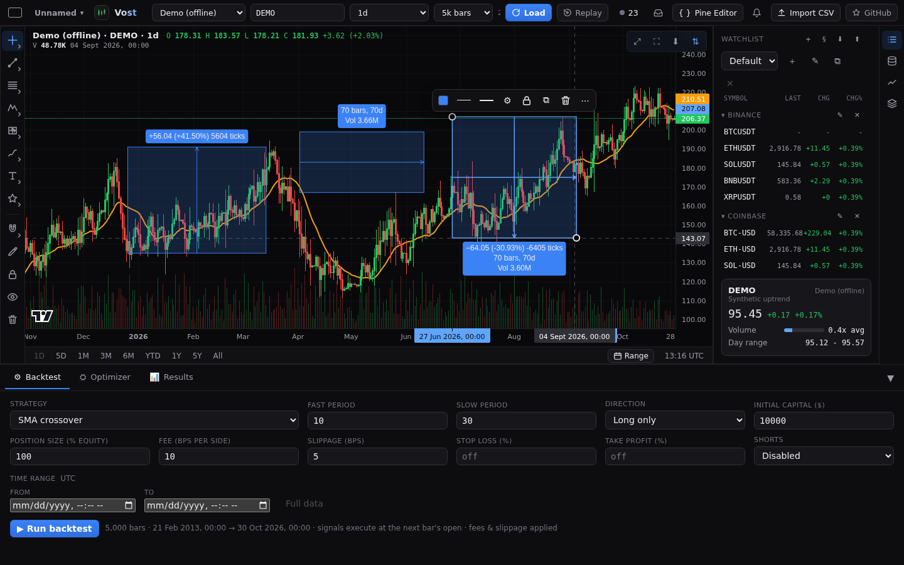

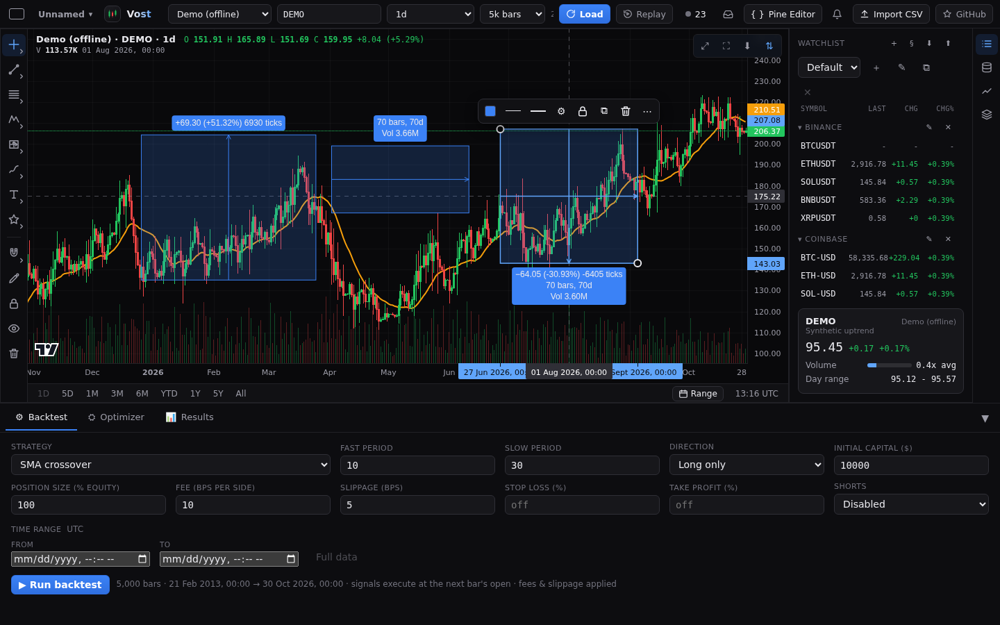

Settings: **Line colour**, **Line width**, **Line style**, **Background** (on or off), **Background colour** and **Background opacity**, **Text colour**, **Font size** and **Label background** with its colour. The Price range adds **Extend left** and **Extend right** and the Date range **Extend top** and **Extend bottom**, which stretch the box's edges to the pane edge. The colours do not change with the direction of the move.

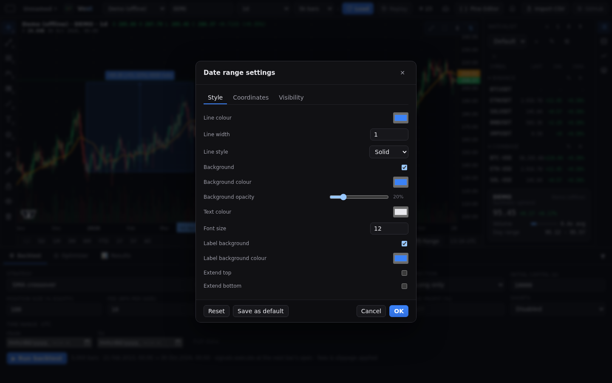

Range tools are saved in your browser, survive a reload, a zoom, a pan and a timeframe change, and take part in undo and redo.
