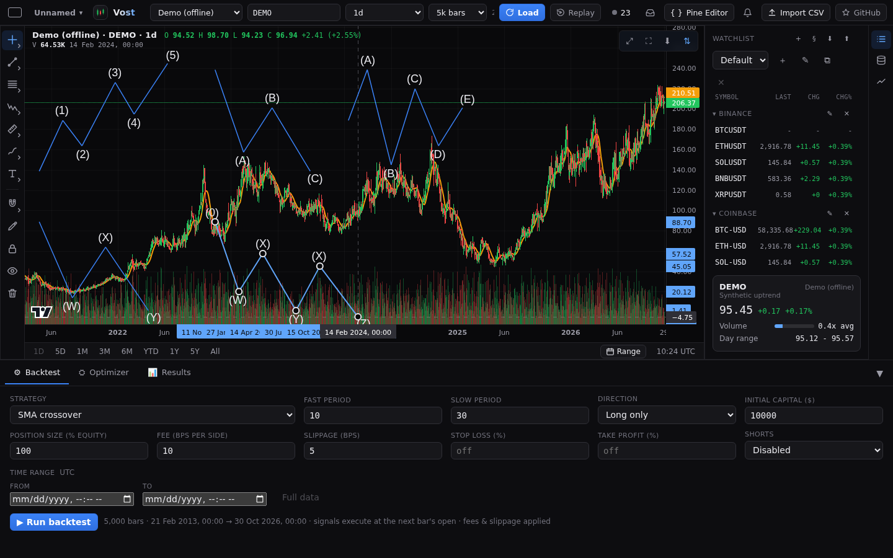
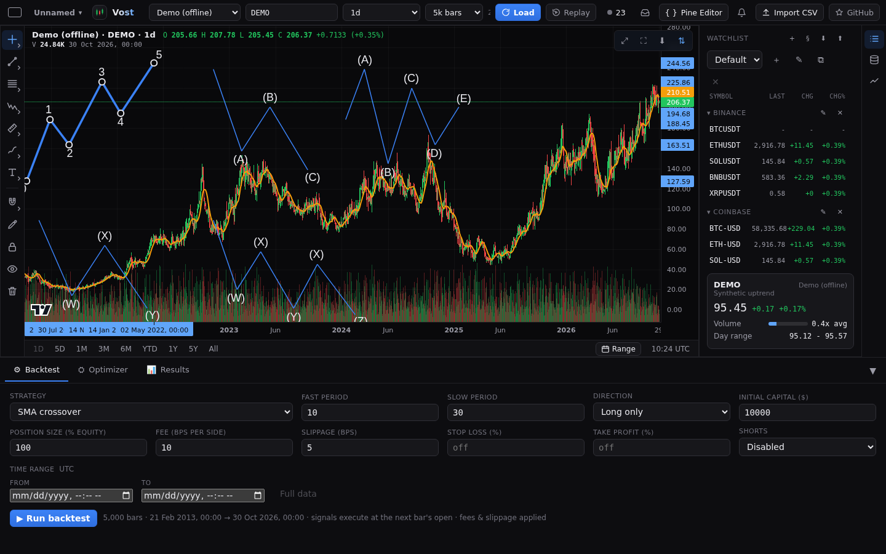
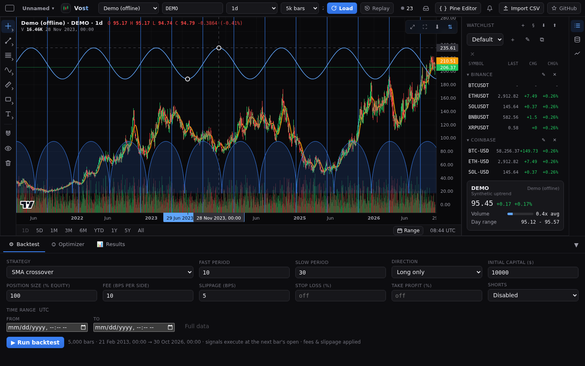

# Chart patterns

The **Patterns** family of the [drawing rail](drawings.md) holds six pattern tools in its **Chart patterns** section: **XABCD pattern** (5 points X A B C D), **Cypher pattern** (5 points X A B C D), **ABCD pattern** (4 points A B C D), **Head and shoulders** (7 points), **Triangle pattern** (4 points A B C D) and **Three drives** (7 points). Its **Cycles** section holds the two-point [cycle tools](#cycle-tools): **Cyclic lines**, **Time cycles** and **Sine line**.

## Placing a pattern

Pick the tool, then click the points one by one (or tap them on a phone). Each click places the next point and the following point moves with the pointer, so you see the legs and labels as you go. You can also press, drag and release for the first leg, then click the rest. The last point finishes the drawing and selects it. Escape cancels.

## What is drawn

- The legs through the points, a letter beside each point (away from the shape) and dashed ratio lines with their ratio as a plain number with 3 decimals. A ratio is the price move of one leg divided by another's.
- XABCD: ratios AB/XA (X to B), BC/AB (A to C), CD/BC (B to D) and AD/XA (X to D); the triangles XAB and BCD are filled.
- Cypher: ratios AB/XA (X to B), XC/XA (X to C) and CD/XC (X to D); the same two triangles are filled.
- ABCD: ratios BC/AB (A to C) and CD/BC (B to D); no fill.
- Head and shoulders: the seven points are the start, left shoulder, left neck, head, right neck, right shoulder and end. The labels are the words "Left Shoulder", "Head" and "Right Shoulder". The neckline runs through the two neck points and ends where it meets the outer legs (or at the first and last point's time when it does not), and fills the left shoulder, the head and the right shoulder. No ratios.
- Triangle pattern: the zigzag A B C D plus the lines A-C and B-D. When the two lines meet to the right of C and D inside the chart, both run to that apex and the triangle A B apex is filled; otherwise the lines end at C and D and the quadrilateral A C D B is filled. No ratios.
- Three drives: the seven points are the start, drive 1, retracement A, drive 2, retracement C and drive 3, then the end; the labels are 1, A, 2, C and 3. The dashed ratio lines show A (start to A), drive 2 (drive 1 to drive 2), C (A to C) and drive 3 (drive 2 to drive 3), each as one leg divided by the previous one. No fill.
- A ratio whose divisor leg has no price move is left out.

## Editing and settings

Select a pattern to see a handle on every point and the price and time of each point on the axes. Drag a handle to move that point only, or drag a leg or fill to move the whole pattern. Double-click it for its settings: line colour, width and style, and (XABCD, Cypher, Head and shoulders and Triangle pattern) fill colour and opacity on the **Style** tab, with a **Background** switch for the Triangle pattern; the label text colour and size, and **Show ratios** (all but Head and shoulders and Triangle pattern), on the **Text** tab. Patterns are saved with the chart.

## Elliott waves

The **Elliott waves** section of the **Patterns** family holds five tools: **Elliott impulse wave** (6 points: the origin and waves 1 to 5), **Elliott correction wave** (4 points: the origin and A B C), **Elliott triangle wave** (6 points: the origin and A to E), **Elliott double combo wave** (4 points: the origin and W X Y) and **Elliott triple combo wave** (6 points: the origin and W X Y X Z). Place them point by point like the chart patterns: each click places the next point and the following point moves with the pointer; Escape cancels.

- The lines join the points in order and each wave's label sits beside its point, above a peak and below a trough. The origin point has no label.
- **Wave degree** (on the **Style** tab) sets the notation of the labels, using TradingView's 15 degrees from the largest to the smallest: Supermillennium, Millennium, Submillennium, Grand Supercycle, Supercycle, Cycle, Primary, Intermediate (the default), Minor, Minute, Minuette, Subminuette, Micro, Submicro and Minuscule. They go in threes: the smallest of a three is plain, the middle one is in (brackets) and the largest is in a circle. An impulse is numbered 1 to 5 from Minor up to Primary, in lower case Roman (i to v) from Subminuette to Minute, in upper case Roman (I to V) from Cycle to Grand Supercycle, and in Arabic again from Submillennium up (and in Micro and below). The other tools use letters, lower case in the same three groups as the Roman ones. Larger groups are drawn in a larger font. The origin shows as 0 while the drawing is hovered or selected. Changing the degree relabels the drawing at once. The degree list, notation and default were checked against TradingView's Advanced Charts documentation and line-tool bundle on 2026-10-30.
- Select a wave to see a handle on every point; drag a handle to move that point, or a line to move the whole drawing. The settings are the line colour, width and style, the wave degree, and the label text colour and size, plus the Coordinates and Visibility tabs. Waves are saved with the chart.

## Cycle tools

The **Cycles** section holds three tools placed with two points, like a trend line: click twice, tap twice, or press, drag and release. Handles sit on the two points; drag a handle to change the period, or the body to move the drawing. Each repeats across the whole chart, to the left and right of the points, and the selected drawing shows its time labels on the time axis.

- **Cyclic lines**: full-height vertical lines at point 1 and at every whole multiple of the distance from point 1 to point 2, in both directions. The settings are colour, width and line style.
- **Time cycles**: a row of half arcs on point 1's price line, each as wide as the distance between the points. The height of the arcs follows point 2's vertical offset, so they bulge up or down toward point 2. The settings are colour, width, line style, and a background fill (on by default) with its colour and opacity.
- **Sine line**: a sine wave with a peak or trough at point 1 and the opposite extreme at point 2, half a period away; the price difference sets the amplitude. The settings are colour, width and line style.

Like every drawing, they have the Coordinates and Visibility tabs and are saved with the chart.
