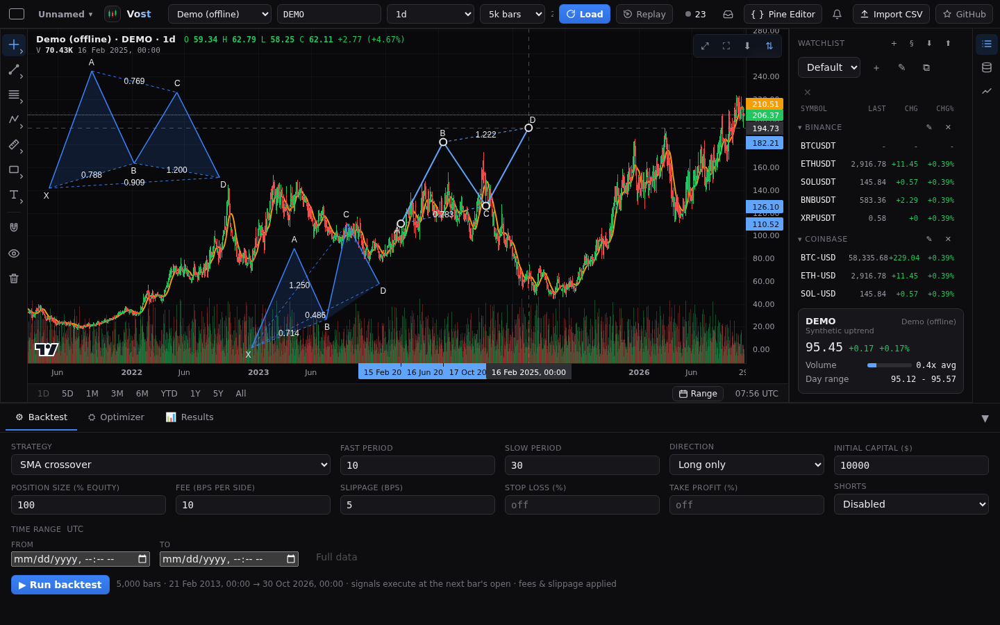
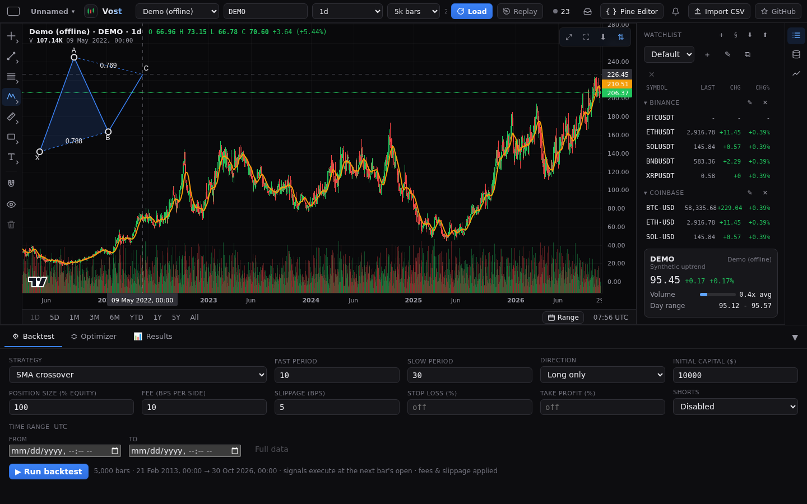
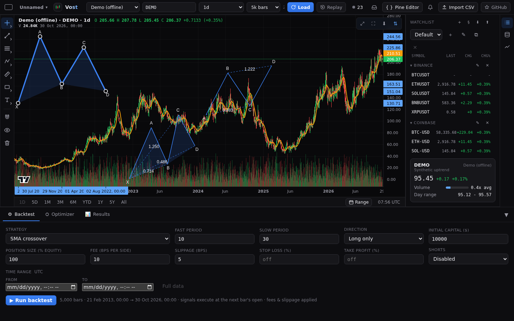

# Chart patterns

The **Patterns** family of the [drawing rail](drawings.md) holds three harmonic-pattern tools in its **Chart patterns** section: **XABCD pattern** (5 points X A B C D), **Cypher pattern** (5 points X A B C D) and **ABCD pattern** (4 points A B C D).

## Placing a pattern

Pick the tool, then click the points one by one (or tap them on a phone). Each click places the next point and the following point moves with the pointer, so you see the legs and labels as you go. You can also press, drag and release for the first leg, then click the rest. The last point finishes the drawing and selects it. Escape cancels.

## What is drawn

- The legs through the points, a letter beside each point (away from the shape) and dashed ratio lines with their ratio as a plain number with 3 decimals. A ratio is the price move of one leg divided by another's.
- XABCD: ratios AB/XA (X to B), BC/AB (A to C), CD/BC (B to D) and AD/XA (X to D); the triangles XAB and BCD are filled.
- Cypher: ratios AB/XA (X to B), XC/XA (X to C) and CD/XC (X to D); the same two triangles are filled.
- ABCD: ratios BC/AB (A to C) and CD/BC (B to D); no fill.
- A ratio whose divisor leg has no price move is left out.

## Editing and settings

Select a pattern to see a handle on every point and the price and time of each point on the axes. Drag a handle to move that point only, or drag a leg or fill to move the whole pattern. Double-click it for its settings: line colour, width and style, and (XABCD and Cypher) fill colour and opacity on the **Style** tab; the label text colour and size, and **Show ratios**, on the **Text** tab. Patterns are saved with the chart.

