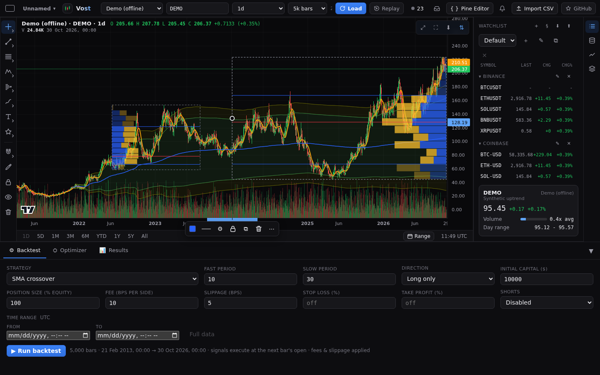
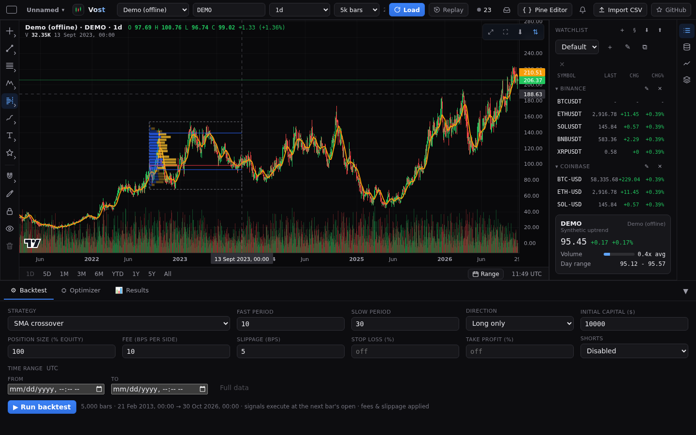
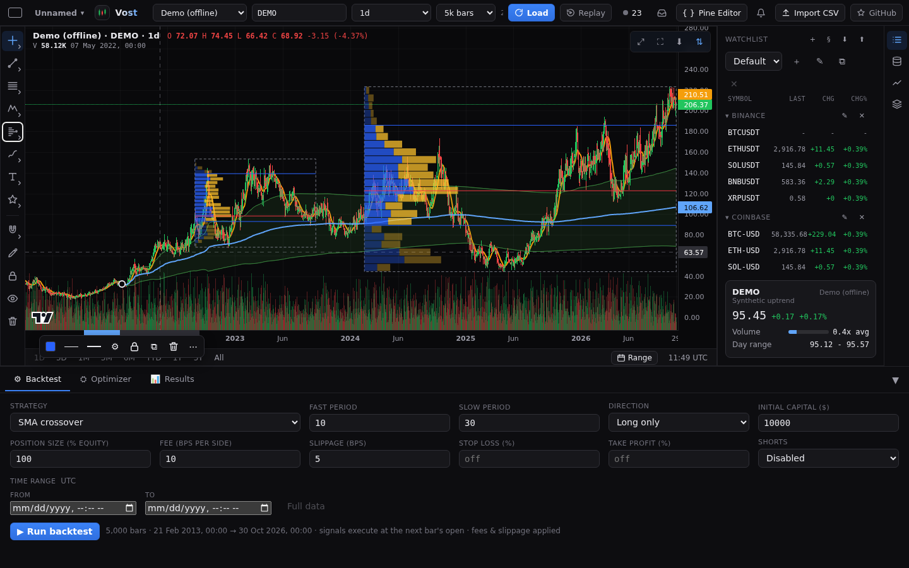
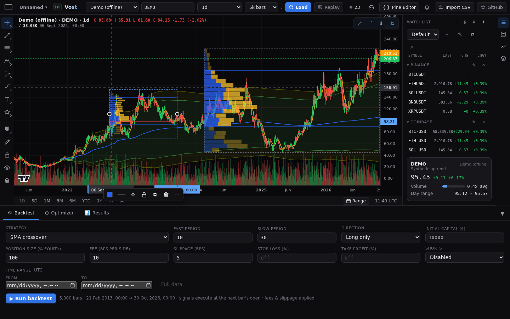
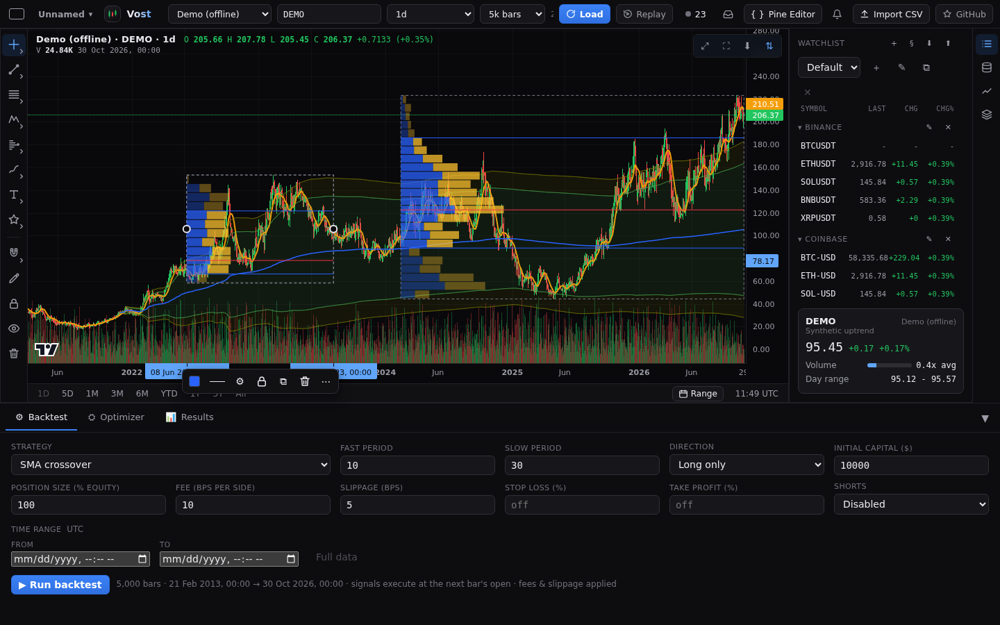

# Volume-based tools

The **Forecasting and measurers** family of the [drawing rail](drawings.md) holds three tools in its **Volume-based** section, ahead of the Measure: **Anchored VWAP**, **Fixed range volume profile** and **Anchored volume profile**. They are worked out from each bar's traded volume, so they follow live bars and a change of timeframe on their own. A bar with no volume counts as zero volume.

## Placing them

Pick a tool from the flyout (the Volume-based heading), then click the chart (or tap it on a phone). Anchored VWAP and Anchored volume profile take one point. Fixed range volume profile takes two: click twice, or press, drag and release; a preview follows the pointer until the second point is placed, and Escape cancels. A point always sits on a whole bar. Dragging a point or the whole drawing changes only the time, never the price, and the magnet snaps the time to a bar.

A selected drawing shows its handles, the time of each point on the time axis and, on the price axis, the last VWAP value or the point of control. Press any part of the drawing to select it: the VWAP and its bands, or the histogram rows, the point of control and the outline of a profile.

## Anchored VWAP

The volume-weighted average price from the anchor bar to the last loaded bar: the sum of price times volume divided by the sum of volume. Bars before the first bar with volume draw nothing. Its handle sits on the line at the anchor bar. If the anchor is outside the loaded bars (for example after a switch to a timeframe that has not loaded that far back) nothing is drawn.

Settings:

- **VWAP colour, opacity, width and line style**.
- **Source**: the price used for each bar (close, open, high, low, hl2, hlc3 - the default - or ohlc4).
- **Band 1, 2 and 3**: each band is VWAP plus and minus a number of standard deviations (1, 2 and 3 to begin with; the multiplier is editable). Band 1 is on to begin with, the others off. Each has its own colour and a **fill** switch, and **Band fill opacity** sets the shading. The defaults follow TradingView's Anchored VWAP.

## Fixed range volume profile and Anchored volume profile

A histogram of the volume traded at each price level. Fixed range volume profile covers the bars between its two points (either order). Anchored volume profile covers the bars from its point to the last loaded bar, so it grows as new bars arrive. The price range is cut into rows; each bar's volume is shared over the rows its high-to-low range covers, in proportion to the overlap. A red line marks the **point of control** (the row with the most volume) and two lines mark the **value area**, the rows around it holding a set share of the volume. A dashed outline shows the range.

Both tools share these settings (defaults follow TradingView's volume profile):

- **Rows layout** and **Row size**: a Number of rows (24 to begin with) or Ticks per row (a tick is the price step of the bars).
- **Volume**: Up/Down, which splits each row into up volume (the bar closed at or above its open) and down volume, or Total.
- **Value area volume (%)**: 70 to begin with. The area grows out from the point of control, each time taking the larger neighbouring row, until it holds at least that share.
- **Histogram width (% of range)** and **Placement**, left or right.
- Colours and opacity of the up and down volume, inside and outside the value area.
- **Point of control**: show, colour, width and **Extend point of control right**.
- **Value area high and low** lines: show and colour, and the outline colour.

All three tools are saved with the chart, survive a reload, zoom, pan and timeframe change, and support undo and redo like any other drawing. The [Visibility](drawings.md) tab limits them to some timeframes.
