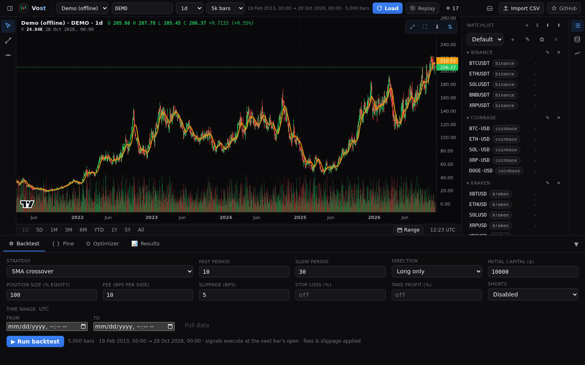
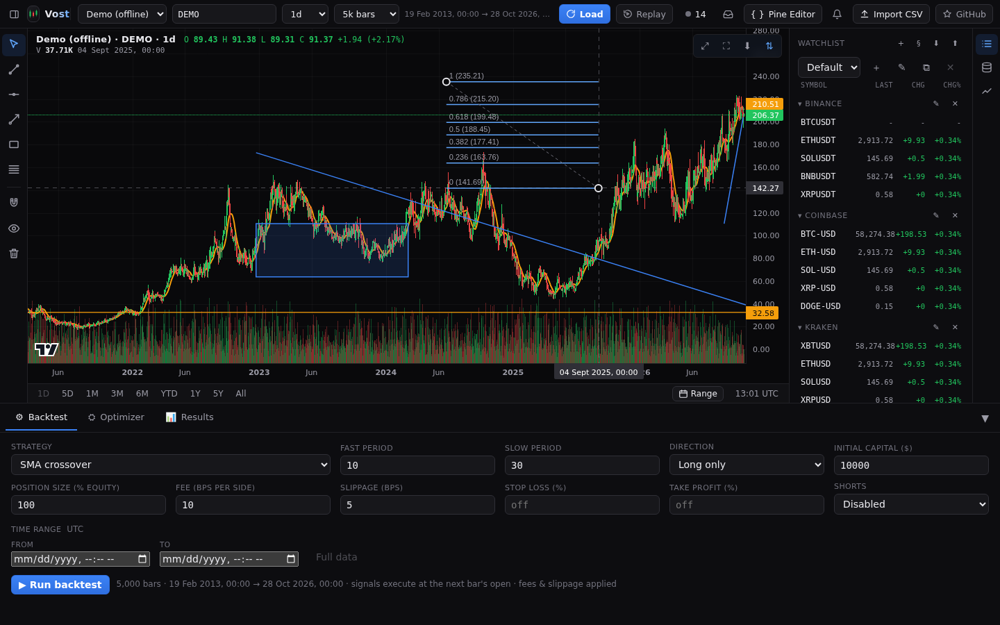
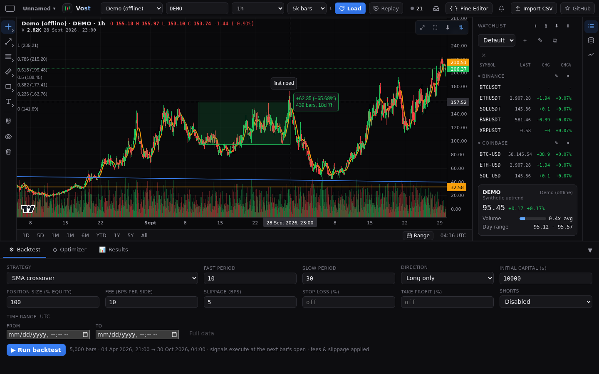
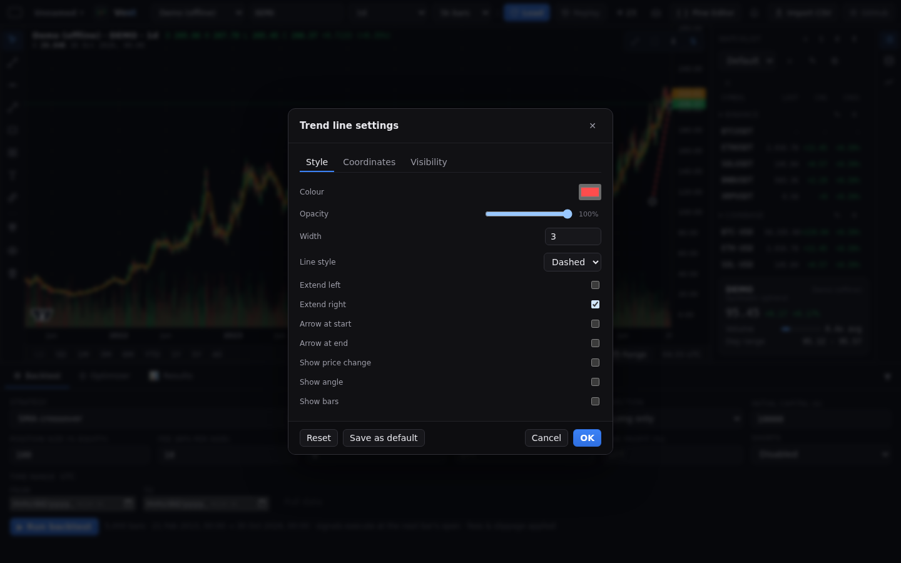
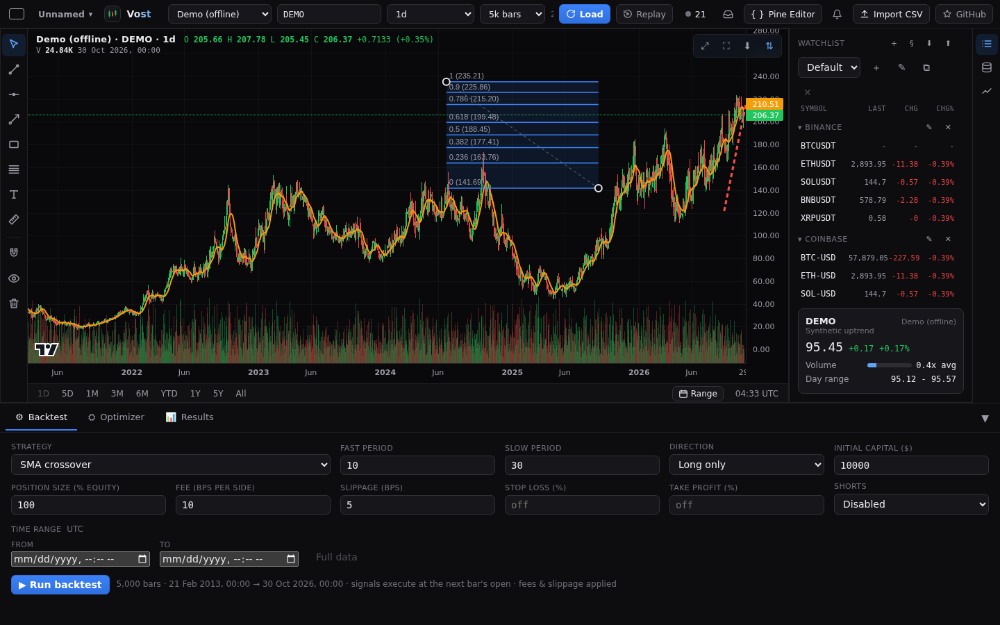
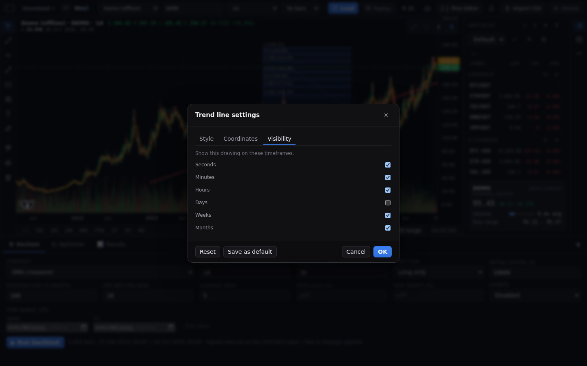
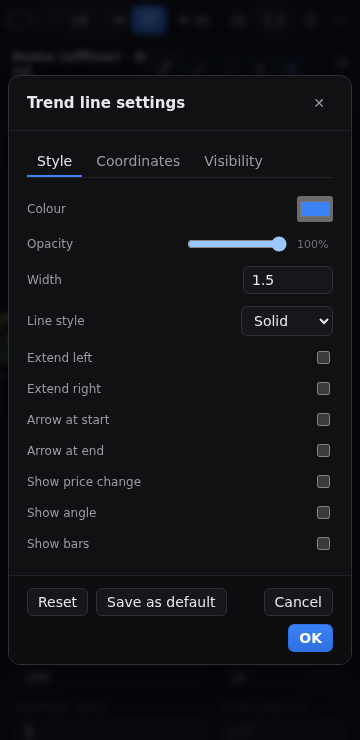
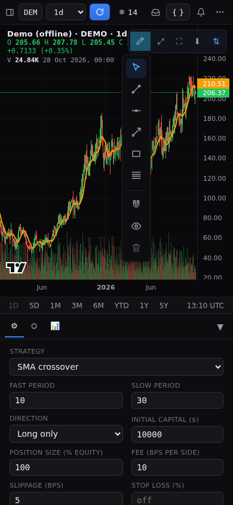

# Drawings

A rail beside the chart holds the drawing tools.

## Tools

- **Cursor**: select, move and resize drawings.
- **Trend line**, **Horizontal line**, **Ray**, **Rectangle** and **Fibonacci retracement**: pick a tool, then click two points on the chart (or press, drag and release).
- **Text**: click the chart and type a note in place. Enter saves, Escape cancels. Double-click a note to edit it.
- **Measure**: drag, or click then click, between two points to see the price change, percent, bars and elapsed time in a shaded box (green up, red down). It is temporary: never saved, not in undo, and it clears on the next press, Escape or a rail pick.

## Working with drawings

Click a drawing to select it, drag to move it and drag a handle to resize it. Delete or Backspace removes the selected drawing. **Ctrl or Cmd+Z** undoes, **Ctrl or Cmd+Shift+Z** (or Ctrl+Y) redoes, Escape leaves the tool or clears the selection. With several charts these keys act on the active chart only ([Layouts](layouts.md)).

The rail also has:

- **Magnet**: snaps points to the nearest bar's time and its open, high, low or close (a horizontal line snaps price only).
- **Hide all drawings**: hides every drawing without deleting it.
- **Delete all drawings**: after a confirm, deletes all drawings for the current source. One undo step brings them back.

The rail scrolls when the window is short.

## Settings

Double-click a drawing (a note opens its text editor instead) to open its settings. Changes show on the chart as you make them; **OK** keeps them all as one undo step, and **Cancel** or Escape puts the drawing back as it was.

- **Style**: each tool has its own settings, as on TradingView.
  - Trend line and ray: colour, opacity, width, solid, dashed or dotted, extend left and right, an arrow at either end, and price change, angle and bars.
  - Horizontal line: colour, opacity, width, line style, and the price label on the axis with its colour.
  - Rectangle: border colour, width and style, fill colour and opacity, extend left and right.
  - Fibonacci retracement: edit, add (up to 24), remove, colour and switch off each level, show prices and levels, reverse, extend lines and a background between levels.
  - Text: colour, size, bold, italic, background and border.
- **Text**: the text of a note.
- **Coordinates**: the price and time (unix seconds) of each point. A value that is not a number is refused.
- **Visibility**: the timeframe kinds (seconds, minutes, hours, days, weeks, months) that show the drawing. A drawing hidden on the current timeframe is neither drawn nor clickable.

**Save as default** keeps the dialog's style as the starting style of that tool for new drawings, and **Reset** returns the drawing to the tool's defaults. A drawing you have not styled looks as it always did and follows the theme.

The dialog fits a phone screen.

## Where they are saved

Drawings are saved per symbol in your browser, and keep their place across zoom, timeframe changes and live bars. Charts on the same market share their drawings. Drawings saved by an older version are carried over, and drawings from a newer version (a tool or a setting this version does not know) are kept as they are and written back unchanged, though this version does not show them.

## On phones

Below 600px the chart toolbar has a **Drawing tools** button that opens the same tools. Tap, tap places a line. One-finger pan and pinch zoom work as before in cursor mode.

