# Drawings

A rail beside the chart holds the drawing tools, one button per family of tools.

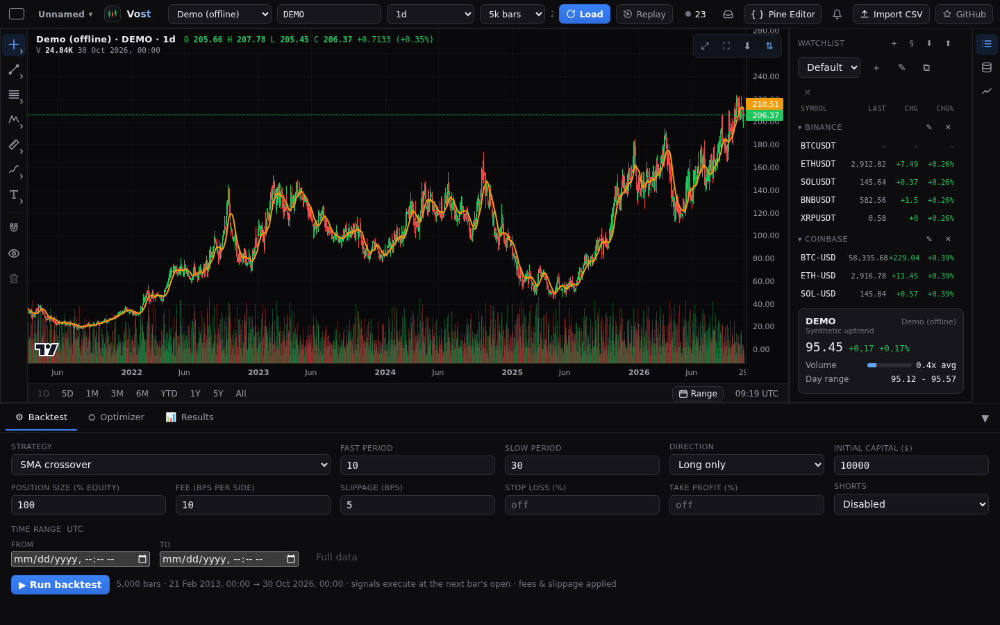

## Families and pop-out lists

Each button shows the tool you used last from its family (the first one at first). Click it to pick that tool. The button is pressed while the current tool is in its family. The families are Cursors, Lines, Fibonacci and Gann (with Fibonacci and Gann headings), Forecasting and measurers, Shapes (with Brushes and Shapes headings) and Annotations; more appear as more tools arrive.

Open a family's list with the small chevron on its button, a long press (half a second) or **ArrowRight** while the button has focus. The list groups tools under headings. Click a tool to pick it, which also makes it the family's button. Only one list is open at a time. An outside click or resizing the window closes it.

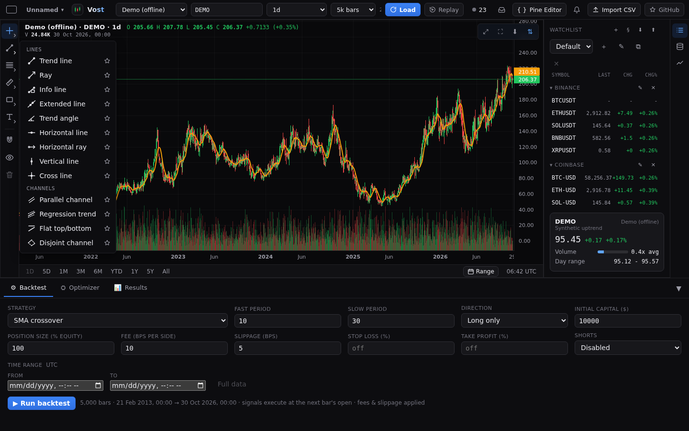

From the keyboard: **ArrowUp** and **ArrowDown** move (wrapping), **Home** and **End** jump, **Enter** or **Space** picks, **F** stars or unstars the tool in focus, and **Escape** or **ArrowLeft** closes the list and puts focus back on the family's button.

## Favourites

Click the star beside a tool to favourite it; the list stays open. Favourites show on a small bar floating over the chart (only the active chart), one button per favourite in the order you starred them. Drag the grip at its left to move it anywhere on the chart; it stays inside the chart, also when the window is resized. Your favourites, each family's last tool and the bar's place are remembered.

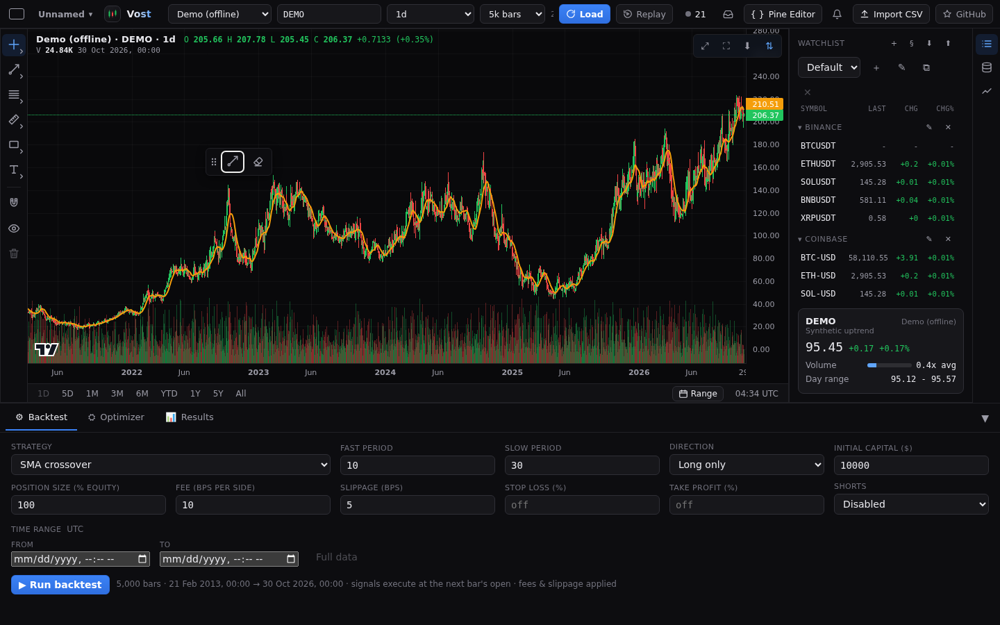

## Tools

- **Cursors**: select, move and resize drawings. **Cross** is the usual crosshair. **Dot** and **Arrow** hide the crosshair lines (the price and time labels stay) and show a small dot or the plain arrow instead. The kind you pick is remembered.
- **Eraser**: a press on a drawing deletes it (one undo step), a press on empty chart does nothing, and the pointer over a drawing shows it will be erased. It is off while drawings are hidden. Escape goes back to the cursor.
- **Trend line**, **Ray**, **Info line**, **Extended line**, **Trend angle**, **Rectangle** and **Fibonacci retracement**: pick a tool, then click two points on the chart (or press, drag and release). The info line labels its price change, bars, angle and distance, the extended line continues both ways to the edge of the chart, and the trend angle draws an arc with its angle in degrees and a dotted horizontal from the first point.
- **Fib time zone**, **Fib speed resistance fan**, **Fib circles**, **Fib spiral** and **Fib speed resistance arcs**: two points each, like the retracement. **Trend-based fib extension**, **Fib channel**, **Trend-based fib time**, **Fib wedge** and **Pitchfan** take three points, like the pitchforks (see [Fibonacci tools](drawing-fib-gann.md)).
- **Gann box**, **Gann square fixed**, **Gann square** and **Gann fan**: two points each, under the Gann heading of the same family (see [Fibonacci and Gann tools](drawing-fib-gann.md#gann-tools)).
- **XABCD pattern**, **Cypher pattern**, **ABCD pattern**, **Head and shoulders**, **Triangle pattern** and **Three drives**: click four to seven points one by one (see [Chart patterns](drawing-patterns.md)).
- **Elliott impulse wave** (6 points), **Elliott correction wave** (4), **Elliott triangle wave** (6), **Elliott double combo wave** (4) and **Elliott triple combo wave** (6): click the points one by one (see [Elliott waves](drawing-patterns.md#elliott-waves)).
- **Cyclic lines**, **Time cycles** and **Sine line**: click two points, like a trend line; the pattern repeats across the chart (see [Cycle tools](drawing-patterns.md#cycle-tools)).
- **Horizontal line**, **Horizontal ray**, **Vertical line** and **Cross line**: pick a tool and click once. The horizontal ray runs from the point to the right edge, the vertical line spans the full height and the cross line is a horizontal and a vertical line through the point. A vertical line only moves in time: dragging it keeps its price.
- **Parallel channel**, **Regression trend**, **Flat top/bottom** and **Disjoint channel** (the Channels section of the Lines list):
  - Parallel channel takes three points. The first two set a line, the third sets how far the second, parallel line is from it. A dashed middle line and a fill sit between them, and both lines can extend left and right. Dragging an end keeps the lines parallel; the handle in the middle of the second line sets the gap.
  - Regression trend takes two points. It fits a straight line to the chosen price (close, open, high, low, hl2, hlc3 or ohlc4) of the bars between them, and draws a line above and below it at the chosen number of standard deviations (2 to begin with), with a fill. It follows the bars as they change and can extend left and right. With fewer than two bars between the points it draws nothing.
  - Flat top/bottom takes three points: a sloped edge from the first two and a flat edge at the third point's price, filled between.
  - Disjoint channel takes three points: a first edge from the first two, and a second edge that starts at the third and mirrors the first edge's rise, so the two edges are not parallel. They are filled between.
  - Three-point drawings are placed with three clicks or taps, or press, drag and release for the first two and then a click or tap. Each placed point stays, a preview follows the pointer for the next one, and Escape cancels the drawing.
- **Brush** and **Highlighter** (the Brushes section, at the top of the Shapes list; the Shapes button shows Brush until you pick another tool): press, drag and release to draw a freehand stroke, with a live preview, on a mouse, a pen or one finger (a second finger cancels the stroke and the chart takes the pinch). A stroke that barely moves is not saved and the tool stays picked; Escape cancels one in progress. Strokes are thinned when you let go, to at most 200 points, and follow zoom, pan and timeframe changes.
  - Brush has colour, opacity, width (up to 10), smoothing (0 to 20, 5 to begin with; it only changes how the saved stroke is drawn, so you can change it later) and an optional fill, shown when the stroke ends close to where it started. Highlighter is a wide translucent stroke (yellow, width 20, from 5 to 40) with round ends.
  - A stroke has no point handles: click it to select it, drag it to move the whole stroke, and open Settings with a double-click.
  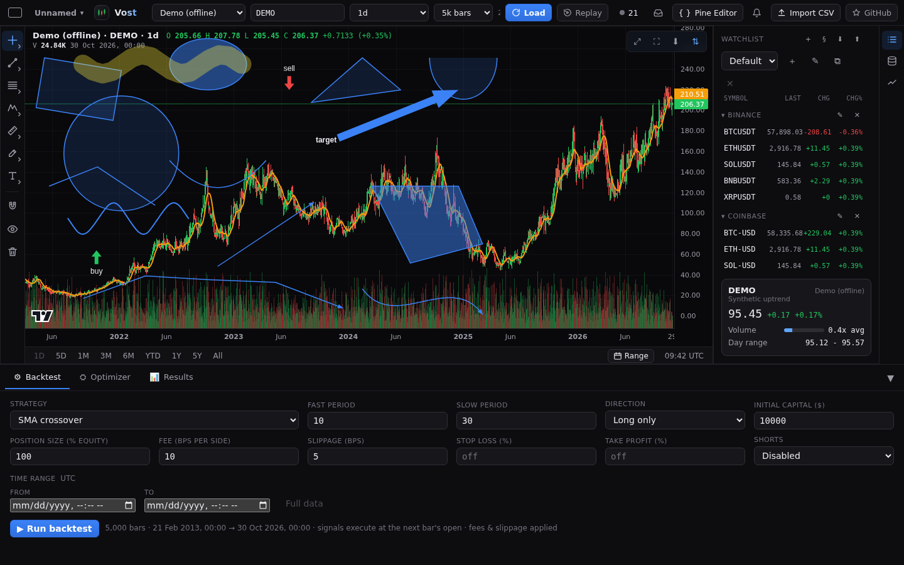
- **Circle**, **Arrow**, **Arrow marker**, **Arrow mark up**, **Arrow mark down**, **Path**, **Polyline**, **Rotated rectangle**, **Ellipse**, **Triangle**, **Arc**, **Curve** and **Double curve** (the Shapes list, after Rectangle):
  - Circle takes two points: the centre, then a point on its edge. It stays round at any zoom. Drag the centre handle to move it and the edge handle to change its radius. Its fill is clickable while the fill opacity is above 0.
  - Arrow is a line with an arrow head at its second point (Arrow at end in Settings; the other line settings work too).
  - Arrow marker takes two points, tail then tip, and draws a filled arrow between them.
  - Arrow mark up and Arrow mark down take one click. The small arrow always sits on a bar's time, however you place or drag it, and its price is free (the magnet still snaps it to a bar's high, low, open or close).
  - Path and Polyline take any number of points, up to 100. Path is an open line (colour, opacity, width, line style, and an arrow at either end); Polyline is a closed shape with a border and a translucent fill, clickable while the fill opacity is above 0. Click to add each point; a line follows the pointer for the next one. End it with a double-click (double tap on a touch screen), Enter, or a click on the first point (a Polyline closes there). Backspace removes the last point and Escape cancels the whole drawing. Ending with too few points (two for a Path, three for a Polyline) saves nothing. Each point has a handle: drag one to move only it, or drag the line to move them all.
  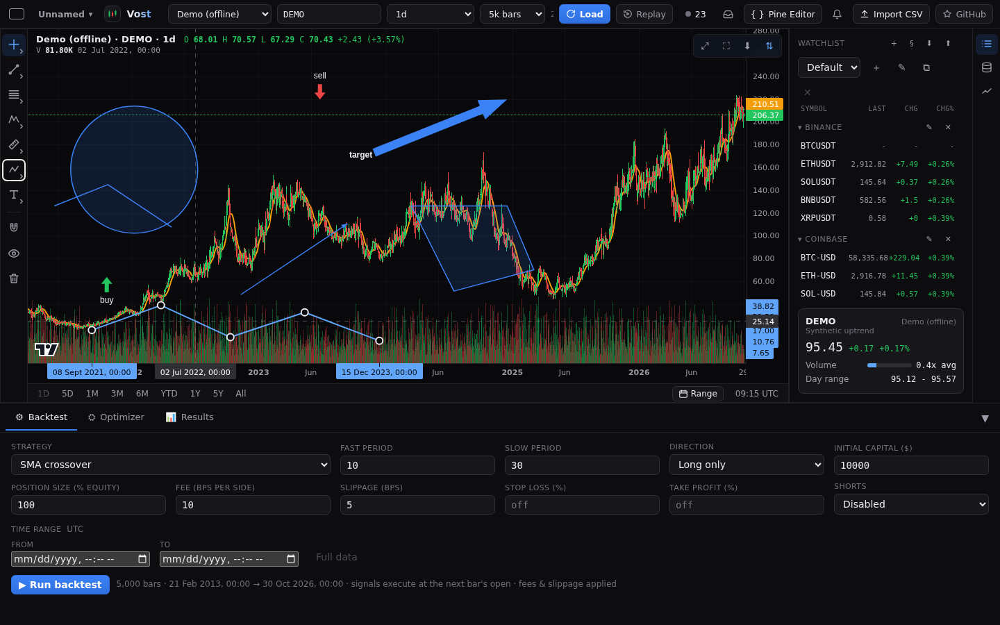
  - **Rotated rectangle**, **Ellipse**, **Triangle**, **Arc**, **Curve** and **Double curve** (after Polyline):
    - Rotated rectangle takes three points: the first two are one side, the third sets the width. It turns with that side. Drag a side end to move it (the width is kept) or the middle of another side to change only the width, so it stays a rectangle.
    - Ellipse takes three points: the first two are the ends of one axis (it turns with the axis), the third sets the other half-axis. The four axis ends have handles; dragging an end of the first axis keeps the other half-axis.
    - Triangle takes three points, one per corner; each handle moves only its corner.
    - Arc takes three points: the first two are its ends, the third sets how far it bulges, on the third point's side. A fill closes it to its chord. Dragging an end keeps the bulge.
    - Curve and Double curve take two points, the start and the end. A new curve starts with a bend (an S for the Double curve) and shows handles at its ends and at its control points: drag a control point to reshape it. Curve and Double curve have the Path's line settings, including arrows at either end.
    - The first three and the arc take the Circle's border and fill settings. While you place any of them a preview follows the pointer; Escape cancels.
  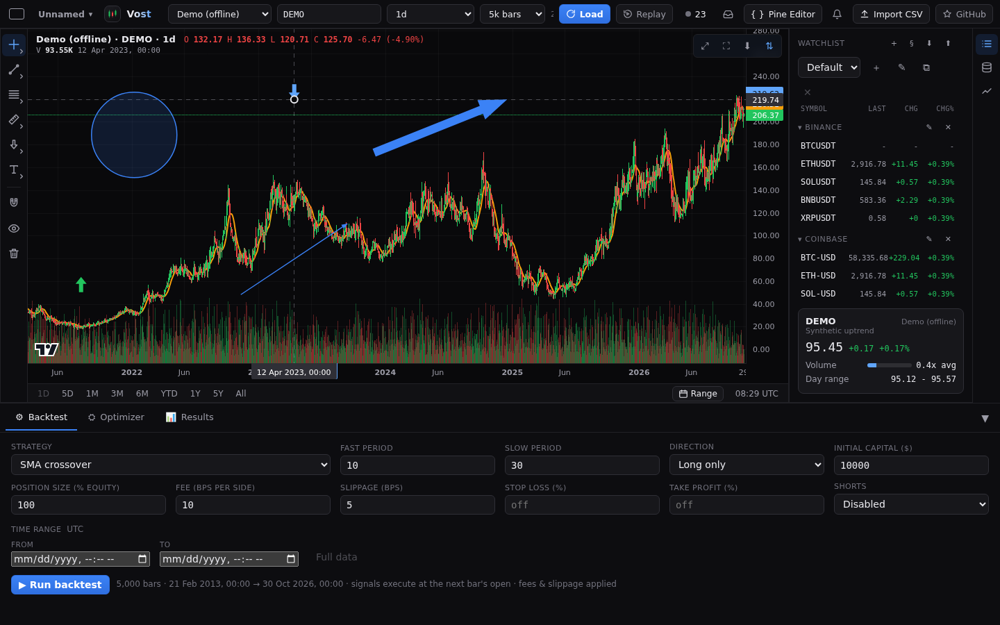
  - The arrow marker and the arrow marks carry an optional label: open Settings, Text tab, and type it there (it can be left empty). The label sits at the marker's tail and beyond a mark's tail.
- **Pitchfork**, **Schiff pitchfork**, **Modified Schiff pitchfork** and **Inside pitchfork** (the Pitchforks section of the Lines list): pick a tool and place three points by clicks or taps, or press, drag and release for the first two and then a click. A median line runs from the first point (Pitchfork), from the middle of the first two points at the first point's time (Schiff), from the middle of the first two points (Modified Schiff) or from the middle of the first two points (Inside, the same origin as Modified Schiff), through the middle of points two and three. Coloured level lines run parallel to the median on both sides, level 1 through points two and three, and a fill sits between neighbouring lines. In the settings, the levels (0.5 and 1 on to begin with) are switched on and off, recoloured, edited, added and removed, the median can be hidden, restyled, the Background turned off, the lines extended backward, and the Style changed to another of the four constructions.
- A selected line shows its price on the price axis and its time on the time axis.
- **Text** and **Anchored text**: click the chart and type a note in place. Enter adds a line, Ctrl+Enter (Cmd+Enter) saves, Escape cancels. Double-click a note to edit it. Anchored text keeps its spot on the pane when the chart moves. The Notes section adds **Note** and **Anchored note** (a pin whose text pops up on hover and stays open after a click), **Callout** (a text box with a pointer to a bar) and **Comment** (a speech bubble). See [Text and notes](drawing-annotations.md).
- **Measure**: drag, or click then click, between two points to see the price change, percent, bars and elapsed time in a shaded box (green up, red down). It is temporary: never saved, not in undo, and it clears on the next press, Escape or a rail pick.

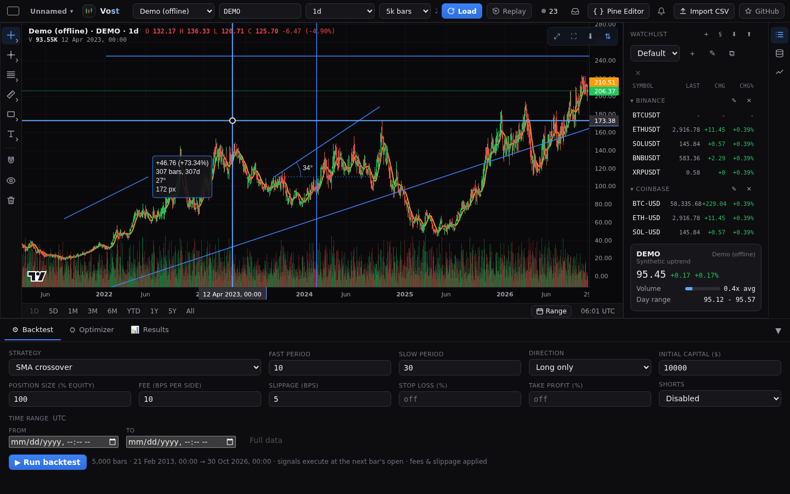

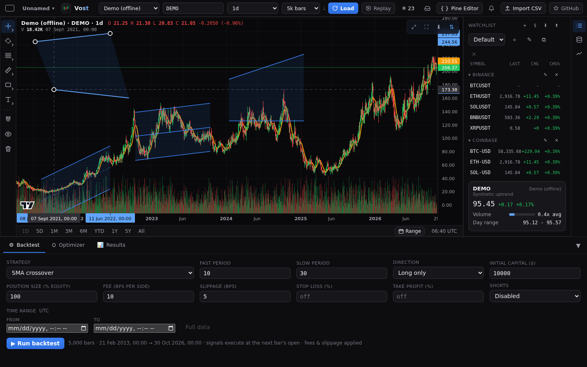

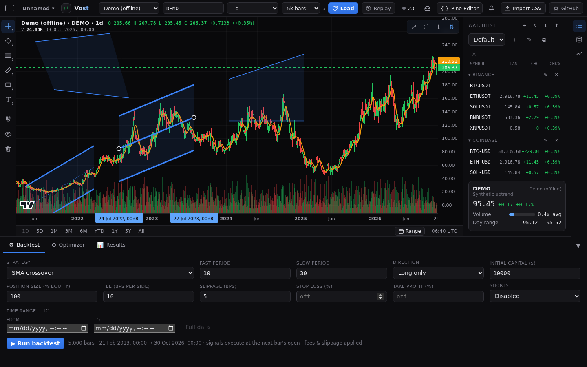

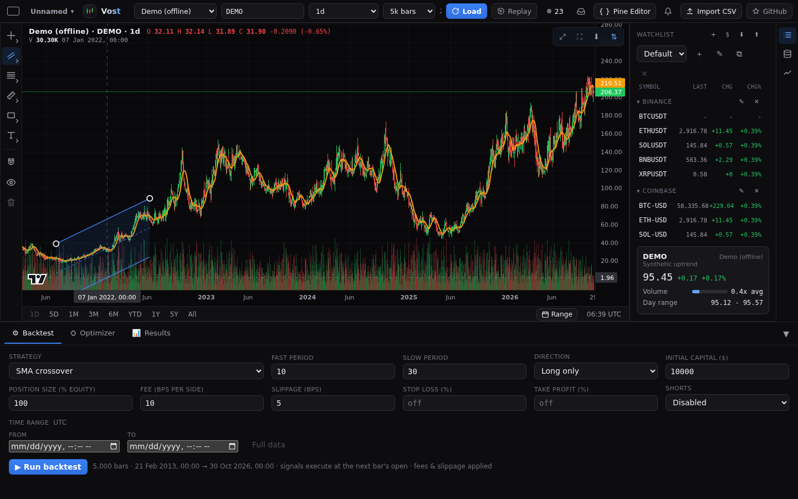

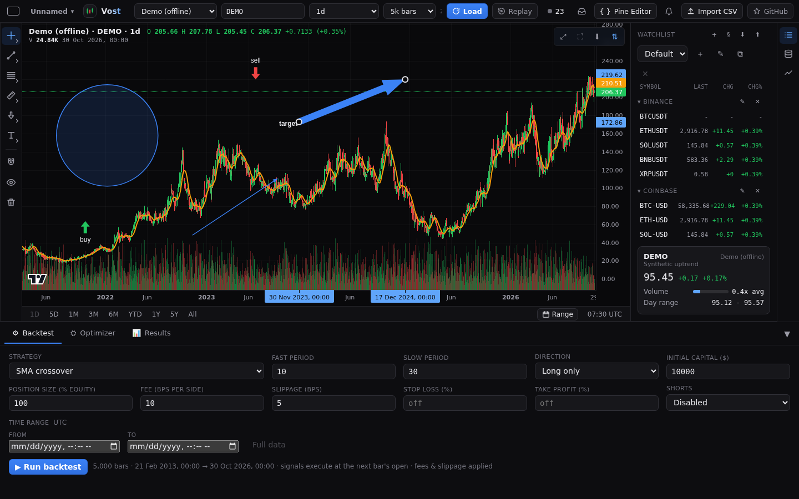
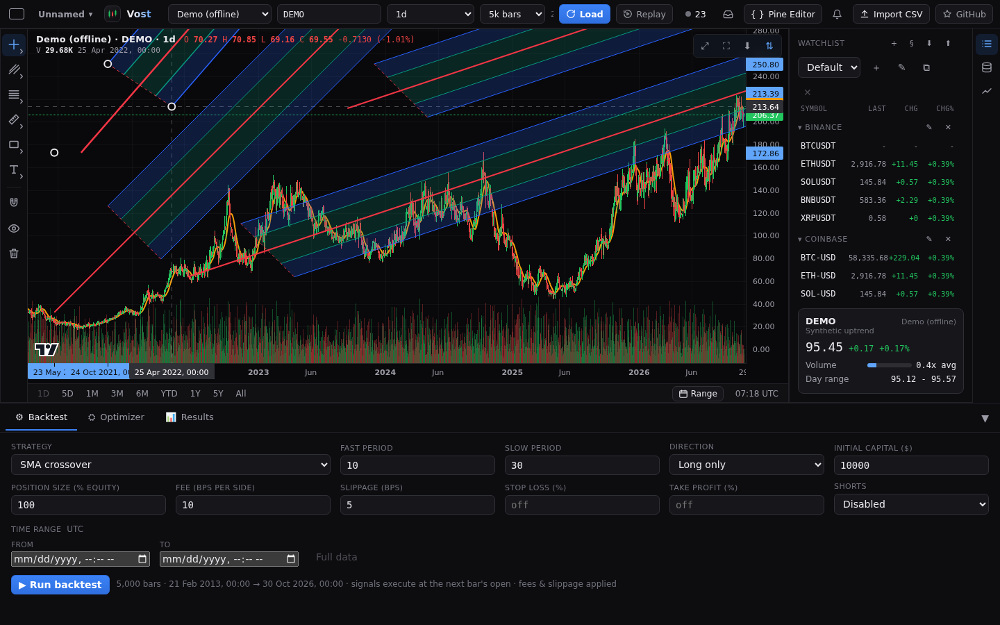

## Working with drawings

Click a drawing to select it, drag to move it and drag a handle to resize it. Delete or Backspace removes the selected drawing (or all the selected drawings). **Ctrl or Cmd+Z** undoes, **Ctrl or Cmd+Shift+Z** (or Ctrl+Y) redoes, Escape leaves the tool or clears the selection. With several charts these keys act on the active chart only ([Layouts](layouts.md)).

The rail also has:

- **Magnet**: snaps points to a bar's time and its open, high, low or close (a horizontal line snaps price only and a vertical line snaps time only). The button switches it off or on again with the strength you chose last (weak at first), and shows a W or an S on its icon. The small chevron beside it (or a long press, or the right arrow key) opens a menu of **Off**, **Weak magnet** and **Strong magnet**. The strong magnet snaps to the nearest open, high, low or close of the bar under the pointer, however far away. The weak magnet snaps only when the pointer is within about 10 pixels of one of those values and otherwise leaves the point where you put it. On a phone the same three modes sit in the drawing menu.
- **Stay in drawing mode**: after each drawing the tool stays picked, so the next press starts another one. Escape or picking another tool returns to the cursor, and the Measure still goes back to the cursor after one use.
- **Lock all drawings**: no drawing can be moved or resized, and none shows handles. You can still select, right-click and delete them. Turning it off restores each drawing's own lock (see the right-click menu).
- **Hide all drawings**: hides every drawing without deleting it.
- **Delete all drawings**: after a confirm, deletes all drawings for the current source. One undo step brings them back.

The rail scrolls when the window is short.

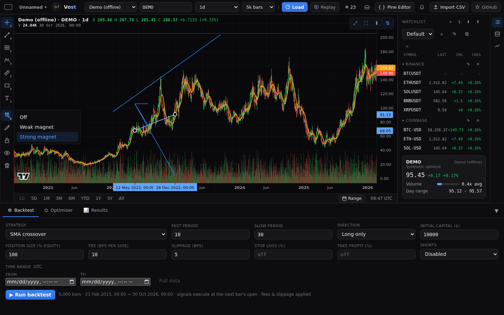

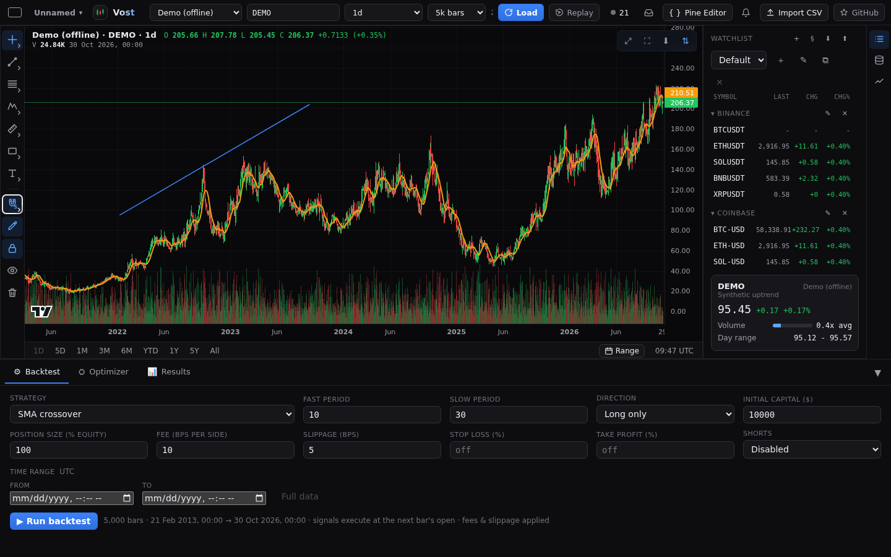

## Selecting several drawings

**Shift+click** a drawing to add it to the selection, or to take it out when it is already in. **Shift+drag** on empty chart draws a selection box (any direction) and selects every drawing that lies wholly inside it, added to what is selected already; the chart does not pan while you drag the box. A horizontal line counts when its price is inside the box and a vertical line when its time is. A click on empty chart clears the selection. On touch there is no Shift, so only one drawing is selected at a time.

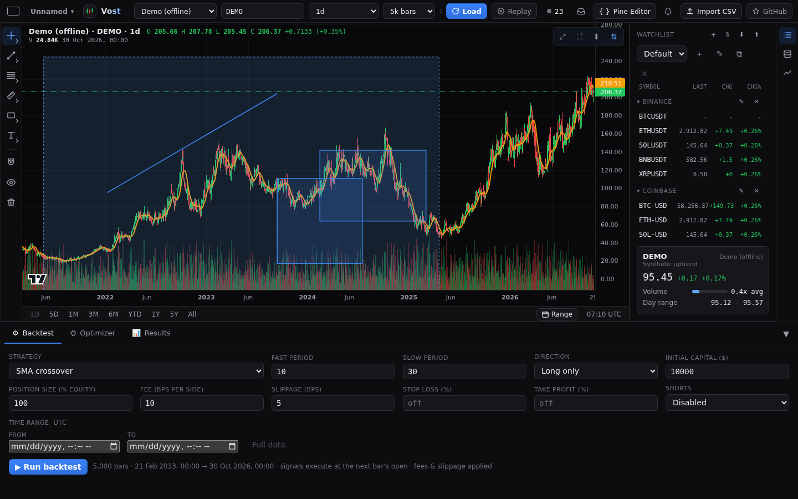

With several drawings selected they show no handles. Dragging any one of them moves them all by the same distance (locked ones stay put), and Delete removes them all; each is one undo step. **Ctrl or Cmd+drag** clones the whole selection and drags the copies. **Ctrl or Cmd+C** copies them and **Ctrl or Cmd+V** pastes them back in the same order, all selected.

Right-click one of them and the menu is headed "3 drawings" (the number selected). Settings and Rename are left out; Clone, Copy, Lock or Unlock (Unlock only when all are locked), the four order commands and Delete act on all of them, each as one undo step. Bring to front and Send to back keep their relative order.

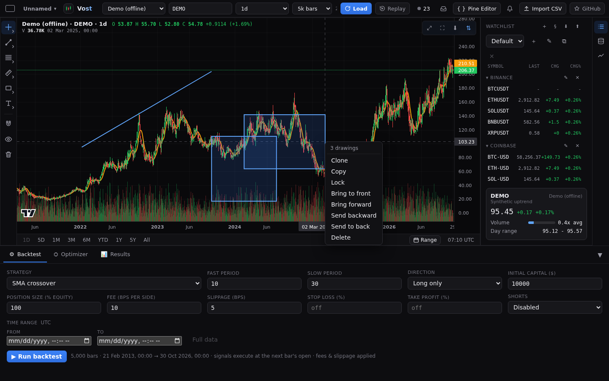

## Managing drawings

Right-click a drawing to select it and open its menu, headed by its name (or its tool). The menu holds **Settings** (a note opens its text editor), **Rename**, **Clone**, **Copy**, **Lock** or **Unlock**, **Hide**, **Bring to front**, **Bring forward**, **Send backward**, **Send to back** and **Delete**. Every change is one undo step.

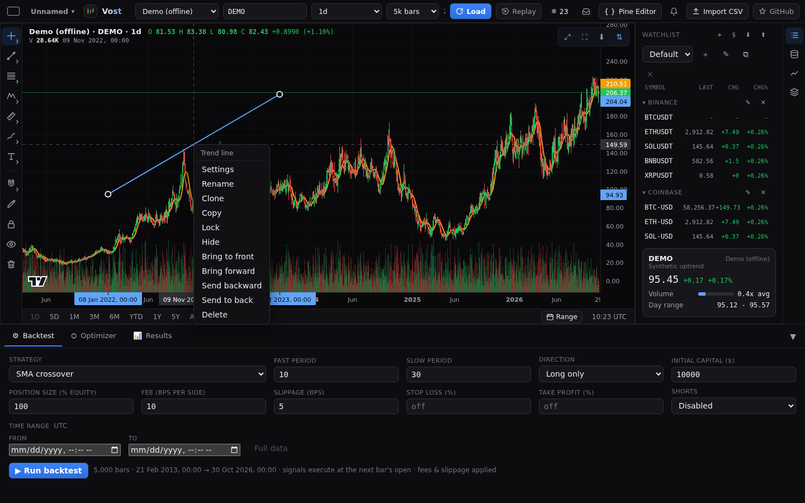

- **Lock**: a locked drawing can still be selected, but it shows no handles, a drag does not move it and the chart does not pan under it. The eraser, Delete and the menu still delete it.
- **Rename**: type a name in the menu and press Enter (Escape cancels). The name is up to 60 characters and shows in the menu header.
- **Clone**: puts a copy just above the original. Holding **Ctrl or Cmd** while you drag a drawing clones it and drags the copy; one undo removes both. On a locked drawing it clones without moving.
- **Copy and paste**: **Ctrl or Cmd+C** copies the selected drawing and **Ctrl or Cmd+V** pastes it on top of the active chart, selected. The clipboard is shared by every chart in the tab, so you can paste onto a chart showing another symbol; the copy keeps its times and prices.
- **Hide**: takes the drawing off the chart (not painted, not clickable, not picked by a selection box, no axis labels). A hidden drawing cannot be right-clicked, so show it again from the Object tree below, or with undo. This is separate from **Hide all drawings** in the rail.
- **Order**: drawings paint in order, the last on top. Bring to front, Bring forward, Send backward and Send to back change it.

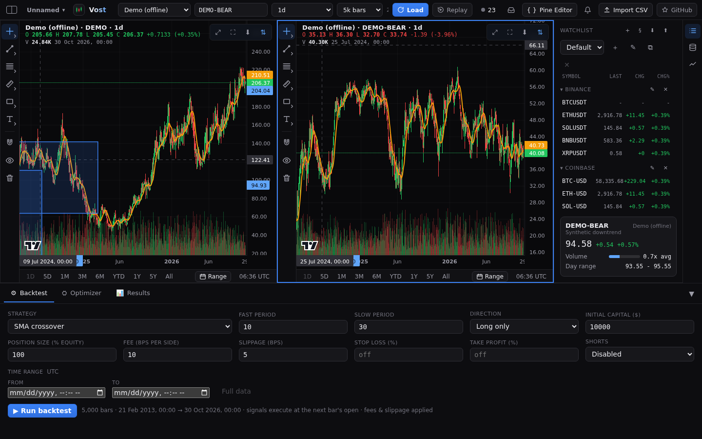

Right-click empty chart for **Add alert at** the price, **Paste** (off while nothing is copied) and **Remove drawings** (the same confirm as Delete all drawings, off with no drawings).

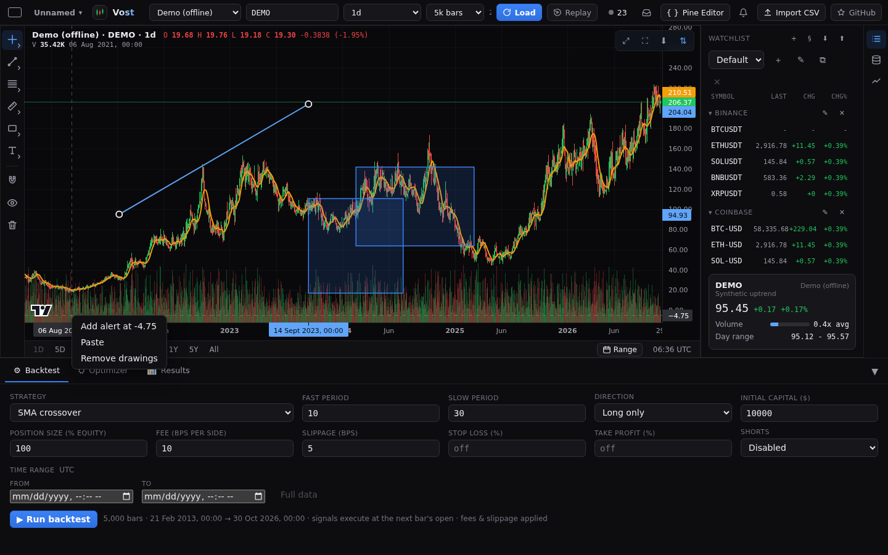

### Object tree

The **Object tree** button in the side rail (the stacked-layers icon, after Indicators; on a narrow screen it is one of the drawer's section buttons) lists every drawing of the active chart, top-most first. Switching the active chart, its symbol or its data changes the list; with no drawings it says "No drawings on this chart".

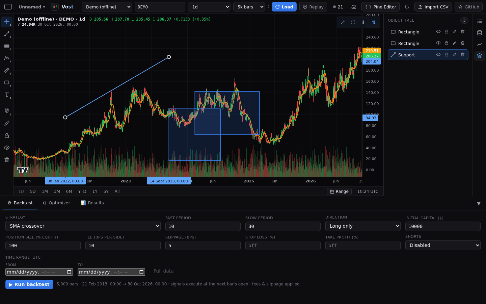

Each row shows the tool's icon, the drawing's name (or its tool) and four buttons: the **eye** hides or shows it, the **lock** locks or unlocks it, the **pencil** renames it and the **bin** deletes it. A hidden drawing's row is dimmed; so is one that does not show on the current timeframe (its tooltip says so).

- **Select**: click a row to select that drawing on the chart; **Shift+click** adds or removes it. Selected rows are marked. While Hide all is on, the list says so and a click does not select.
- **Rename**: double-click the name or press the pencil, type, then Enter (Escape cancels, leaving the field keeps the name).
- **Reorder**: drag a row; a line shows where it will land. Dropping it lower in the list sends the drawing further back in the paint order.

Every change from the list is one undo step on that chart, the same as from the keyboard or the menu.

## Settings

Double-click a drawing (a note opens its text editor instead) to open its settings. Changes show on the chart as you make them; **OK** keeps them all as one undo step, and **Cancel** or Escape puts the drawing back as it was.

- **Style**: each tool has its own settings, as on TradingView.
  - Trend line, ray, info line, extended line and trend angle: colour, opacity, width, solid, dashed or dotted, extend left and right, an arrow at either end, and price change, angle, bars and distance (the info line shows them all and the extended line extends both ways to begin with).
  - Horizontal ray, vertical line and cross line: colour, opacity, width and line style.
  - Horizontal line: colour, opacity, width, line style, and the price label on the axis with its colour.
  - Parallel channel, flat top/bottom and disjoint channel: line colour, width and style, fill colour and opacity (parallel channel also a middle line switch and extend left and right).
  - Regression trend: line colours (base, upper, lower), width and style, fill, extend left and right, the source (close, open, high, low, hl2, hlc3, ohlc4) and the deviation.
  - Rectangle: border colour, width and style, fill colour and opacity, extend left and right.
  - Fibonacci retracement: edit, add (up to 24), remove, colour and switch off each level, show prices and levels, reverse, extend lines and a background between levels.
  - Fib time zone, speed resistance fan, circles, spiral, speed resistance arcs, trend-based extension, channel, trend-based time, wedge and pitchfan: their level tables, width, fills and switches, with the level labels on the Text tab (see [Fibonacci tools](drawing-fib-gann.md)).
  - Gann box, squares and fan: their level, fan and arc tables (each entry on or off, with its own colour), width, fills and the labels on the Text tab (see [Gann tools](drawing-fib-gann.md#gann-tools)).
  - The chart patterns: line colour, width and style, fill colour and opacity (XABCD, Cypher, Head and shoulders, Triangle pattern; the Triangle pattern also a Background switch), with the label text and the ratio switch (not Head and shoulders or Triangle pattern) on the Text tab (see [Chart patterns](drawing-patterns.md)).
  - The Elliott wave tools: line colour, width and style and the Wave degree that sets the wave labels, with the label text colour and size on the Text tab (see [Elliott waves](drawing-patterns.md#elliott-waves)).
  - Cyclic lines, Time cycles and Sine line: colour, width and line style; Time cycles also has a background fill with its colour and opacity (see [Cycle tools](drawing-patterns.md#cycle-tools)).
  - Text, Anchored text, Note, Anchored note, Callout and Comment: background colour and opacity and the border colour (their text settings are on the Text tab); the notes also have a marker colour.
- **Text**: the text of a note and, for the text tools, its colour, size, bold, italic, alignment and wrapping (see [Text and notes](drawing-annotations.md)). The info line, extended line and trend angle have the text colour and size of their label here; the trend line and ray have no Text tab.
- **Coordinates**: the price and time (unix seconds) of each point, or for Anchored text and Anchored note their X % and Y % on the pane. A value that is not a number is refused.
- **Visibility**: the timeframe kinds (seconds, minutes, hours, days, weeks, months) that show the drawing. A drawing hidden on the current timeframe is neither drawn nor clickable.

**Save as default** keeps the dialog's style as the starting style of that tool for new drawings, and **Reset** returns the drawing to the tool's defaults. A drawing you have not styled looks as it always did and follows the theme.

The dialog fits a phone screen.

## Where they are saved

Drawings are saved per symbol in your browser, and keep their place across zoom, timeframe changes and live bars. Charts on the same market share their drawings. Drawings saved by an older version are carried over, and drawings from a newer version (a tool or a setting this version does not know) are kept as they are and written back unchanged, though this version does not show them.

Pictures added with the [Image tool](drawing-annotations.md#image) are kept in a separate picture store in your browser (IndexedDB), which is cleared with the site's data. A drawing copied to another browser does not carry its picture and shows a "Picture missing" box there.

## On phones

Below 600px the chart toolbar has a **Drawing tools** button that opens the same families as collapsible sections (the one holding the current tool is open), each tool with its star. The switches are below the sections. Picking a tool closes the menu, and Escape closes it too. Tap, tap places a line. One-finger pan and pinch zoom work as before in cursor mode.

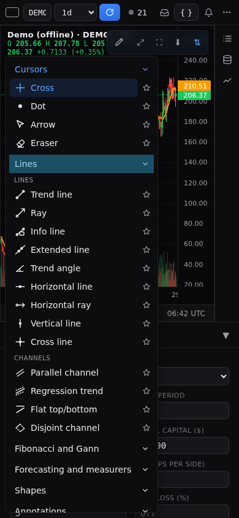
