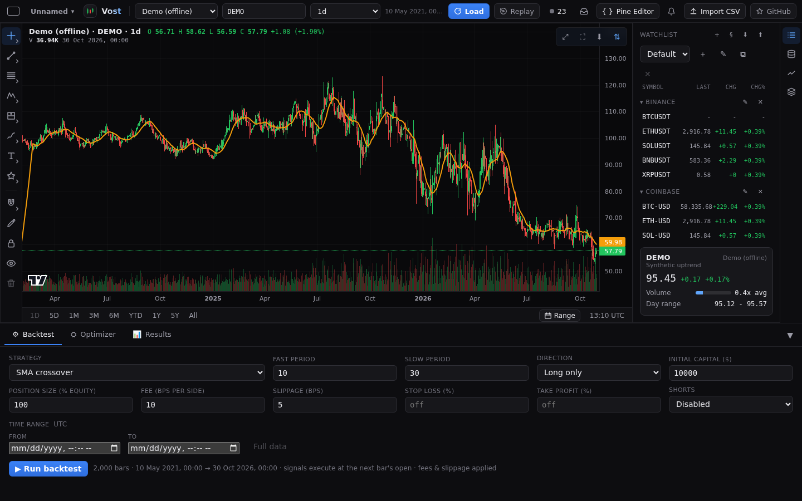
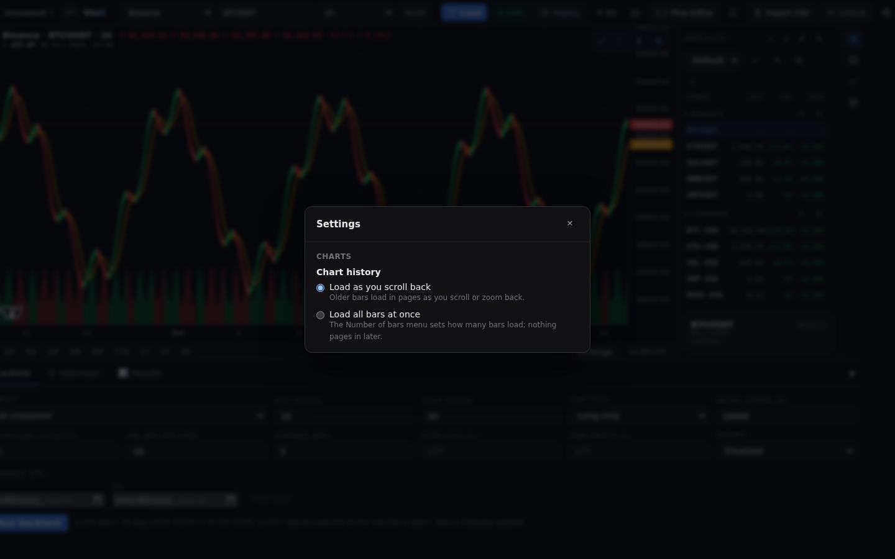
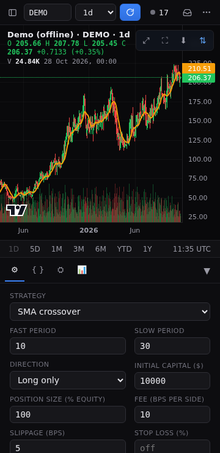

# Getting started

## Run it

With Docker: `docker compose up -d`. Without: `npm install`, `npm run build`, `npm start`. Then open <http://localhost:8787>. No account and no key is needed. The README has the full [quick start](../../README.md#quick-start) and [deployment](../DEPLOYMENT.md) covers hosting it.

## Your first chart

Vost opens on a chart. To see something at once, pick the **Demo (offline)** provider in the top bar: it makes synthetic candles with no network. To chart real data, pick a provider such as Binance, type or search a symbol and press **Load**. To chart your own file, press **Import CSV** (see [Data](data.md)).

## The top bar

From left to right (on narrow screens the less used controls move into a **More** menu):

- **Select layout** and the **layout name**: pick how many charts to show and manage named layouts. See [Layouts](layouts.md).
- The Vost logo with the running version.
- **Symbol search**, the **Provider** menu and, when history loads all at once instead of by scrolling, the **Number of bars** menu (500 to 20k bars; see [Data](data.md#how-history-loads)).
- The **timeframe picker** and the **Build** switch. See [Timeframes](timeframes.md).
- **Load** reloads the data. **Live** streams new candles and is on by default for markets that support it. See [Charts](charts.md).
- **Replay** starts bar replay. See [Bar replay](replay.md).
- **Import CSV**. See [Data](data.md).
- The loaded date range and bar count.
- The **connection light**, the **Inbox** (messages and errors), the **Pine Editor** button and the **Alerts** bell and the **Settings** gear at the right end of the bar (see [The Settings popup](#the-settings-popup)). See [Charts](charts.md), [Pine Script](pine.md) and [Alerts](alerts.md).

## The Settings popup

The gear at the right end of the top bar opens **Settings**. Its **Charts** section holds **Chart history**: **Load as you scroll back** (the default; older bars load in pages as you scroll or zoom back) or **Load all bars at once** (the **Number of bars** menu then sets how many bars load). A choice applies at once, with no Save button, and the open charts reload to follow it. Escape, the close button or a click outside closes the popup. See [Data](data.md#how-history-loads).

## The side panel

The icon rail at the right edge opens three sections: **Watchlist** ([Watchlist](watchlist.md)), **Data and library** ([Data](data.md)) and **Indicators** ([Charts](charts.md)). Click the open section's icon again to collapse the panel. On narrow screens (900px and below) the same buttons open the panel as a drawer. Drag its edge to resize it; double-click the handle to reset.

## The bottom dock

Below the chart: **Backtest**, **Optimizer** and **Results** tabs ([Backtesting](backtesting.md)). Drag the handle to resize it.

## Small screens

At 900px and below the Pine editor is a dialog, dialogs fit phones and the layout shows one chart at a time. Below 600px the chart toolbar has a **Drawing tools** button ([Drawings](drawings.md)).

## What is saved where

Your settings (the [Settings popup](#the-settings-popup) included), layouts, drawings, imported datasets and watchlists live in your browser's local storage, so they do not follow you to another browser or device, and clearing site data removes them. The server keeps only price alerts, Pine libraries and recorded candles in its data folder. See [Alerts](alerts.md), [Pine Script](pine.md) and [Data](data.md).
