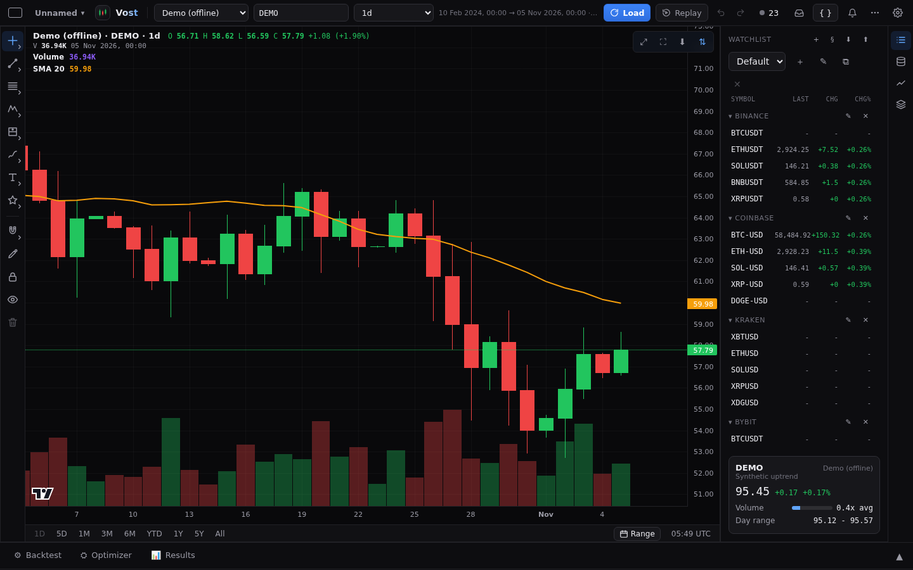
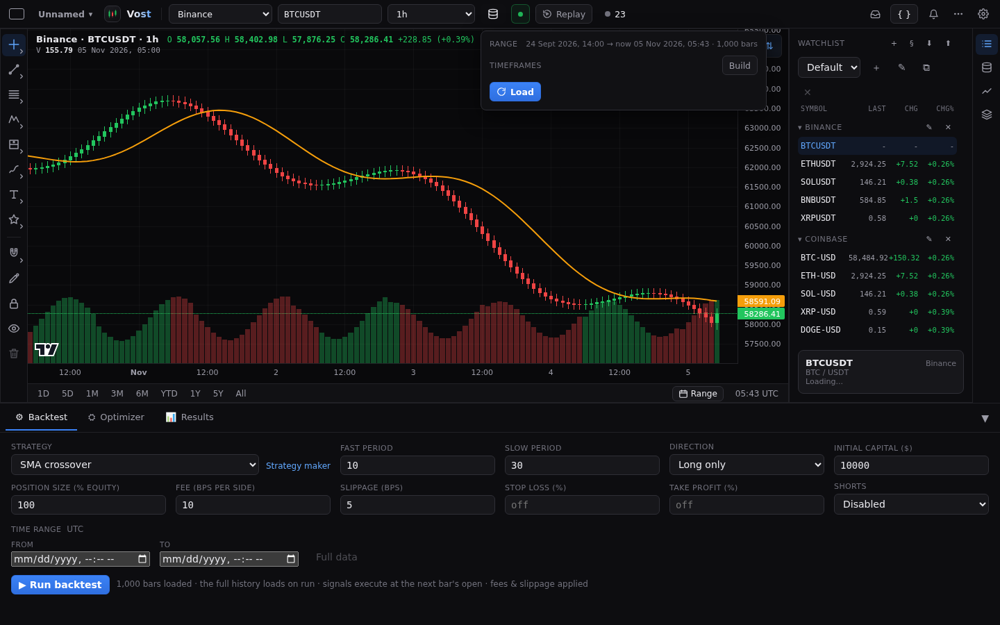
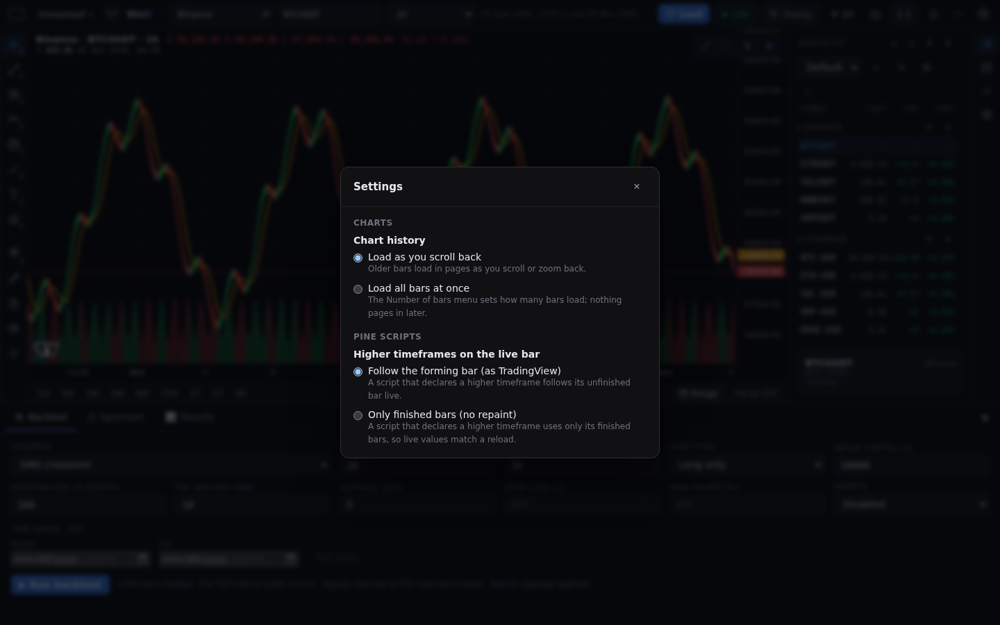
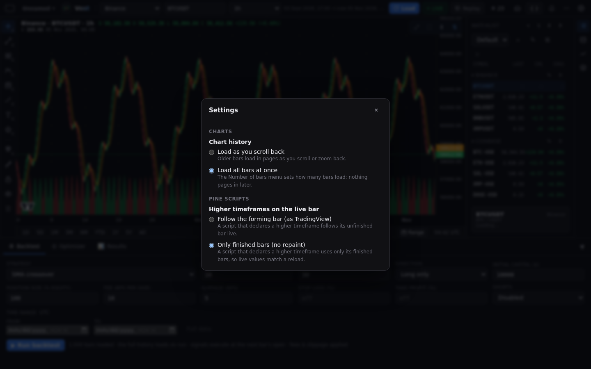
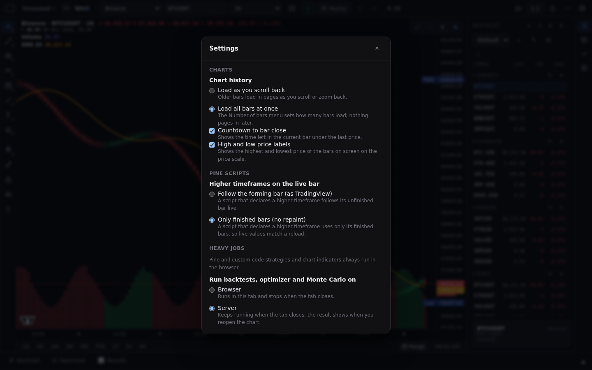
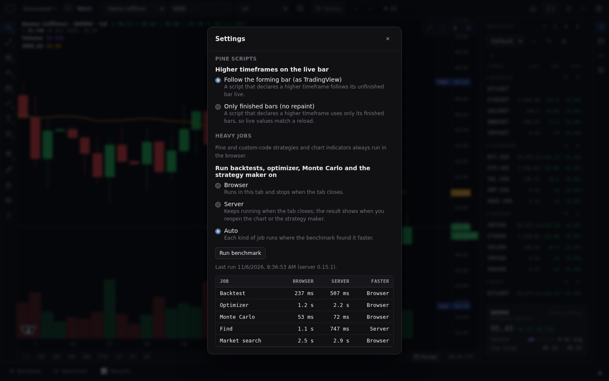
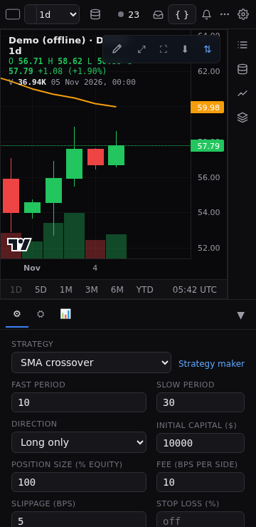

# Getting started

## Run it

With Docker: `docker compose up -d`. Without: `npm install`, `npm run build`, `npm start`. Then open <http://localhost:8787>. No account and no key is needed. The README has the full [quick start](../../README.md#quick-start) and [deployment](../DEPLOYMENT.md) covers hosting it.

## Your first chart

Vost opens on a chart. To see something at once, pick the **Demo (offline)** provider in the top bar: it makes synthetic candles with no network. To chart real data, pick a provider such as Binance, type or search a symbol; the chart loads by itself (the **Chart data** button has a **Load** button to reload). To chart your own file, press **Import CSV** (see [Data](data.md)).

## The top bar

From left to right (on narrow screens the less used controls move into a **More** menu):

- **Select layout** and the **layout name**: pick how many charts to show and manage named layouts. See [Layouts](layouts.md).
- The Vost logo with the running version.
- **Symbol search**, the **Provider** menu and the **timeframe picker**. See [Timeframes](timeframes.md).
- **Chart data** (the database icon, which shows a spinner while loading) opens a small pop-up with the loaded date range and bar count, the **Build** switch ([Timeframes](timeframes.md)), the **Number of bars** menu when history loads all at once instead of by scrolling (500 to 20k bars; see [Data](data.md#how-history-loads)) and **Load**, which reloads the data.
- **Live** is a dot that streams new candles and is on by default for markets that support it: green when live, amber while connecting or reconnecting, red on an error (click it to open the inbox) and grey when off. Hover it for the state in words. See [Charts](charts.md).
- **Replay** starts bar replay. See [Bar replay](replay.md).
- **Import CSV**. See [Data](data.md).
- The **connection light**, the **Inbox** (messages and errors), the **Pine Editor** button, the **Alerts** bell and the **Settings** gear at the right end of the bar (see [The Settings popup](#the-settings-popup)). See [Charts](charts.md), [Pine Script](pine.md) and [Alerts](alerts.md).

## The Settings popup

The gear at the right end of the top bar opens **Settings**. Its **Charts** section holds **Chart history**: **Load as you scroll back** (the default; older bars load in pages as you scroll or zoom back) or **Load all bars at once** (the **Number of bars** menu then sets how many bars load). Its **Pine scripts** section holds **Higher timeframes on the live bar**: **Follow the forming bar (as TradingView)** (the default) or **Only finished bars (no repaint)**, which keeps a script that declares a higher timeframe from changing its live bar later (see [Repainting](pine.md#repainting)). Its **Heavy jobs** section holds **Run backtests, optimizer, Monte Carlo and the strategy maker on**: **Browser** (the default; runs in this tab and stops when the tab closes), **Server** (keeps running when the tab closes, and the result shows when you reopen the chart or the strategy maker) or **Auto** (each kind of job runs where the benchmark found it faster). **Run benchmark**, under the choices, times five standard jobs in this browser and on the server and shows both times side by side (see [Where heavy jobs run](backtesting.md#where-heavy-jobs-run)); Pine and custom-code strategies follow this switch too, so on Server (or when Auto picks it) their code runs on the server machine (see [Running user code on the server](../DEPLOYMENT.md#running-user-code-on-the-server)); only chart indicators always run in the browser. A choice applies at once, with no Save button; the chart history choice reloads the open charts and the Pine choice re-runs their Pine indicators. A heavy-jobs choice applies to the next job. Escape, the close button or a click outside closes the popup. See [Data](data.md#how-history-loads).

## The side panel

The icon rail at the right edge opens three sections: **Watchlist** ([Watchlist](watchlist.md)), **Data and library** ([Data](data.md)) and **Indicators** ([Charts](charts.md)). Click the open section's icon again to collapse the panel. On narrow screens (900px and below) the same buttons open the panel as a drawer. Drag its edge to resize it; double-click the handle to reset.

## The bottom dock

Below the chart: **Backtest**, **Optimizer** and **Results** tabs ([Backtesting](backtesting.md)). The dock starts collapsed below the chart: click a tab or the arrow to open it. Drag the handle to resize it.

## Small screens

At 900px and below the Pine editor is a dialog, dialogs fit phones and the layout shows one chart at a time. Below 600px the chart toolbar has a **Drawing tools** button ([Drawings](drawings.md)).

## What is saved where

The Vost server keeps your settings (the [Settings popup](#the-settings-popup) included), chart layout and named layouts, drawings, imported datasets, watchlists, the Pine compare page, and the alert sound and seen state in its data folder, next to price alerts, Pine libraries and recorded candles. They follow you to another browser or device and survive clearing site data, and Vost cannot start without its server: it then shows a page saying the server cannot be reached, with a Retry button. If saving fails while you work, a message says so and Vost keeps trying. The [strategy maker](strategy-maker.md)'s marked trades, find form and trained model are kept there too (its **Export** still saves them to a file). Pictures added to drawings are kept there too, in a `images/` folder. Data an older version kept in this browser is moved to the server once, at the first start, and the inbox says so (the strategy maker says so on its own page). See [Alerts](alerts.md), [Pine Script](pine.md) and [Data](data.md).
