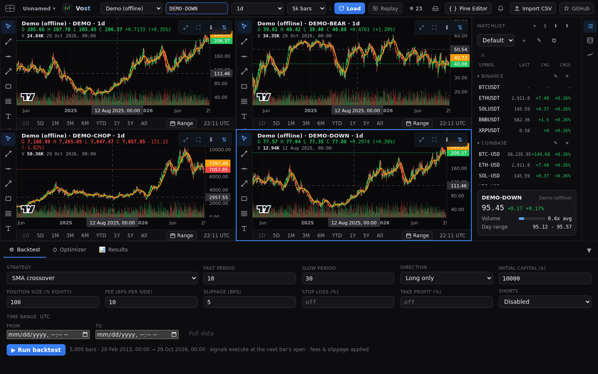
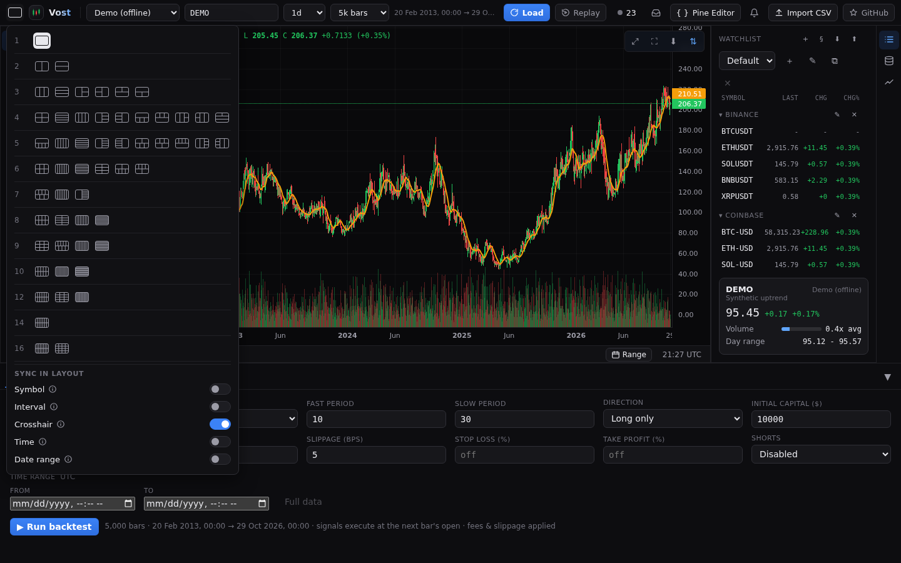
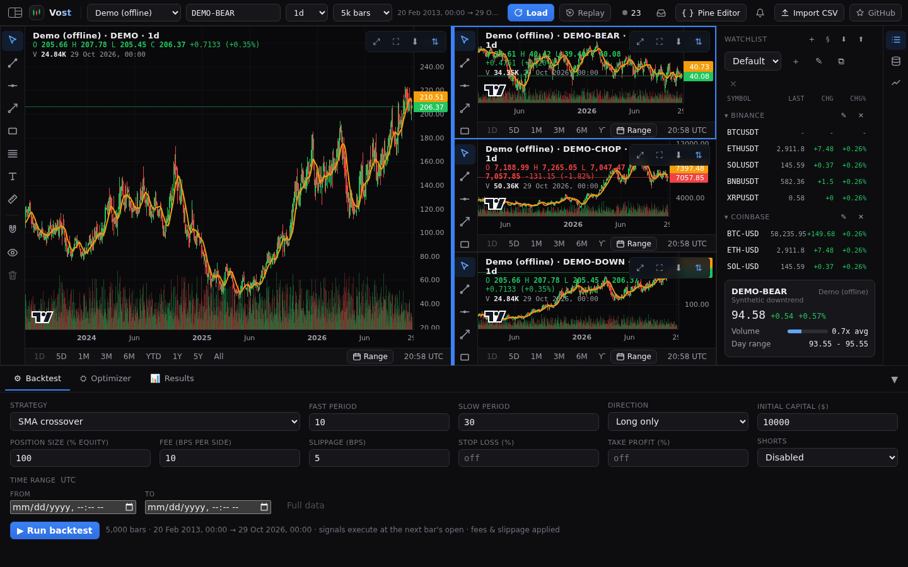
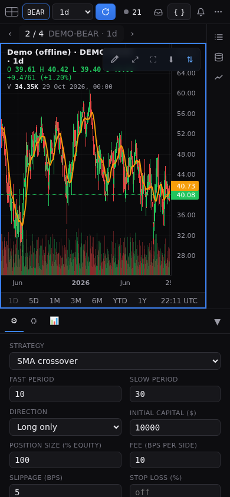
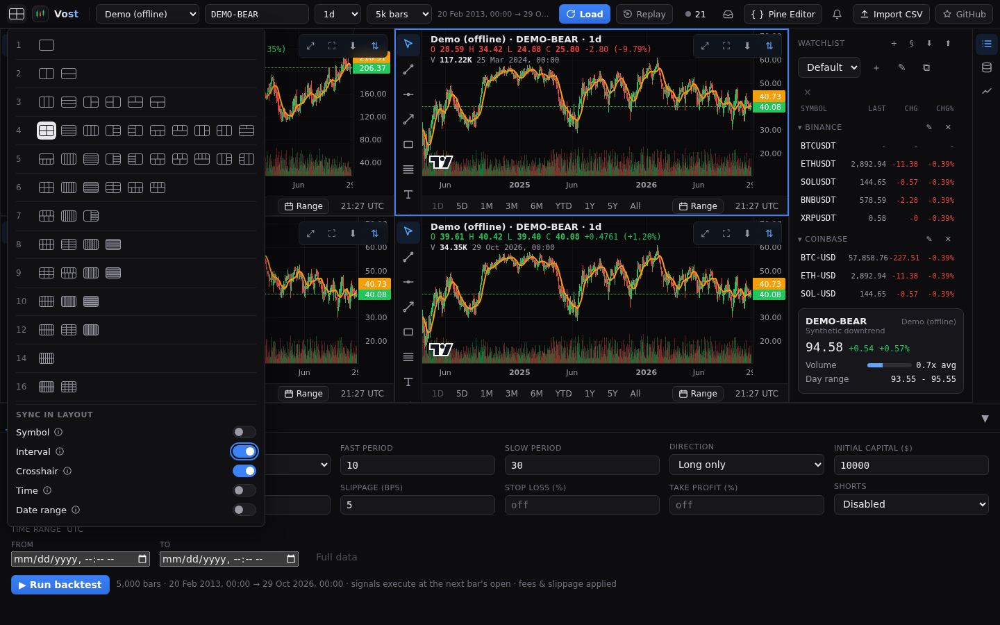
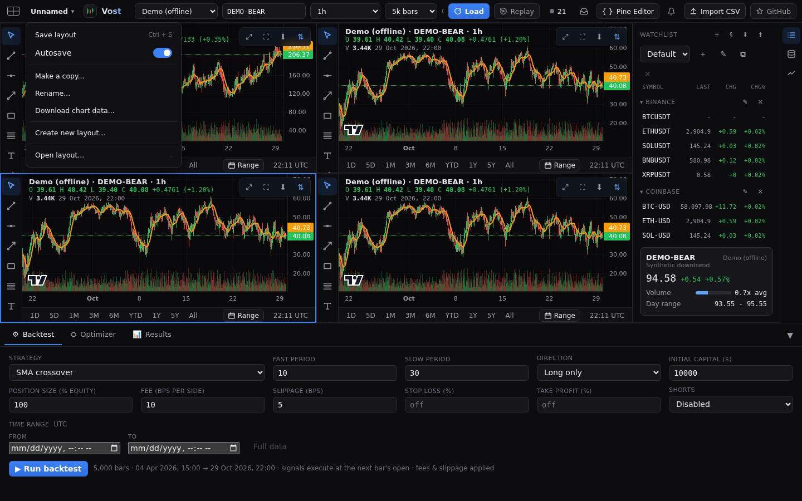
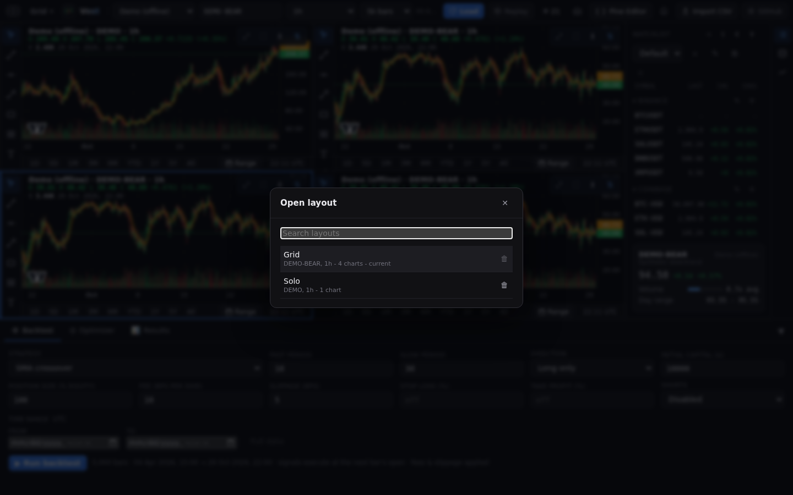

# Layouts

Vost can show 1 to 16 charts at once in 55 arrangements.

## Arrangements

The **Select layout** button at the left of the top bar opens the arrangements, grouped by chart count. Going to more charts copies the active chart's market, timeframe and bars into the new ones; going to fewer keeps the first ones and stops the rest.

## Active chart

Click a chart to make it active: it gets an accent outline. The top bar, the dock, the Pine pane and the watchlist act on the active chart. Drawing shortcuts (Escape, undo, redo, Delete) also act only on the active chart ([Drawings](drawings.md)).

## Dividers

Drag a divider between charts to resize them. Double-click it to reset to even sizes. Sizes are saved with the layout.

## Narrow screens

On narrow screens only the active chart shows, with a switcher: the position ("2 / 4"), previous and next buttons, and a menu listing the charts by market and timeframe.

## Sync in layout

Five switches at the bottom of the layout picker: **Symbol**, **Interval**, **Crosshair**, **Time** and **Date range**. With one on, a change on one chart follows on every other chart. Crosshair is on by default, the others off. A chart whose provider does not serve a synced interval keeps its own, with a toast naming it.

## Named layouts

The layout's name sits in the top bar (in the **More** menu on narrow screens) and opens a menu:

- **Save layout**: Ctrl+S, or Cmd+S on a Mac (the browser's save dialog does not open).
- **Autosave**: on by default. With it off, a dot after the name marks unsaved changes, and switching layouts asks **Save**, **Don't save** or **Cancel**.
- **Make a copy**, **Rename** and **Create new layout**.
- Up to 5 **Recently used** layouts.
- **Open layout**, also the `.` key (outside a text field): a searchable list where you can also delete layouts.

## Download chart data

From the layout menu, download the active chart's bars or every chart's as `<symbol>_<timeframe>.csv` files.

## Where layouts are saved

In your browser's local storage only: the working layout and the named layouts do not follow you to another browser or device, and clearing site data removes them. Layouts have no export yet; use Download chart data if you need the bars.
