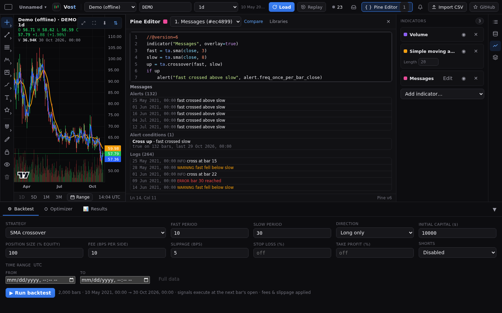
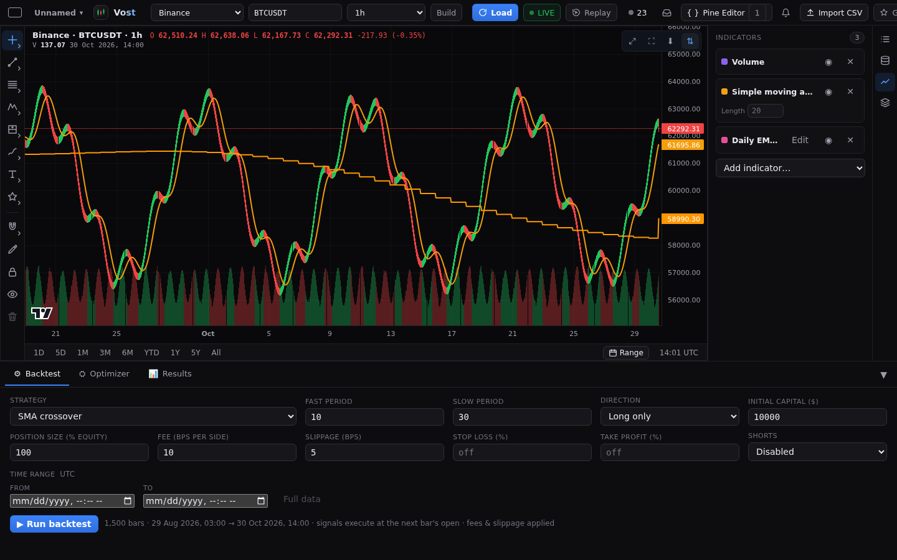
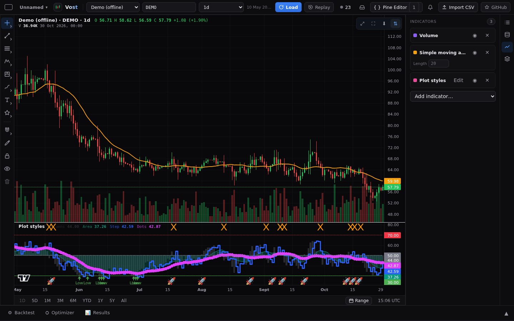
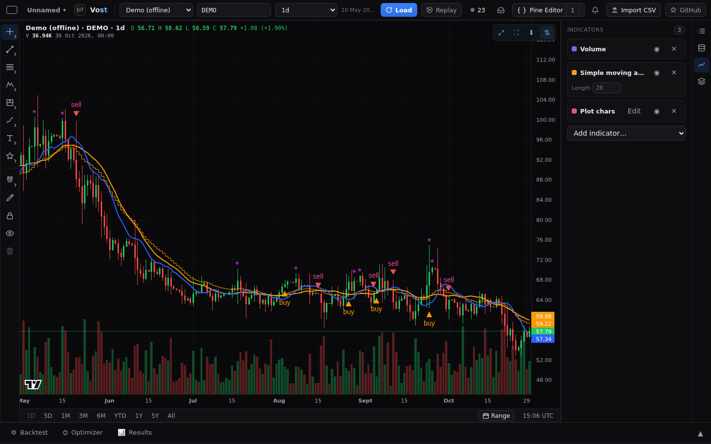
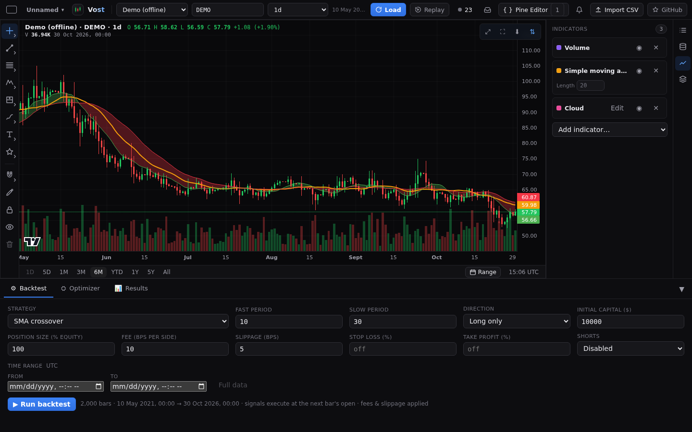
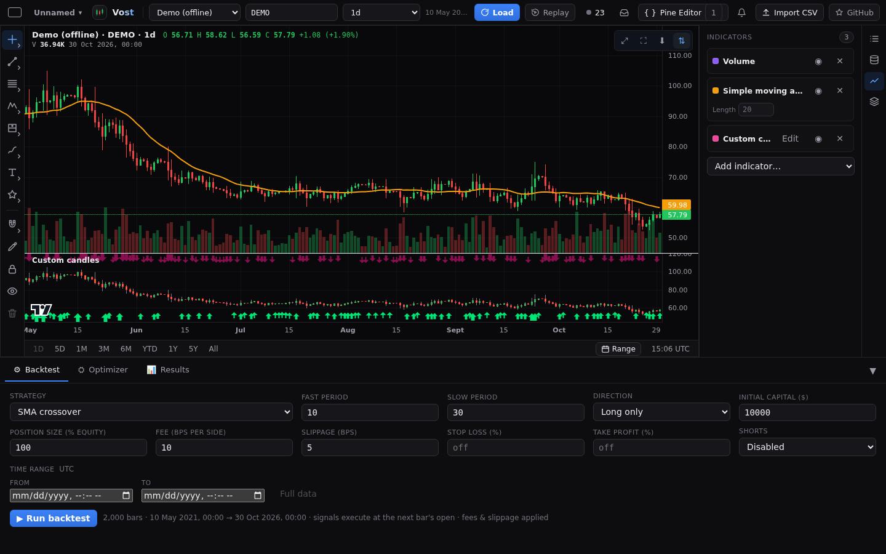
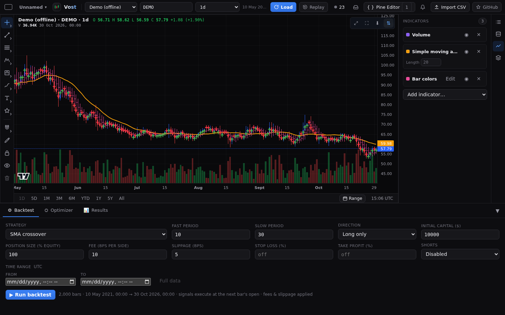
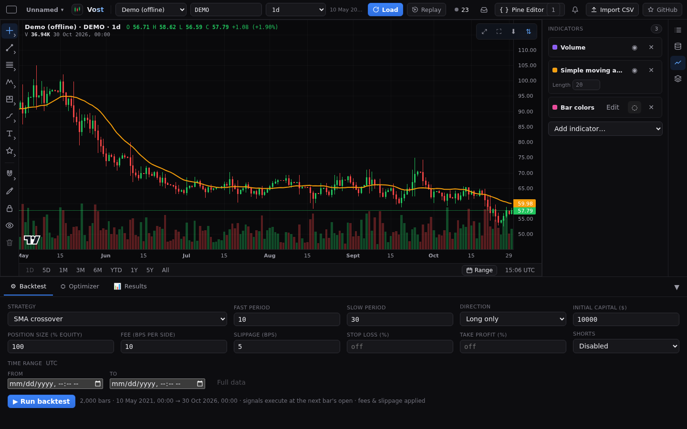
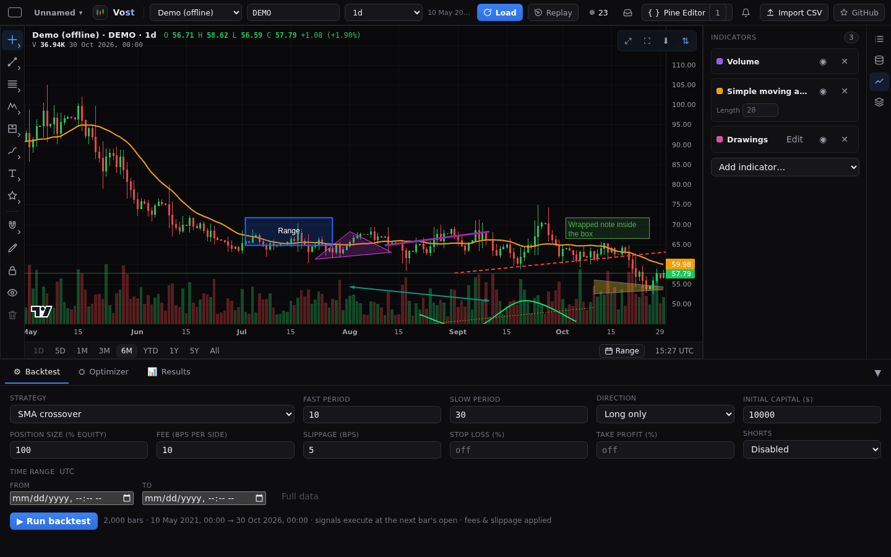

# Pine Script

Vost runs Pine Script v5 and v6 with the PineTS runtime. Pine indicators draw on the chart, and `strategy()` scripts also backtest. What is and is not supported is in [Pine support](../PINE.md).

## The Pine pane

Press **Pine Editor** in the top bar (or **Edit** on a Pine indicator in the Indicators section) to open the Pine pane beside the chart. It has a code editor with highlighting, autocomplete and error markers, an indicator selector, the run status and errors, and the script's inputs. Drag its handle to resize; the close button hides it. On windows 900px wide and below it is a dialog that closes with Escape. A status line shows the cursor position and Pine version.

### Messages

After a successful run, a Messages section below the inputs lists what the script said on the loaded bars: the `alert()` calls that fired, the `alertcondition()`s that came true (with how many bars and the last one), and the `log.info`, `log.warning` and `log.error` lines, with times in the chart's time zone. Each list shows the newest 500 and says how many more are not shown. Pine alerts are only listed here; they are not sent to Vost's alerts, and a condition that was never true on the loaded bars is not listed. `runtime.error()` stops the run and shows its message as an error.

Pine strategies run from the Backtest tab and the Optimizer too ([Backtesting](backtesting.md)).

## What a script sees of the chart

A script runs with the chart's symbol, timeframe and market details, the same on the chart, in the backtester and in the optimizer. `syminfo.ticker` is the symbol, `syminfo.tickerid` reads like `BINANCE:BTCUSDT`, `syminfo.type` is `crypto` (or `stock` for Yahoo), and `timeframe.period`, `timeframe.in_seconds()` and `timeframe.isintraday` match the chart, also on a custom timeframe such as `2h`. `math.round_to_mintick` works. A chart that shows an imported dataset uses the dataset's name, source and bar length instead.

A script can ask for the same symbol at another timeframe with `request.security`, for example the daily EMA on an hourly chart (`request.security(syminfo.tickerid, "D", ta.ema(close, 10))`), and gets the real daily, 12-hour or 15-minute values from the chart's data source (the Build setting applies). The value of a finished higher bar shows on the last chart bar inside it, and the day still in progress never shows its final close, so a backtest, an optimizer combination, a walk-forward window and replay see the same numbers and nothing from the future. `lookahead_on` without `[1]` does look ahead in a backtest, as in TradingView. A seconds timeframe or a timeframe the data source cannot give stops the run with a message naming the symbol and timeframe. A different symbol stops with a message such as `request.security(ETHUSDT, D) needs data Vost does not load yet`, rather than showing the chart's own numbers as if they were the other market's.

Two limits: the time zone is always UTC (right for crypto, not for Yahoo stocks), and the tick size is estimated from the prices on the chart, not taken from the exchange.

## Shapes in a script's own pane

A script that draws in its own pane (`overlay=false`) shows its `plotshape` and `plotchar` marks in that pane, not on the candles: `abovebar` and `top` at the top of the pane, `belowbar` and `bottom` at the bottom, `absolute` at the plotted value. Overlay scripts keep their marks on the candles. A `plotshape` shows its `text` beside the shape, and `size` (`tiny`, `small`, `normal`, `large`, `huge`) sets how big it is.

## Plot styles

Plots draw the options a script gives them, as TradingView does:

- `linewidth` sets the line width; with none the line is 1 pixel wide, as in Pine. It also sets the size of `circles` and `cross` points and the width of `hline`.
- `offset=n` moves a plot n bars right (negative: left); values moved past the first or last bar are dropped.
- `style=plot.style_stepline` (and `style_stepline_diamond`) draws steps, `style_area` and `style_areabr` a filled area down to `histbase` (default 0), `style_columns` and `style_histogram` columns that start at `histbase`, `style_circles` and `style_cross` points only.
- `hline` takes `linestyle=hline.style_solid`, `style_dashed` (the default) or `style_dotted`.
- `plotchar` draws its character in the plot's colour: any character works, emoji included, and a star when none is given. It sits above or below the bar on the candles (in the pane for a script with `overlay=false`), is sized by `size` and carries its `text`.

## Fills

`fill()` shades the area between two plots, or between two `hline`s, in the pane of those lines: the RSI 30/70 band, or a moving-average cloud that changes colour with `color = a > b ? color.green : color.red`. The area takes the fill's own colour, transparency included, sits beneath the lines and leaves a gap where either side has no value. The gradient form of `fill` is not shown yet.

## Custom candles, bar colors and arrows

`plotcandle` and `plotbar` draw their own candles and bars, with the colors the script gives them (body, wick and border). A script with `overlay=false` shows them in its own pane, an overlay script on the chart. `plotarrow` draws an up arrow below the bar for a positive value and a down arrow above it for a negative one, larger for a larger value.

`barcolor` recolors the chart's own candles (body, wick and border). When several scripts color the same bar the last one in the list wins. Hide or remove the script and the normal candles come back.

## Drawing objects

The `line`, `box`, `polyline` and `linefill` objects a script makes are drawn on the chart, in the state the script left them: a line moved with `line.set_xy2` is where it ended up, and a deleted object is gone. A script with `overlay=false` draws them in its own pane, on that pane's scale (a script that only draws still gets a pane); an object made with `force_overlay=true` goes on the candles. They follow the script: hiding it hides them, and during a replay they show only once the replay has reached the end of the run.

Lines keep their colour, width and style (solid, dashed, dotted, or an arrow at either or both ends) and can extend left, right or both to the edge of the pane, so a line that ends bars after the last candle reaches into the empty space on the right. Boxes draw their border, background and text, aligned and wrapped as the script says. Polylines can be closed, filled and curved. A `linefill` shades the area between its two lines, extensions included. `max_lines_count`, `max_boxes_count` and `max_polylines_count` keep the newest objects.

The objects are only a picture of the script's output: you cannot select, move, edit or save them, and a click on one goes through to the chart. `label` and `table` objects are not shown yet.

## Converting old scripts

A script with no `//@version` line, or a version below 5, will not run. The pane says so and shows **Convert to v6**. It rewrites the source in one edit (Ctrl+Z restores the original) and reports "Converted from Pine v<N> to v6". Whatever it cannot convert safely stays with a `// TODO(convert)` comment above it; search for that.

## Libraries

A script can `import user/name/version as x` a TradingView library. The server looks the library up (open-source ones only), keeps a copy and serves it to every tab. If it cannot be fetched, the run fails with a message naming it and a **Paste library** button. **Libraries** in the pane head lets you paste a library's source once (give the path as `user/name/version`) and remove stored ones.

## Compare

The page at `/compare` (also the **Compare** link in the Pine editor head) puts 2 to 4 scripts side by side, Code A to Code D. Paste or type into a pane, **Load** a Pine indicator from the chart, **Open file** (`.pine` or `.txt`) or **Clear** it. **Compare against** picks the reference pane; the others show only what differs: unchanged code folds into an "N unchanged lines" bar (click it to open that run), a small change inside a line is shown in the line (the removed text struck through in red next to the added text in green), and an added or changed line is green and a removed line red. A pane with no text reads **Empty** and shows no marks. It loads no market data and runs no Pine code.

