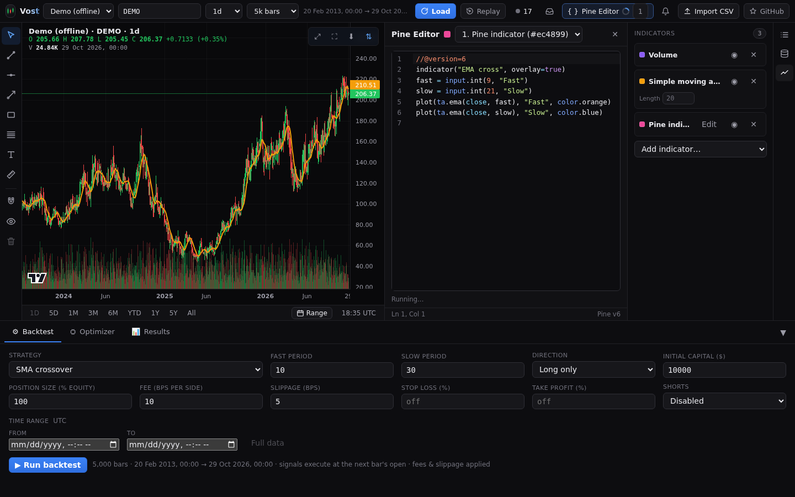
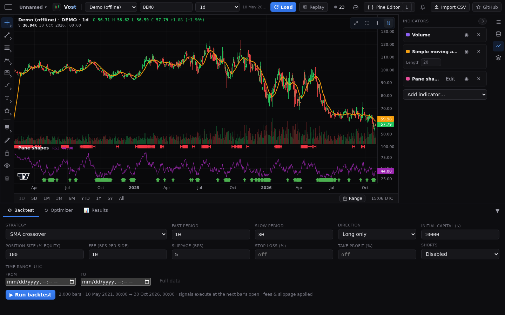
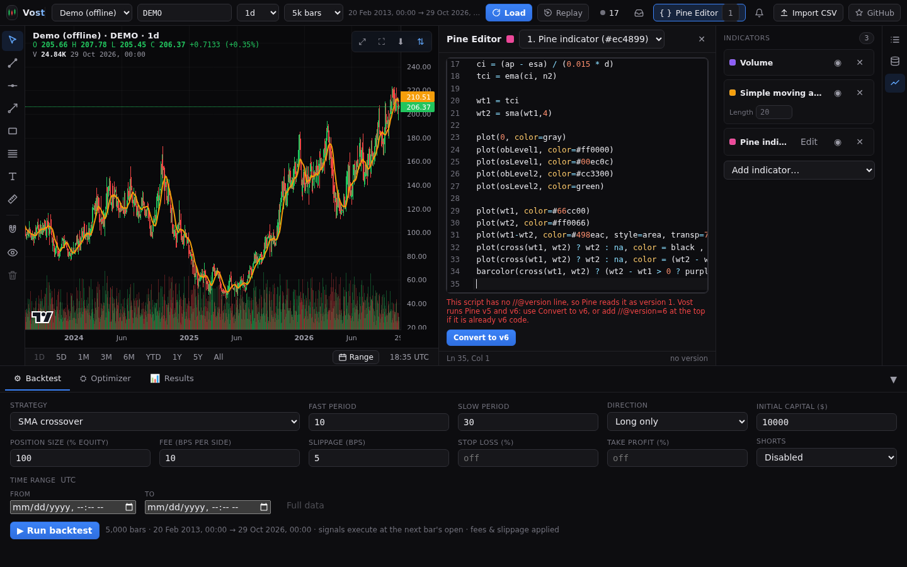
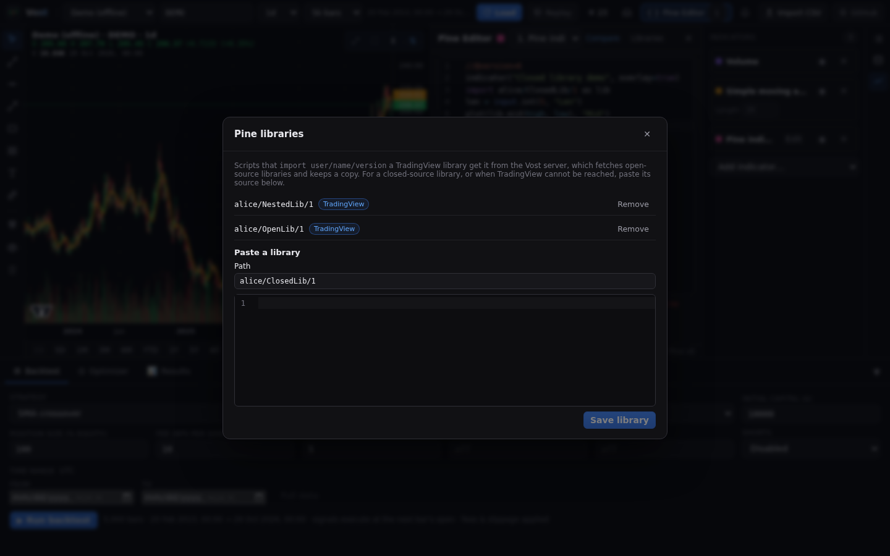
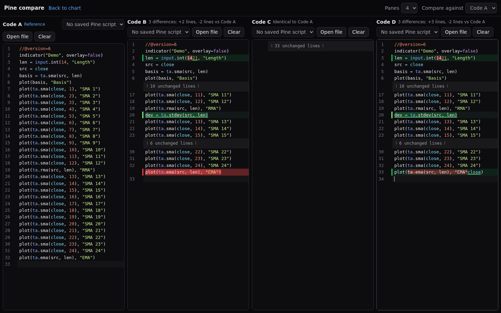

# Pine Script

Vost runs Pine Script v5 and v6 with the PineTS runtime. Pine indicators draw on the chart, and `strategy()` scripts also backtest. What is and is not supported is in [Pine support](../PINE.md).

## The Pine pane

Press **Pine Editor** in the top bar (or **Edit** on a Pine indicator in the Indicators section) to open the Pine pane beside the chart. It has a code editor with highlighting, autocomplete and error markers, an indicator selector, the run status and errors, and the script's inputs. Drag its handle to resize; the close button hides it. On windows 900px wide and below it is a dialog that closes with Escape. A status line shows the cursor position and Pine version.

Pine strategies run from the Backtest tab and the Optimizer too ([Backtesting](backtesting.md)).

## Shapes in a script's own pane

A script that draws in its own pane (`overlay=false`) shows its `plotshape` and `plotchar` marks in that pane, not on the candles: `abovebar` and `top` at the top of the pane, `belowbar` and `bottom` at the bottom. Overlay scripts keep their marks on the candles.

## Converting old scripts

A script with no `//@version` line, or a version below 5, will not run. The pane says so and shows **Convert to v6**. It rewrites the source in one edit (Ctrl+Z restores the original) and reports "Converted from Pine v<N> to v6". Whatever it cannot convert safely stays with a `// TODO(convert)` comment above it; search for that.

## Libraries

A script can `import user/name/version as x` a TradingView library. The server looks the library up (open-source ones only), keeps a copy and serves it to every tab. If it cannot be fetched, the run fails with a message naming it and a **Paste library** button. **Libraries** in the pane head lets you paste a library's source once (give the path as `user/name/version`) and remove stored ones.

## Compare

The page at `/compare` (also the **Compare** link in the Pine editor head) puts 2 to 4 scripts side by side, Code A to Code D. Paste or type into a pane, **Load** a Pine indicator from the chart, **Open file** (`.pine` or `.txt`) or **Clear** it. **Compare against** picks the reference pane; the others show only what differs: unchanged code folds into an "N unchanged lines" bar (click it to open that run), a small change inside a line is shown in the line (the removed text struck through in red next to the added text in green), and an added or changed line is green and a removed line red. A pane with no text reads **Empty** and shows no marks. It loads no market data and runs no Pine code.

