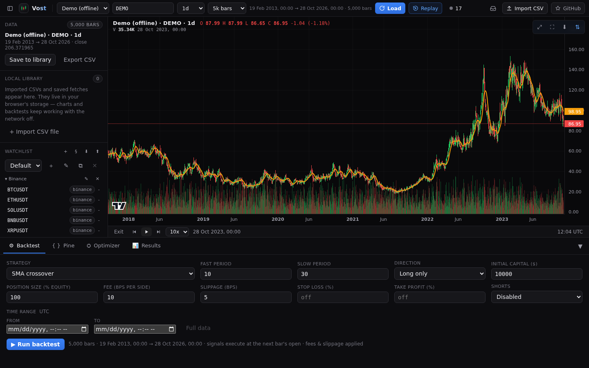
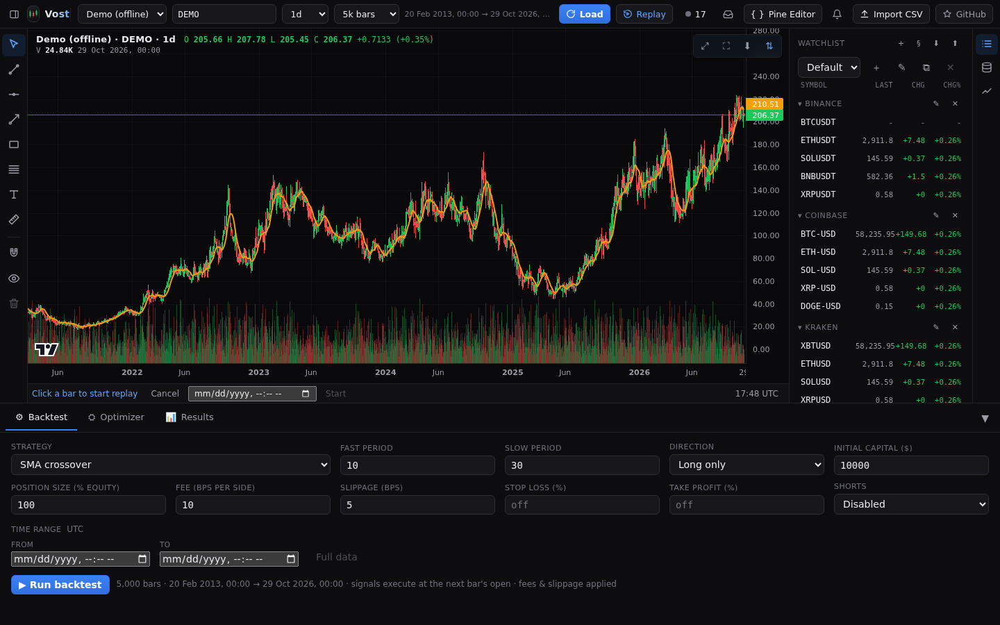
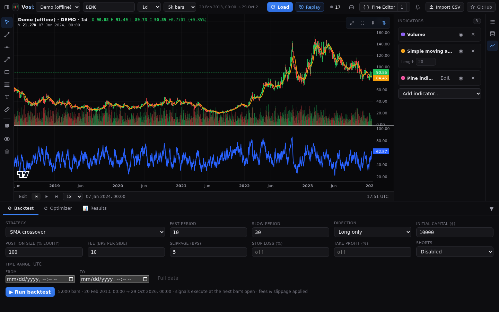

# Bar replay

Replay the chart bar by bar, as if the market were live, to practise or review a setup.

## Starting

Press **Replay** in the top bar. Pick the starting bar by clicking it on the chart or by typing a date and time. The chart then shows only the bars up to that point.

## Controls

The replay strip has **Step back**, **Play** and **Pause**, **Step forward** and a speed menu of 1, 3 or 10 bars per second, with the current replay bar's date. **Select a new start bar** goes back to picking (Cancel resumes where you were), and **Exit replay** returns to the full chart.

## What you see

The chart, indicators, Pine output and trade markers use only the bars up to the replay bar, so there is no look-ahead. Backtests still use all the data, and live bars keep arriving in the background. A Pine run that finishes after the replay has moved on is kept when it still holds for the visible bars.
