# Strategy maker

The strategy maker is an optional page at `/strategy-maker` (type it after your Vost address). It is a small tool for working out strategies from candles: you pick candles, mark the trades you would have taken, and it looks for a built-in strategy that behaves like your marks. What you mark and the model it trains are kept on the Vost server (so any browser on the same server shows them), and the main chart app is not started: the page opens no live stream and does no alert polling. The main app never loads the page's code.

## Where the data comes from

- **A market**: choose a provider, a symbol (pick a popular one or type your own) and a timeframe, then **Load market**. A market load brings up to 20,000 candles (fewer where the provider has less; Kraken gives at most 720). The chart opens on the latest 300 or so bars so they stay readable; pan and zoom back to see the rest.
- **A saved dataset**: datasets saved in the main app's library are listed read-only; the page never changes the library. With none saved it says "No saved datasets."
- **A CSV file**: **CSV file** opens a file from your disk. A file that cannot be read shows a message on the page.

The chart pans, zooms and resizes with the window, and works on a narrow screen too.

## Marking trades

Once candles are showing, a toolbar above the chart lets you mark the trades you would have taken, with a brush. These marks are what the tool learns a strategy from; you need at least 30 of them.

- **Brush long** and **Brush short**: pick one (it shows as pressed), then press on the chart, drag across some bars and let go. The bars from the first to the last one you touched become one trade, shaded green for long or red for short, with an entry and an exit marker. Dragging right to left gives the same trade. A plain click, or a drag over a single bar, marks nothing.
- **Eraser**: drag over trades to remove every one you touch.
- **Undo**, **Redo** and **Clear** (which asks first) work on the marks of this chart.
- While a tool is on, dragging paints instead of moving the chart. Press the tool again, or **Escape**, to pan and zoom as before. One finger paints on a touch screen.
- A new stroke over existing trades replaces the part it covers, so trades never overlap; what is left of a cut trade stays when it still spans two bars.

Keys: **B** brush (it keeps its last side), **E** eraser, **Ctrl+Z** / **Cmd+Z** undo, **Ctrl+Shift+Z** redo, **Escape** leaves the tool. They are ignored while you type in a field.

The list beside the chart (below it on a narrow screen) shows each trade with its side, entry and exit time and bar count; click a row to scroll the chart to it, or its **x** to delete it. The counter shows "N of 30 trades" across all your saved charts and how many more are needed.

Marks are saved on the Vost server a moment after each change (and when you leave or hide the page) and come back when you open the same chart again (the same market and timeframe, saved dataset or CSV file name). Undo history is not kept. If the server cannot be reached or cannot save them, the page says "Marks are not saved" with the reason, and the brush still works until you leave.

## Finding a strategy

Below the chart, **Find a strategy** turns your marks into a recommendation. Fill in what you want, then press **Find a strategy**.

- **Strategy type**: long and short (the default), long only or short only.
- **Allowed indicators**: the families the search may use (SMA crossover, EMA crossover, MACD, RSI mean reversion, Bollinger Bands, Donchian breakout, Pullback in trend, Reversal, Momentum breakout). All are on at first; at least one must stay on.
- **Risk (always on)**: fee and slippage in basis points, and the same exits as the Backtest tab, all optional. The stop loss is a percent or a multiple of the ATR. The take profit is a percent, a multiple of the ATR, or a multiple of the stop ("Times the stop", which needs a stop loss or a trailing stop). The trailing stop is off, a percent or a multiple of the ATR. **ATR length** shows only when an ATR option is on. They start at the main backtester's defaults with every exit option off, and fees and slippage are always applied. The search tries every candidate with these exits.

  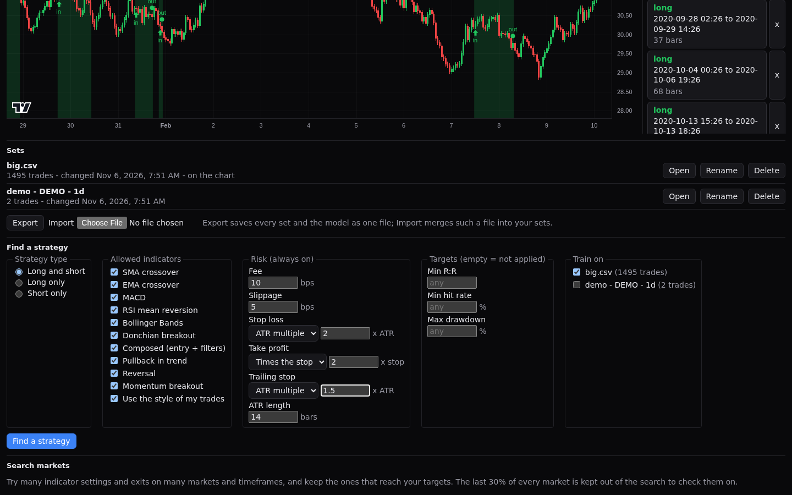
- **Targets**: an optional minimum R:R (average win over average loss), minimum hit rate and maximum drawdown. An empty target is not applied.
- **Train on**: which saved sets of marks to learn from. It starts as the chart you have open, or all of them when none is open.

A number that cannot be used is flagged under its field and switches Find off. With fewer than 30 marked trades in the chosen sets, Find stays off and the form says how many more trades are needed. Your choices are kept on the server and are there when you come back, in any browser.

The work runs in a background worker of the page, so the page stays usable and the main app is not touched. A progress bar names the stage (loading data, training, searching, validating). **Cancel** stops it within a second and the page goes back to what it showed before. Pressing Find again also stops a run in progress. If the browser cannot start a worker, the page says "Running on this page; it may pause while it works" and does the same work itself. Market sets are fetched again for the run, and a set that cannot be loaded is listed in the results and skipped.

## Reading the results

- **What explains your trades**: a small decision tree learns when you were in a trade and writes it as plain rules, with how much each family of indicators mattered and how well it called the state on bars it had not seen.
- **Ranked settings**: the settings that best reproduce your entries and exits, with the best match and the best one that meets your targets marked. Each row shows its return, hit rate, R:R, largest drawdown, trade count and signals per 100 bars (with how many fired and the rate per day, a signal being a turn to a new side) on the part it was chosen on and on a held-out part it was not. Click a row to draw its trades on the chart beside your own, as outlined circles (entries) and squares (exits) joined by a dashed line; the legend tells "Your trades" from "Found trades". Click the row again to clear them.
- **Validated or Not validated**: the chosen setting is checked on held-out data, in a walk-forward test, against its neighbouring settings and with a Monte Carlo reshuffle, and each check is listed as passed or failed with its detail. It is validated only when the held-out result keeps within your targets.
- **Closest found**: when no setting meets your targets, the nearest one and each gap in words.
- A short note on the limits: few trades prove little, the highlights are drawn with hindsight, and fees and slippage are always on. Skipped sets and skipped trades are listed with their reasons.

## Using a result in the backtester

Under the ranked settings, an actions bar acts on the row you clicked, or on the headline strategy when none is picked, and names it ("For SMA crossover (fast period 8, slow period 34):").

- **Open in Backtest** opens Vost in a new tab with the Backtest tab filled in with that strategy, its settings, its direction and its risk (fee, slippage and every exit set: stop loss, take profit, trailing stop and ATR length). A message says what was set and which data it was found on. It does not run the backtest: run it on the same data to see the same trades, because it is the same strategy code. The address carries the settings after a `#`, so nothing is stored by the strategy maker; Vost reads it once and removes it from the address bar, so a reload applies nothing again. A link that cannot be read changes nothing and says so.
- **Copy settings** copies plain text: the strategy, every setting by its name, direction, fee and slippage in bps, stop loss and take profit (or "off"; an ATR or times-the-stop exit is named as such, for example "Stop loss: 2 x ATR" or "Take profit: 2 x the stop"), the trailing stop and ATR length when they are on, initial capital and position size.
- **Copy as Pine strategy** copies a Pine v6 `strategy()` script with those settings as `input.*` defaults, the same capital, size and commission, and the stop and target as `strategy.exit`. An ATR exit computes the ATR in the script as Vost does (not `ta.atr`, which differs), and a trailing stop is a stop the script moves at each bar close, not Pine's built-in trailing order. It takes the same trades as the built-in strategy on the same data (it follows Vost's own indicator maths, and tests check this against the built-in strategies). Two things differ: slippage is not in the script, and a stop or target counts from the bar after the entry, while the Backtest tab also checks the entry bar. After a copy the bar says "Copied". If the browser refuses the clipboard, the text shows in a read-only box, already selected, so you can copy it by hand.

## Searching many markets

Below the Find section, **Search markets** tries many indicator settings and exits on many markets and timeframes at once, and keeps the ones that reach your targets. It needs no marks and does not use the model. The last 30% of every market is kept out of the search to check the winners on.

- **Market lists**: the top 30 crypto by market cap and by 24-hour volume (built live, so they carry a date and say "stale" when the last refresh failed), the top 30 stocks by market cap and by volume, and a list of indices. Each shows its date and how many markets it holds; a list that could not be built shows why and cannot be picked. None is picked at first.
- **Timeframes** (1d and 1w at first; 1m to 1w can be picked), **Indicators** (MACD, SMA and EMA crossover at first), and **Strategy type** (long only at first). An earlier study of this search ([the spike](../spikes/strategy-search/README.md)) found nothing that met a target on 1m, 5m, 15m and 30m bars, and nothing that held for RSI reversion and Bollinger bands; those choices carry a note saying so and a link here. They stay pickable.
- **Composed (entry + filters)** is the last Indicators choice. It tries an entry rule plus filters. Pick the **entry rules** (SMA or EMA crossover, MACD, RSI reversion, Bollinger bands, Donchian breakout), each with its own small grid of settings, and the **filters** (trend, volume, volatility, trend strength): each picked filter is tried both off and on. The trend filter is price against a 100 or 200 bar SMA or EMA, and **trend timeframes** read it on a longer timeframe built from the loaded bars (2x to 24x the chart; "same as the chart" is always tried). On weekly bars only the chart's own timeframe is tried. Volume asks for 1.5 times the average, volatility for the default ATR band and trend strength for an ADX of at least 25.
- **Beat buy and hold on unseen data**: off at first. "Return above buy and hold" makes a result count as held only if its return on the unseen part is also above the return of buying at the first close and holding to the last. "Return over drawdown" compares return divided by largest drawdown instead. The target applies to the unseen part only; "met a target" is not changed by it.
- **Chance baseline**: off at first. When on, every market that was searched is searched again on a shuffled copy of its candles (the order of the bar-to-bar moves is mixed, so the spread of moves stays and any pattern in time is gone), with the same settings, exits, targets and split. It adds only counts, never rows, and it doubles the number of combinations.
- **Targets**: two rows, "75% hit rate with R:R 1" **or** "50% hit rate with R:R 4". A result needs to meet either one. Clear both boxes of a row to leave it out; at least one row must stay.
- **Sizing and costs**: account size (1000), risk per trade as the percent of the account lost when the stop is hit (2%), and fee and slippage in bps (10 and 5).
- **Exit kinds**: how the exits are placed. "Stop sized by the typical bar range" is on at first; "ATR stop" and "ATR trailing stop" can be added. Each kind chosen multiplies the number of combinations, and at least one must stay on.
- **Stop** and **Take profit**: the multiples tried. For the range kind a stop is a multiple of the market's typical bar range. For the ATR kinds it is a multiple of the ATR (14 bars, read on the signal bar), and for the trailing kind the stop trails the price at that distance, fixed at entry. A take profit is a multiple of the stop (for the ATR kinds, in R: 3R is three times the stop distance). An ATR exit cannot trade in the first 14 bars of each part while the ATR warms up.

A bad number is flagged under its field and switches the search off with the reason, as does no list, no timeframe, no indicator or no target row. Above the button, the page says how big the search is ("10 markets x 1 timeframe = 116,100 combinations"; a market in two lists counts once). The count is exact: it covers the Composed settings (worked out for each timeframe) and the baseline's second pass. Above the limit of 2,000,000 combinations the button is off and the page says so; nothing starts.

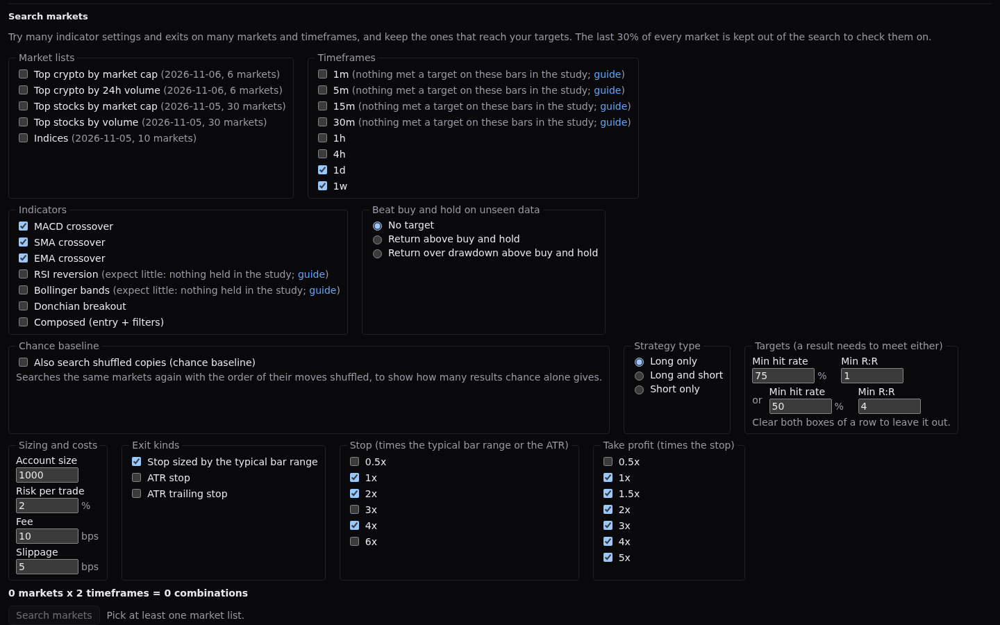

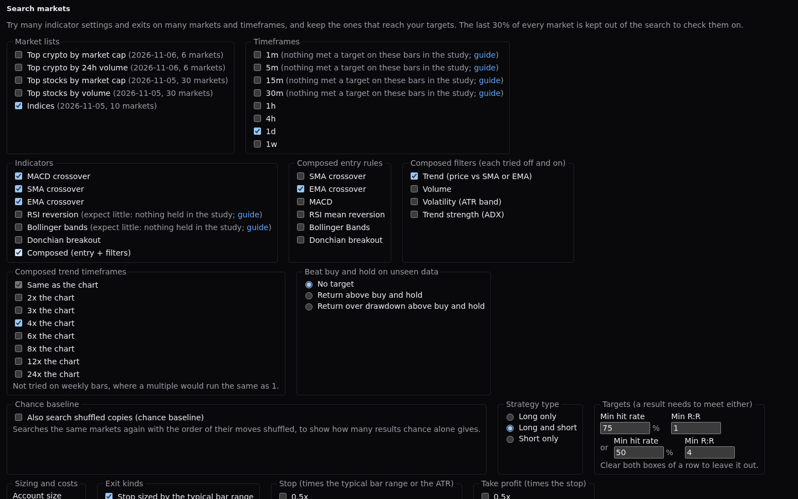

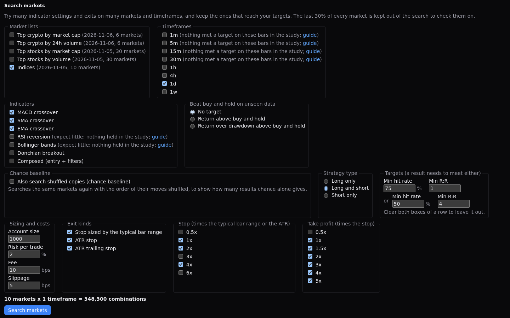

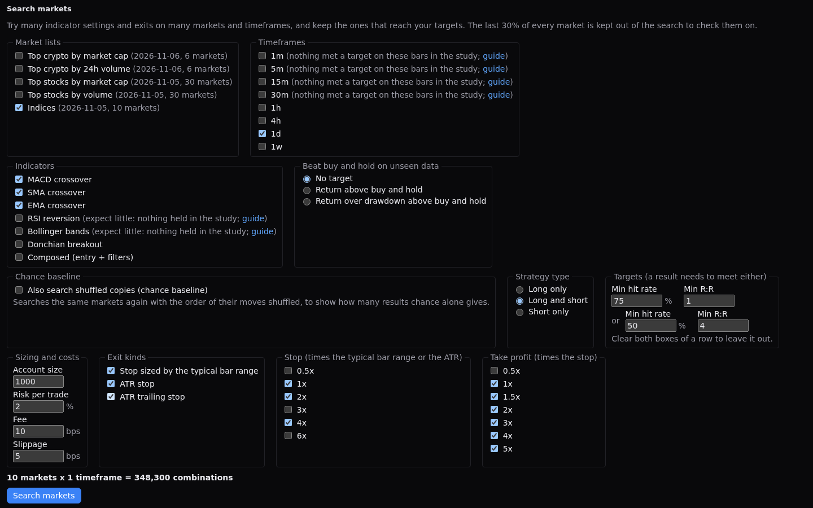

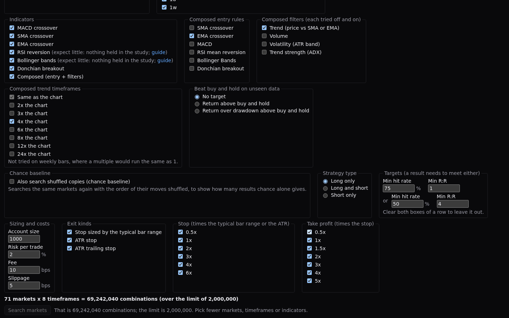

While it runs, a bar shows the percent and the market and timeframe being searched. **Cancel** takes the panel back to idle within a second, and starting Find or another search replaces the run.

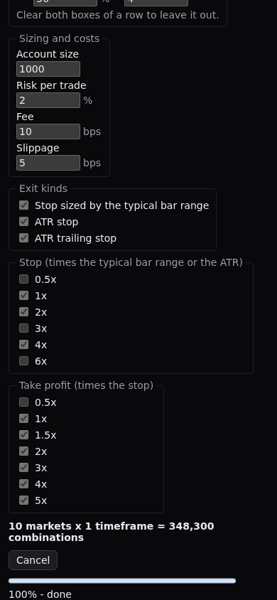

The results start with how many combinations were tried, how many met a target and how many also **held on unseen data**, and a plain warning: with this many combinations tried, a result that meets a target can be luck, and the ones that held are the ones to trust more. Each row names its exit: `2.10% / 4.20%` for the range kind, `2 ATR / 3R` for an ATR stop and `2 ATR trailing / 3R` for an ATR trailing stop; the Stop / take profit column sorts by kind, then by stop. A **Buy & hold** column shows the return of holding the market over the same part as the row's other figures, so a result can be read against it (an older result without it shows "n/a"). A Composed result is worded as its entry rule and only the filters that are on, for example `EMA crossover fast 10, slow 40; trend EMA 200 on 4x bars; ADX 25 or more`. With the chance baseline on, the header adds a line, "N held on real data, M on shuffled copies of the same markets (S series)": M is what chance alone gives on markets with the same moves in a random order, so a real count near it says little, and one well above it is worth a closer look. The table is ranked held results first and sorts by any column header. For a held row the figures (trades, signals per 100 bars, hit rate, R:R, final equity, maximum drawdown) come from the unseen part; for the others they come from the part that was searched. The **Signals / 100 bars** column also shows how many signals fired and the rate per day, and hovering it gives the other part's figures. **Open in Backtest** opens Vost in a new tab on that market and timeframe, with the Backtest tab set to the strategy, its settings, the exit it used (the percent stop and take profit, or the ATR stop or trailing stop with the R target and ATR length), fee, slippage, account size and risk per trade, and the direction. A message names the market and timeframe. Run the backtest to see the same trades the search took.

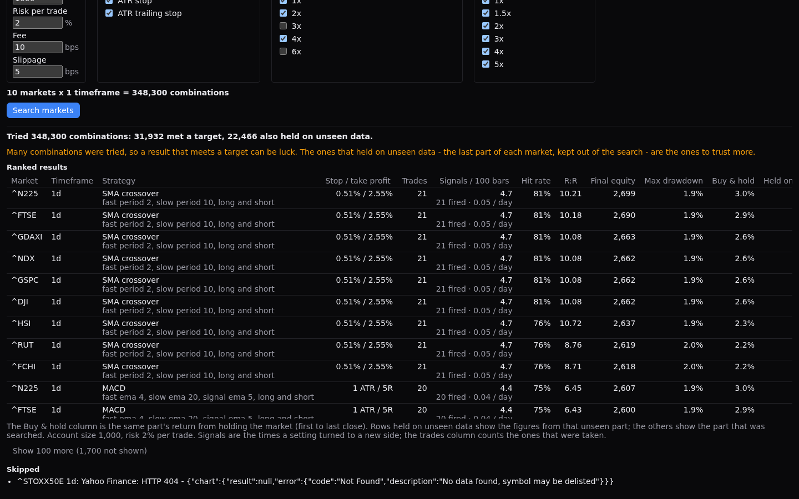

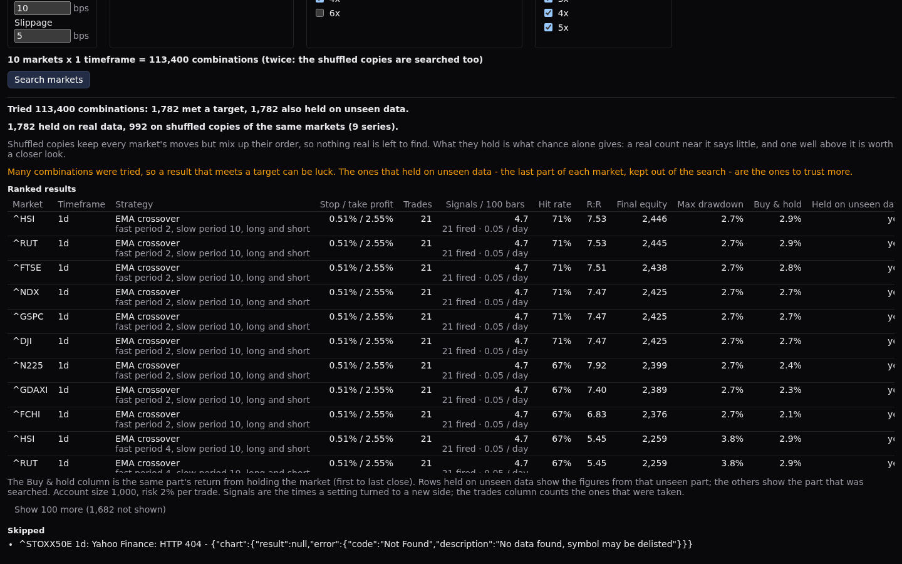

**Closest found** lists, for each market and timeframe where nothing met a target, the nearest setting and its gaps in words. **Skipped** lists the markets that failed to load, or were too short, with the reason.

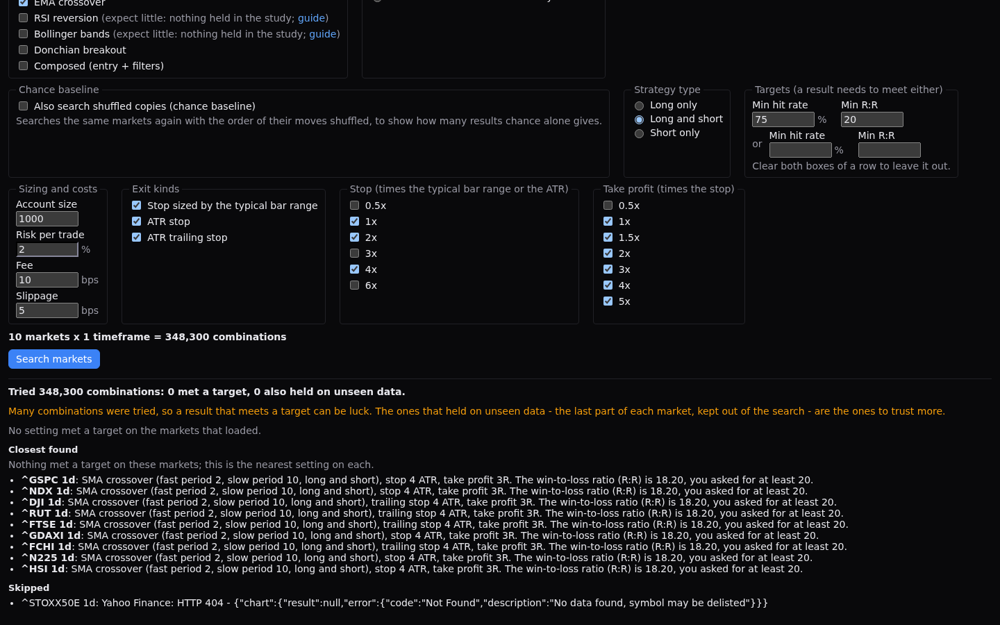

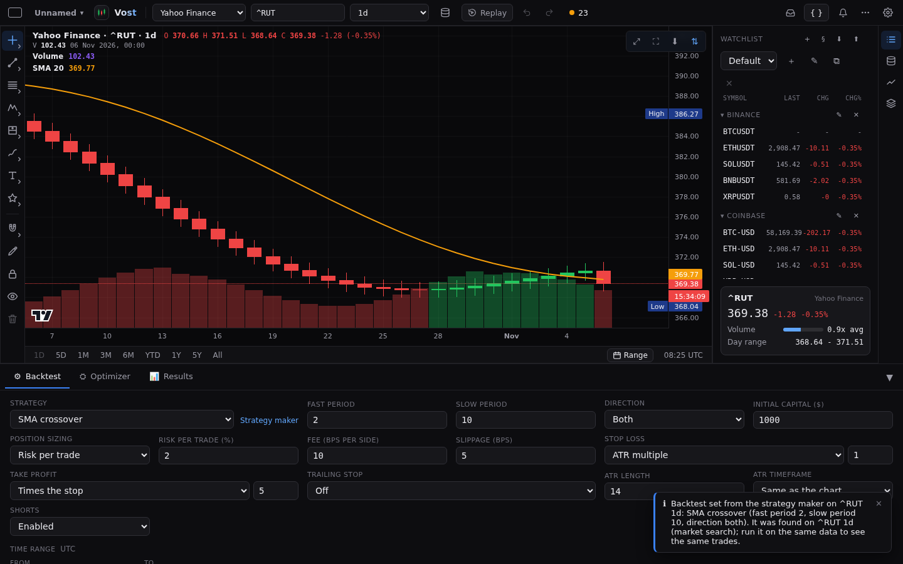

## Teaching it more

The more charts you mark, the more the model has to learn from. Each chart you mark is its own **set**, and **Train on** picks which sets a run learns from.

- **Saved model**: after a Find or a Retrain the model is kept on the server. When you open the page again its rules, importance and held-out report show under **Saved model**, with no run.
- **Out of date and Retrain**: when you mark or change trades on a chosen set, add a set to **Train on** or take one out, the page says "Model out of date" and why, and offers **Retrain**. Retrain learns from the chosen sets only, with the same progress and **Cancel** as Find, and clears the notice. When the model is up to date, **Find** reuses it and goes straight to the search, so it starts faster; when it is not, Find trains again first, so its results never come from an out-of-date model.
- **Sets**: one row per saved set with its name, trade count and when it last changed. **Open** loads that market, saved dataset or CSV file on the chart, **Rename** gives it a name of your own (it is still the same set), and **Delete** asks first and removes the set and its marks.
- **Export and Import**: **Export** saves every set (a CSV set with its candles) and the model as one file, `vost-strategy-maker.json`, to move to another machine. **Import** reads such a file and checks all of it before it writes anything: a file that is not a Strategy maker export, has another version or has a malformed set or model is refused with the reason. Sets you do not have are added. Sets that are the same are left alone, so importing a file twice changes nothing. A set that differs from yours is listed with **Keep mine** and **Use imported** (Cancel writes nothing); then everything is written at once. A model in the file replaces the saved one and shows as out of date unless its sets match yours. A saved dataset from another machine that is not in this library is listed and skipped at Find with "no longer in the library".

- **Kept on the server, moved once**: the sets, the find form and the model live in the Vost server's data folder, so a brand-new browser on the same server shows the same sets and the saved model. Versions before this kept them in the browser's own database; the first time you open the page the server adopts what it lacks and the browser's copy is deleted, once the server has confirmed it holds everything. The page says "Moved N sets from this browser to the server". A set the server already held differently stays as it is on the server, and the browser's version is kept in `strategy-maker-imported-<ms>.json` in the data folder (the page names the file). If the server cannot be reached the move waits for the next visit.

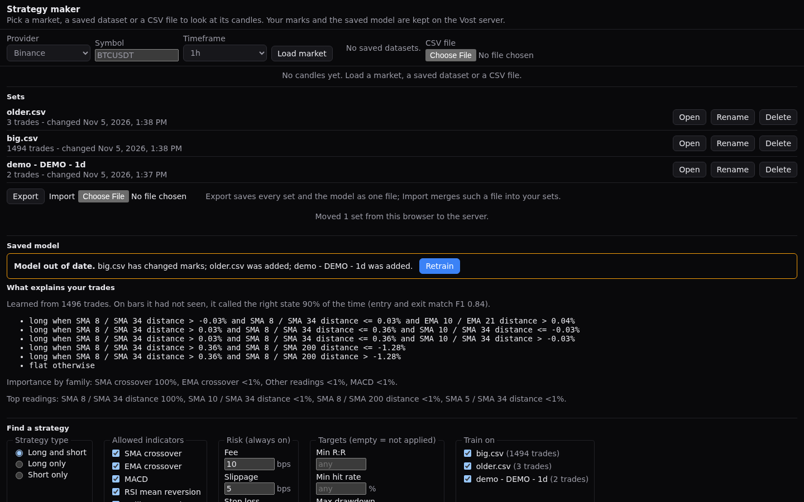

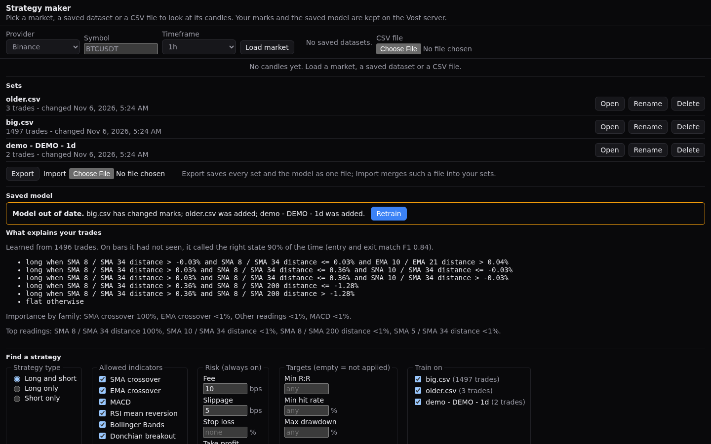

