# Strategy maker

The strategy maker is an optional page at `/strategy-maker` (type it after your Vost address). It is a small tool for working out strategies from candles: you pick candles, mark the trades you would have taken, and it looks for a built-in strategy that behaves like your marks. Everything stays in this browser, and the main chart app is not started: the page opens no live stream and does no alert polling. The main app never loads the page's code.

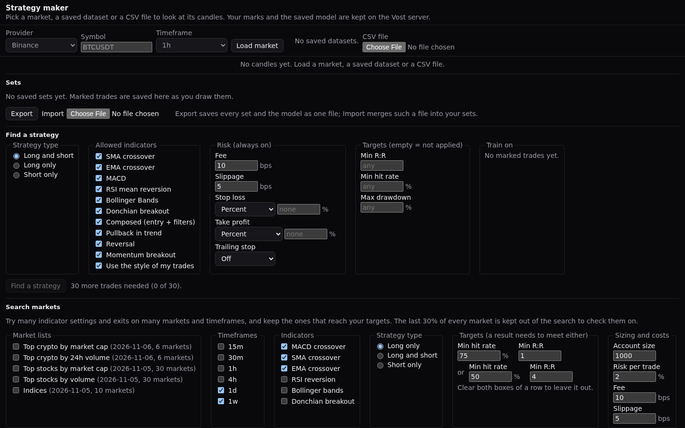

## Where the data comes from

- **A market**: choose a provider, a symbol (pick a popular one or type your own) and a timeframe, then **Load market**.
- **A saved dataset**: datasets saved in the main app's library are listed read-only; the page never changes the library. With none saved it says "No saved datasets."
- **A CSV file**: **CSV file** opens a file from your disk. A file that cannot be read shows a message on the page.

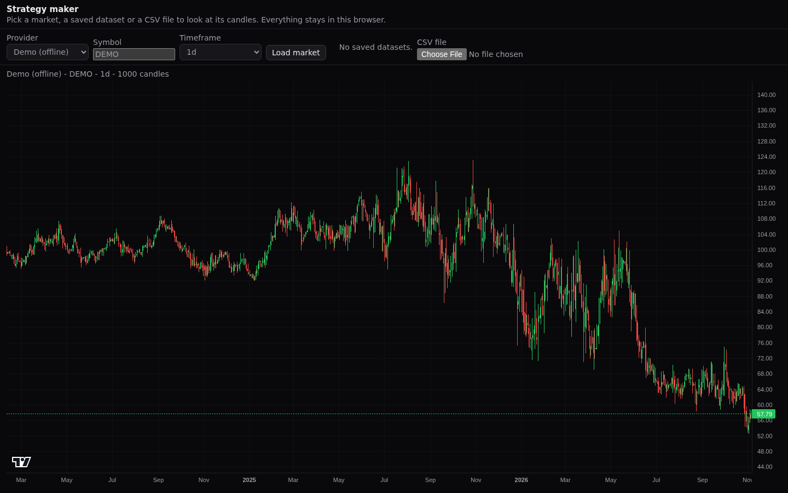

The chart pans, zooms and resizes with the window, and works on a narrow screen too.

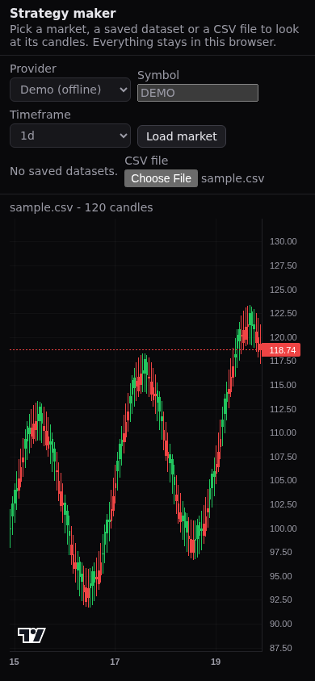

## Marking trades

Once candles are showing, a toolbar above the chart lets you mark the trades you would have taken, with a brush. These marks are what the tool learns a strategy from; you need at least 30 of them.

- **Brush long** and **Brush short**: pick one (it shows as pressed), then press on the chart, drag across some bars and let go. The bars from the first to the last one you touched become one trade, shaded green for long or red for short, with an entry and an exit marker. Dragging right to left gives the same trade. A plain click, or a drag over a single bar, marks nothing.
- **Eraser**: drag over trades to remove every one you touch.
- **Undo**, **Redo** and **Clear** (which asks first) work on the marks of this chart.
- While a tool is on, dragging paints instead of moving the chart. Press the tool again, or **Escape**, to pan and zoom as before. One finger paints on a touch screen.
- A new stroke over existing trades replaces the part it covers, so trades never overlap; what is left of a cut trade stays when it still spans two bars.

Keys: **B** brush (it keeps its last side), **E** eraser, **Ctrl+Z** / **Cmd+Z** undo, **Ctrl+Shift+Z** redo, **Escape** leaves the tool. They are ignored while you type in a field.

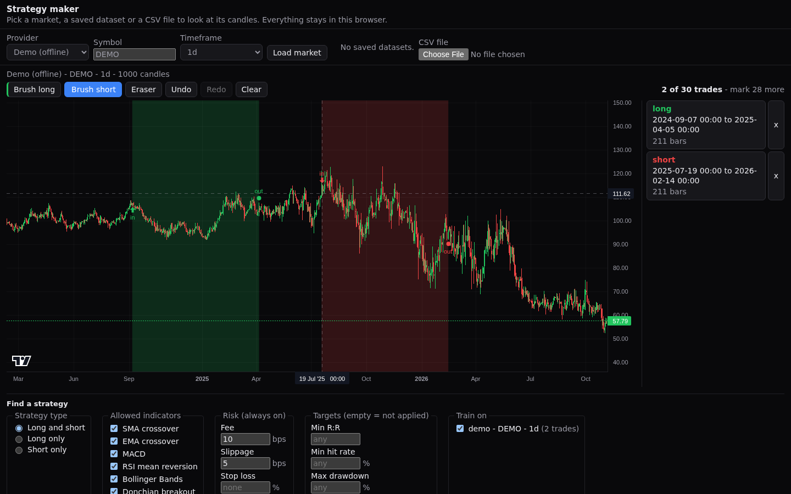

The list beside the chart (below it on a narrow screen) shows each trade with its side, entry and exit time and bar count; click a row to scroll the chart to it, or its **x** to delete it. The counter shows "N of 30 trades" across all your saved charts and how many more are needed.

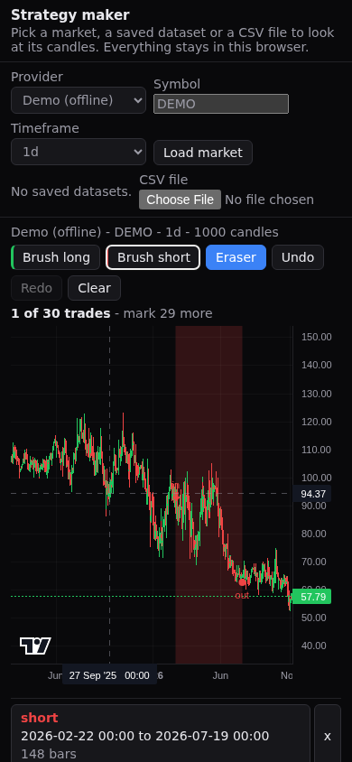

Marks are saved in this browser a moment after each change and come back when you open the same chart again (the same market and timeframe, saved dataset or CSV file name). Undo history is not kept. If the browser cannot store them, the page says so and the brush still works until you leave.

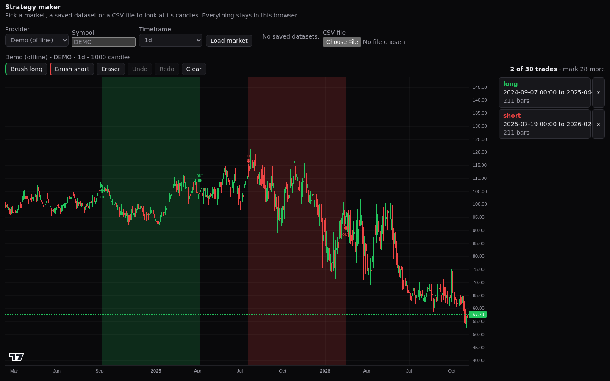

## Finding a strategy

Below the chart, **Find a strategy** turns your marks into a recommendation. Fill in what you want, then press **Find a strategy**.

- **Strategy type**: long and short (the default), long only or short only.
- **Allowed indicators**: the families the search may use (SMA crossover, EMA crossover, MACD, RSI mean reversion, Bollinger Bands, Donchian breakout). All are on at first; at least one must stay on.
- **Risk (always on)**: fee and slippage in basis points, and an optional stop loss and take profit in percent. They start at the main backtester's defaults, and fees and slippage are always applied.
- **Targets**: an optional minimum R:R (average win over average loss), minimum hit rate and maximum drawdown. An empty target is not applied.
- **Train on**: which saved sets of marks to learn from. It starts as the chart you have open, or all of them when none is open.

A number that cannot be used is flagged under its field and switches Find off. With fewer than 30 marked trades in the chosen sets, Find stays off and the form says how many more trades are needed. Your choices are kept in this browser and are there when you come back.

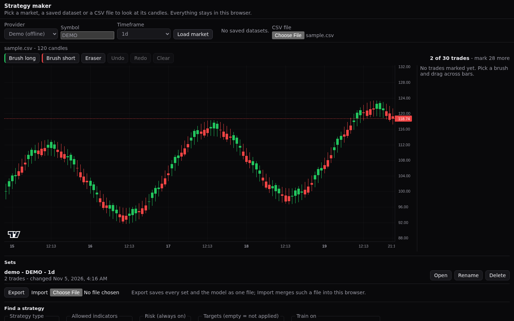

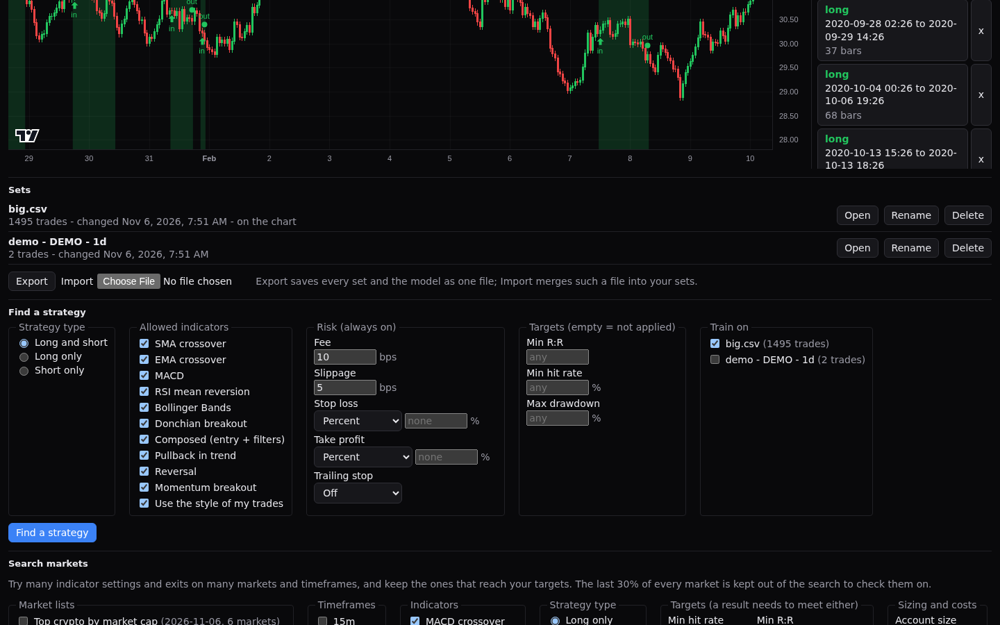

The work runs in a background worker of the page, so the page stays usable and the main app is not touched. A progress bar names the stage (loading data, training, searching, validating). **Cancel** stops it within a second and the page goes back to what it showed before. Pressing Find again also stops a run in progress. If the browser cannot start a worker, the page says "Running on this page; it may pause while it works" and does the same work itself. Market sets are fetched again for the run, and a set that cannot be loaded is listed in the results and skipped.

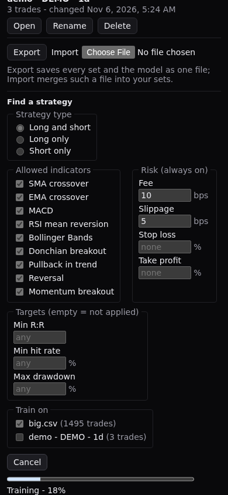

## Reading the results

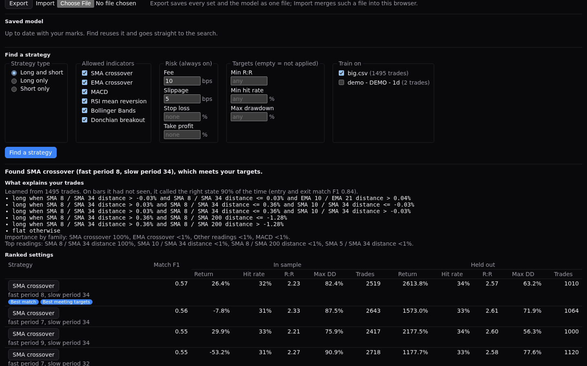

- **What explains your trades**: a small decision tree learns when you were in a trade and writes it as plain rules, with how much each family of indicators mattered and how well it called the state on bars it had not seen.
- **Ranked settings**: the settings that best reproduce your entries and exits, with the best match and the best one that meets your targets marked. Each row shows its return, hit rate, R:R, largest drawdown and trade count on the part it was chosen on and on a held-out part it was not. Click a row to draw its trades on the chart beside your own, as outlined circles (entries) and squares (exits) joined by a dashed line; the legend tells "Your trades" from "Found trades". Click the row again to clear them.
- **Validated or Not validated**: the chosen setting is checked on held-out data, in a walk-forward test, against its neighbouring settings and with a Monte Carlo reshuffle, and each check is listed as passed or failed with its detail. It is validated only when the held-out result keeps within your targets.
- **Closest found**: when no setting meets your targets, the nearest one and each gap in words.
- A short note on the limits: few trades prove little, the highlights are drawn with hindsight, and fees and slippage are always on. Skipped sets and skipped trades are listed with their reasons.

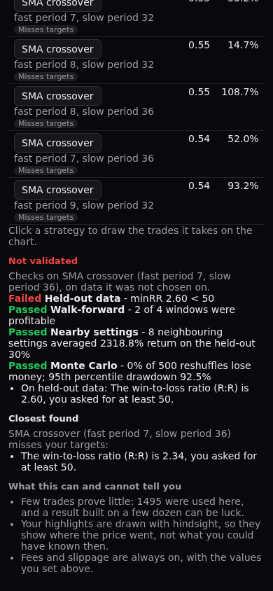

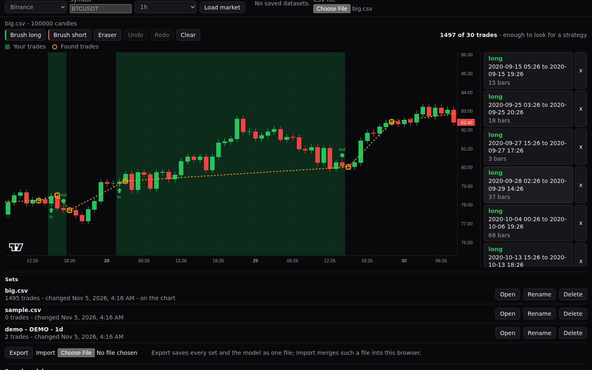

## Using a result in the backtester

Under the ranked settings, an actions bar acts on the row you clicked, or on the headline strategy when none is picked, and names it ("For SMA crossover (fast period 8, slow period 34):").

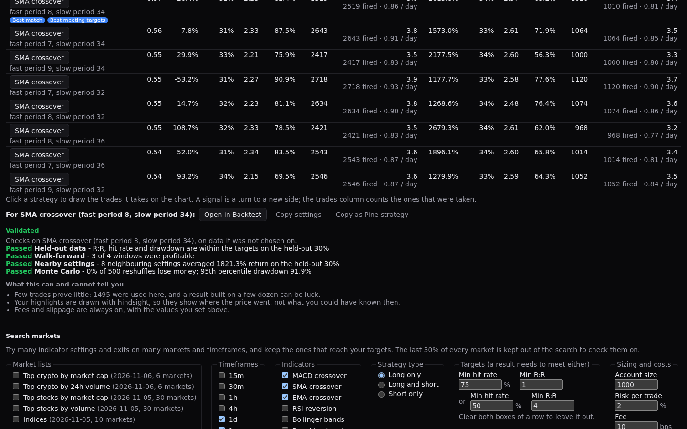

- **Open in Backtest** opens Vost in a new tab with the Backtest tab filled in with that strategy, its settings, its direction and its risk (fee, slippage, stop loss and take profit). A message says what was set and which data it was found on. It does not run the backtest: run it on the same data to see the same trades, because it is the same strategy code. The address carries the settings after a `#`, so nothing is stored by the strategy maker; Vost reads it once and removes it from the address bar, so a reload applies nothing again. A link that cannot be read changes nothing and says so.
- **Copy settings** copies plain text: the strategy, every setting by its name, direction, fee and slippage in bps, stop loss and take profit (or "off"), initial capital and position size.
- **Copy as Pine strategy** copies a Pine v6 `strategy()` script with those settings as `input.*` defaults, the same capital, size and commission, and the stop and target as `strategy.exit`. It takes the same trades as the built-in strategy on the same data (it follows Vost's own indicator maths, and tests check this against the built-in strategies). Two things differ: slippage is not in the script, and a stop or target counts from the bar after the entry, while the Backtest tab also checks the entry bar. After a copy the bar says "Copied". If the browser refuses the clipboard, the text shows in a read-only box, already selected, so you can copy it by hand.

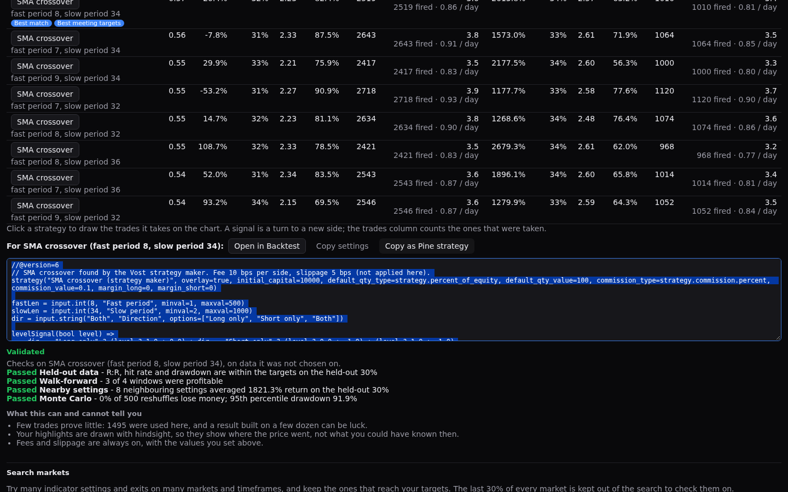

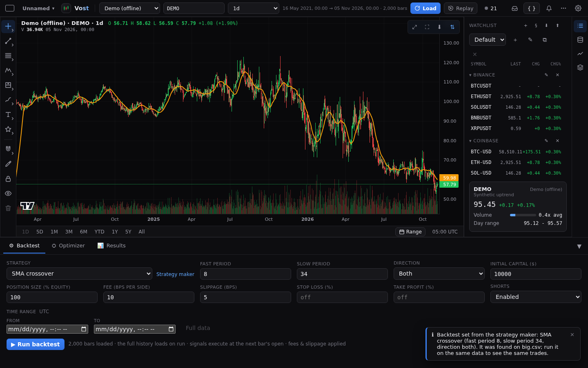

## Teaching it more

The more charts you mark, the more the model has to learn from. Each chart you mark is its own **set**, and **Train on** picks which sets a run learns from.

- **Saved model**: after a Find or a Retrain the model is kept in this browser. When you open the page again its rules, importance and held-out report show under **Saved model**, with no run.
- **Out of date and Retrain**: when you mark or change trades on a chosen set, add a set to **Train on** or take one out, the page says "Model out of date" and why, and offers **Retrain**. Retrain learns from the chosen sets only, with the same progress and **Cancel** as Find, and clears the notice. When the model is up to date, **Find** reuses it and goes straight to the search, so it starts faster; when it is not, Find trains again first, so its results never come from an out-of-date model.
- **Sets**: one row per saved set with its name, trade count and when it last changed. **Open** loads that market, saved dataset or CSV file on the chart, **Rename** gives it a name of your own (it is still the same set), and **Delete** asks first and removes the set and its marks.
- **Export and Import**: **Export** saves every set (a CSV set with its candles) and the model as one file, `vost-strategy-maker.json`, to move to another machine. **Import** reads such a file and checks all of it before it writes anything: a file that is not a Strategy maker export, has another version or has a malformed set or model is refused with the reason. Sets you do not have are added. Sets that are the same are left alone, so importing a file twice changes nothing. A set that differs from yours is listed with **Keep mine** and **Use imported** (Cancel writes nothing); then everything is written at once. A model in the file replaces the saved one and shows as out of date unless its sets match yours. A saved dataset from another machine that is not in this library is listed and skipped at Find with "no longer in the library".

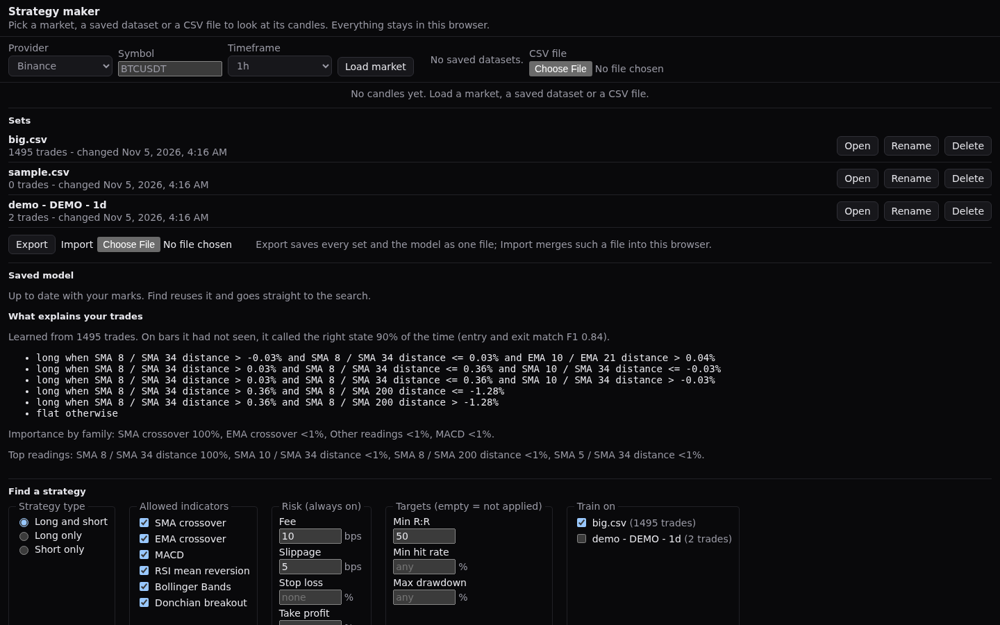

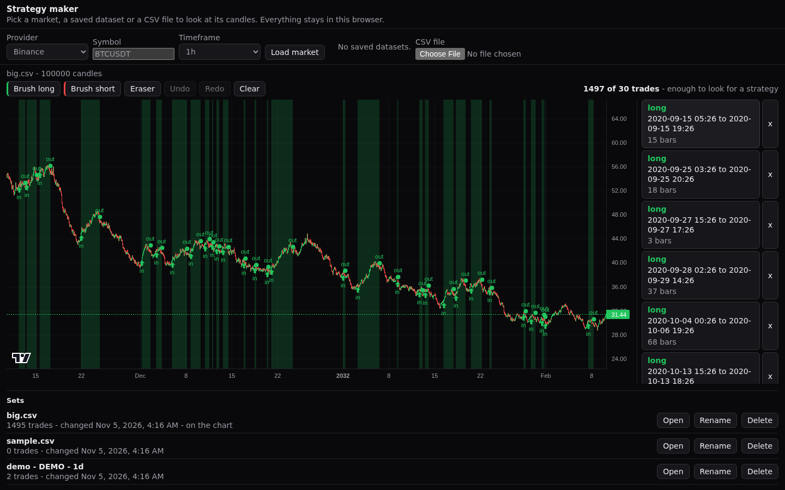

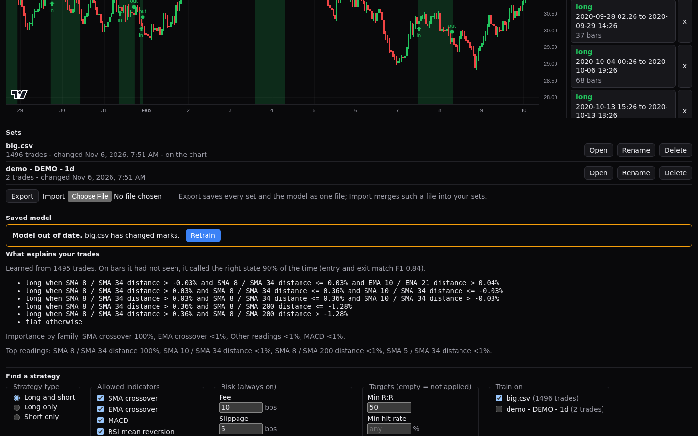

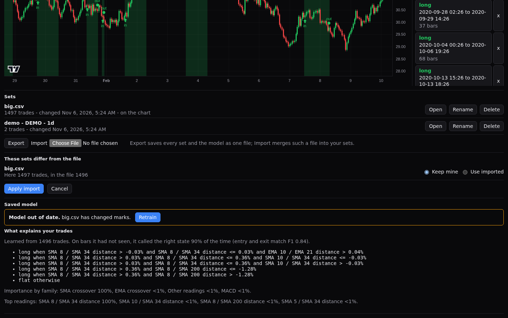
