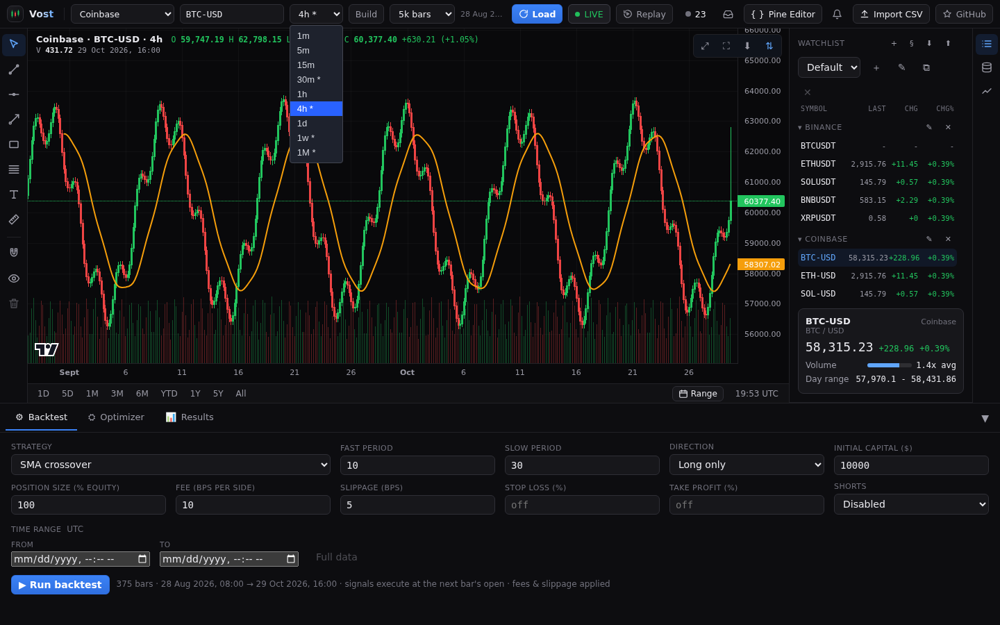
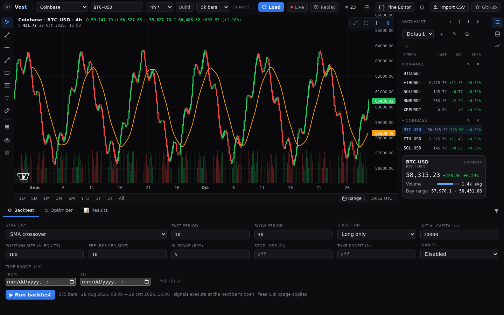
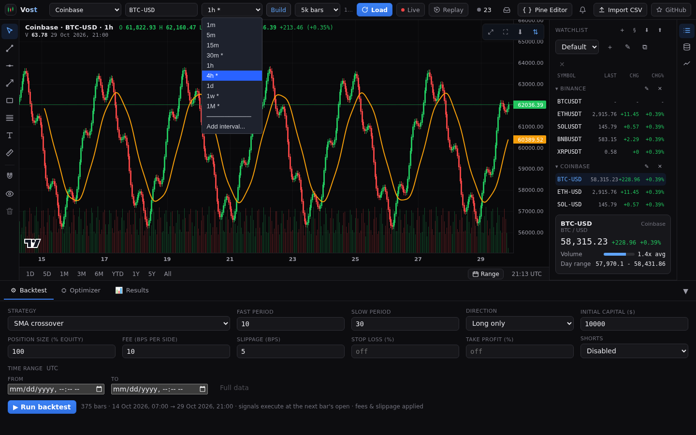
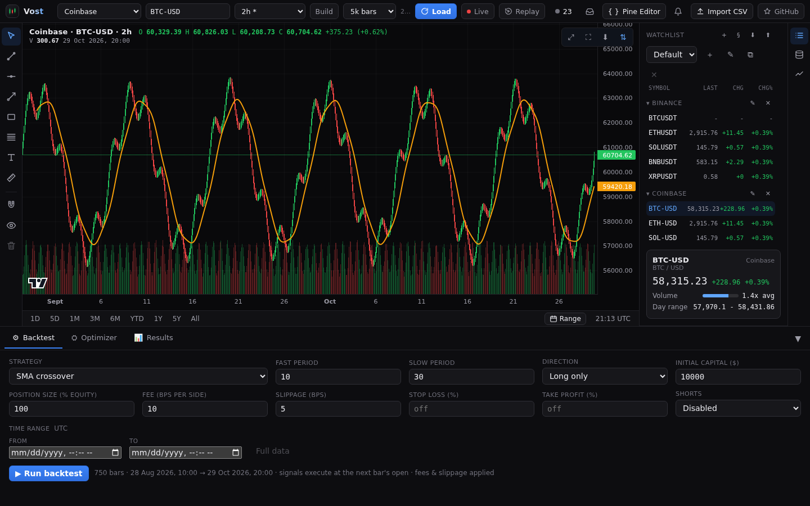

# Timeframes

## The picker

The timeframe picker in the top bar lists the timeframes the current provider serves (for example 1m, 5m, 1h, 1d, 1w). Pick one and the chart reloads. Each chart in a [layout](layouts.md) has its own timeframe, and the picker acts on the active chart.

## Built timeframes (marked `*`)

Some providers lack timeframes that others have. Vost offers them anyway, built on the server from a lower native timeframe, and marks them `*` (hover to see what it is built from). Today that is Coinbase 30m, 4h, 1w and 1M, Kraken 1M and Yahoo 4h. A built timeframe has history and works with **Live**.

## The Build setting

The **Build** switch next to the picker (in the **More** menu on narrower screens) is off by default and remembered. With it on, every timeframe above the provider's lowest is built from the next lower native one instead of using the exchange's own bars, for history and for live. Built stock daily bars can differ slightly from the exchange's official ones, and OKX's own daily bars use UTC+8 days while built ones use UTC.

## Custom intervals

Pick **Add interval...** at the end of the picker. Enter a number and a unit (minutes, hours, days, weeks or months, for example `2h`, `10m`, `3d`, `2w` or `3M`). The dialog previews what the interval is built from and refuses one that is outside the limits, already listed, or that the provider cannot serve or build.

Up to 20 custom intervals are kept. They are listed in the picker by bar length and marked `*`, and are hidden (not removed) on a provider that cannot serve them. Remove one from the picker and every chart on it moves to the provider's default timeframe. The Demo provider generates any interval. Custom intervals are saved in your browser.

For how the server builds bars, see [Data sources](../DATA-SOURCES.md).
