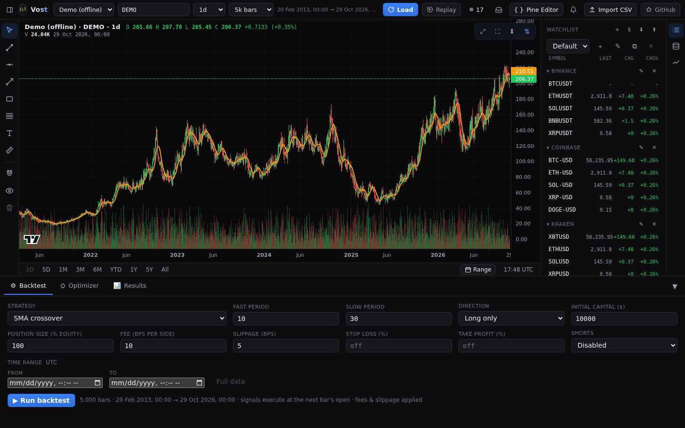
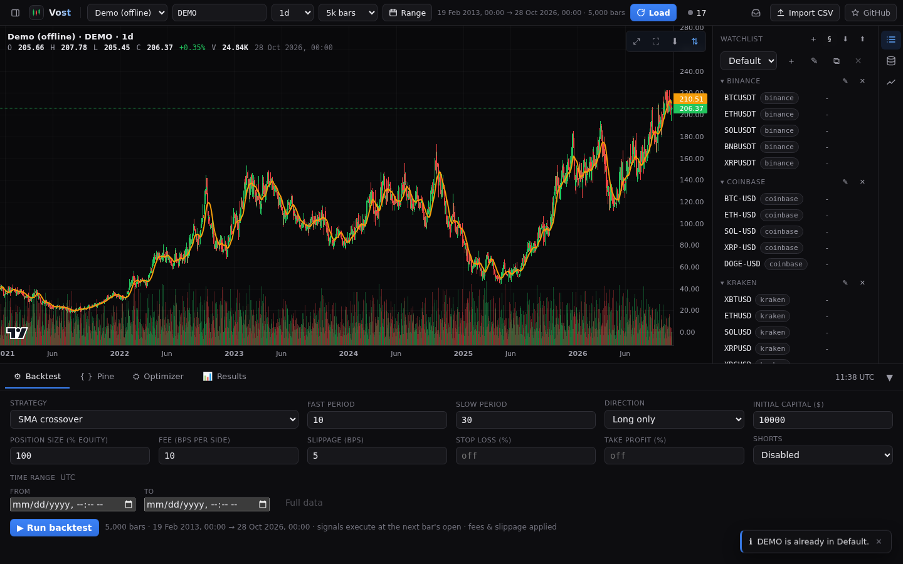
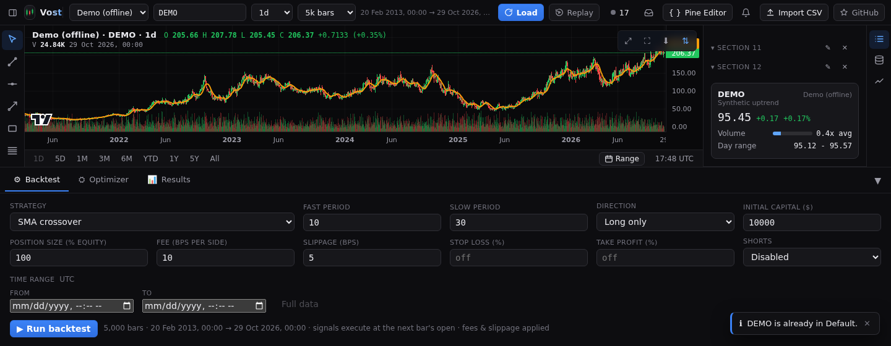

# Watchlist

Open **Watchlist** from the icon rail at the right edge.

## Lists, sections and tags

- The menu at the top picks the active list. The buttons beside it create a **New list**, **Rename list**, **Duplicate list** and **Delete list**.
- **Add current symbol** puts the chart's symbol in the list. **Add section** groups rows under a heading, which you can rename or remove.
- Click a section's name to collapse or expand it. Drag rows and sections to reorder them.
- Right-click a row for **Edit tags / note**, **Move to** another section and **Remove**. Tags show as coloured dots on the row; **Filter by tag** narrows the list.
- Click a row to load that symbol on the active chart.

## Quotes and the symbol card

Rows show the last price and change (**Last** and **Chg**) from their own data source. The card for the selected symbol is pinned to the bottom of the panel and shows more detail while the list scrolls.

## Symbol search

The search box in the top bar lists a provider's symbols (browse the full list or type to filter) and has an add-to-watchlist action on each result.

## Import and export

**Export list as JSON** and **Import list from JSON** move a list between browsers or back it up.

## Where it is saved

In your browser's local storage, with your other preferences.
